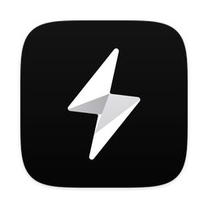
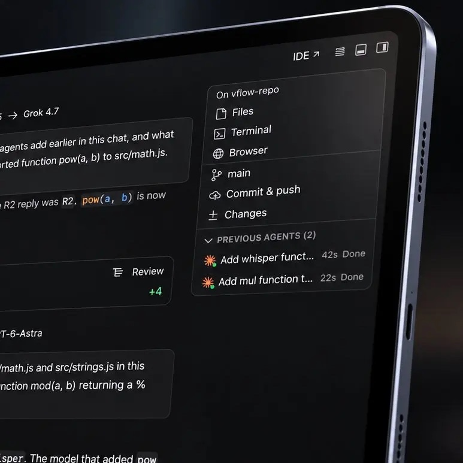

<div align="center">



# Volt

### The open-source agentic editor, built on the VS Code core.

Drive **Claude Code**, **Codex** or **Grok** over ACP, or a **local model through Ollama**,<br />
then review every change hunk by hunk before it lands. MIT licensed, in public beta.

[](https://github.com/LeulAria/volt/stargazers)
[](https://github.com/LeulAria/volt/releases/latest)
[](LICENSE.txt)
[](docs/install/README.md)
[](https://discord.gg/SJ97jqDVN)

[**Download**](https://github.com/LeulAria/volt/releases/latest) · [Website](https://getvolt.dev) · [Install guide](https://getvolt.dev/docs/install) · [Changelog](CHANGELOG.md) · [Discord](https://discord.gg/SJ97jqDVN) · [Contributing](CONTRIBUTING.md)

<br />



<br />

**⭐ If Volt looks useful, star the repo.** It's an independent project, and stars are how other developers find it.

</div>

<br />

Volt is highly inspired by Cursor, but open source all the way down. It is a workspace for working *with* coding agents: the chat, the code, Git, a browser and a terminal share one window. Because it is built on the real VS Code core, your extensions, themes, keybindings, language servers and debuggers come along.

> **Public beta.** Volt is below 1.0 and moves fast. Expect rough edges and changes between releases. The [changelog](CHANGELOG.md) lists what changed in each one.

## Quick start

**1. Install.** On macOS or Linux, one command downloads the right build, checks its SHA-256 against the release and installs it, with no `sudo`:

```bash
curl -fsSL https://raw.githubusercontent.com/LeulAria/volt/main/install.sh | bash
```

Or download an installer from **[GitHub Releases](https://github.com/LeulAria/volt/releases/latest)**:

| Your computer | File |
| --- | --- |
| Mac with Apple silicon | `volt-stable-<version>-darwin-arm64.dmg` |
| Mac with an Intel chip | `volt-stable-<version>-darwin-x64.dmg` |
| Windows | `volt-stable-<version>-win32-<x64 or arm64>-user-setup.exe` |
| Linux | `volt-stable-<version>-linux-<x64, arm64 or armhf>` as `.deb`, `.rpm` or `.tar.gz` |

**2. Open it past the first-launch warning.** The builds are not code-signed yet, because Volt is an independent project without a signing certificate, so your system warns you the first time. That is expected:

- **macOS:** open **System Settings > Privacy & Security** and click **Open Anyway**. The [macOS install guide](docs/install/macos.md) has a screenshot for every step.
- **Windows:** when SmartScreen says *Windows protected your PC*, click **More info**, then **Run anyway**.
- **Linux:** `sudo apt install ./volt-stable-<version>-linux-x64.deb`, or `sudo dnf install ./volt-stable-<version>-linux-x64.rpm`.

**3. Connect an agent.** Open **Volt Settings** from the command palette (<kbd>⇧</kbd><kbd>⌘</kbd><kbd>P</kbd>) and pick one:

- an agent CLI you already use and are signed in to, such as **Claude Code**, **Codex** or **Grok** (early access), over the [Agent Client Protocol](https://agentclientprotocol.com). Volt leaves your plan and credentials with that tool;
- a **local model** through Ollama (`127.0.0.1:11434` by default);
- an API key.

**4. Start.** Press <kbd>⌘</kbd><kbd>N</kbd> for a new agent chat, ask for a change, then keep or undo it hunk by hunk.

macOS is the platform Volt is developed and tested on; Windows and Linux builds come from the same pipeline but have had little testing. There are also **Beta** and **Nightly** channels, each its own app that installs next to Volt (see [Releasing Volt](docs/releasing.md)). Everything about installing is in [docs/install](docs/install/README.md).

## Highlights

| | |
| --- | --- |
| **Bring your own agent** | Claude Code, Codex and Grok (early access) over ACP, or a local model via Ollama. Volt doesn't sell tokens. |
| **Plan mode** | The agent proposes a plan card you approve, revise, edit or save before anything runs. |
| **Subagents and parallel agents** | Delegate to subagents and steer them. Give each chat its own Git worktree so parallel agents don't trample each other. |
| **Hunk-level review** | Every agent edit is pending until you keep or undo it, hunk by hunk. |
| **Git checkpoints** | Each turn is checkpointed in Git, so you can preview, restore or redo any point in a conversation. |
| **Built-in browser with an element picker** | The agent can drive the in-app browser. You pick an element or draw an area and say what to change. |
| **MCP** | Connect MCP servers and agents call them like built-in tools, under the same permissions. |
| **The VS Code core** | Extensions from Open VSX, your themes, keybindings, debuggers and language servers. |

## How Volt compares

| | Volt | Cursor | Zed | Void |
| --- | --- | --- | --- | --- |
| Source | Open source (MIT) | Closed source | Open source (GPL-3.0-or-later, some Apache-2.0) | Open source (Apache-2.0) |
| Editor base | VS Code core | VS Code fork | Its own editor, written in Rust | VS Code fork |
| Status | Public beta | Commercial product | Stable releases | Deprecated; repo archived |

Volt is highly inspired by Cursor. The difference is that it is MIT-licensed, and it drives the agent CLIs you already pay for instead of selling tokens.

## Why Volt

| Principle | What it means |
| --- | --- |
| **Bring your own agent** | Volt doesn't sell tokens. Use the Claude Code, Codex, OpenCode, Cursor, Grok, Antigravity or Kimi sign-in you already have, or point Volt at an API (OpenAI, Anthropic, Gemini, OpenRouter) or a local model (Ollama, LM Studio). You keep your plan and your keys. |
| **You set the leash** | Four access presets, from *Supervised* to *Full access*, decide what an agent may read, edit, run, fetch or connect to. Risky commands are flagged before they run, and a hard-deny list for destructive commands and secret files holds even under Full access. |
| **Review before it lands** | Every agent edit is pending until you keep or undo it, hunk by hunk. Each turn is checkpointed in Git, so you can preview, restore or redo any point in a conversation without touching your own index. |
| **One window, no tab sprawl** | An in-app browser the agent can drive and you can annotate, a real editor, Git and a terminal sit beside the conversation. Switch between the *Agent* and *IDE* layouts with one command. |
| **Open all the way down** | MIT licensed, with extensions from [Open VSX](https://open-vsx.org). If we ever go the wrong way, everything you need to fork it is here. |

## What's inside

### Agents and models

- **Agent CLIs over ACP.** Claude Code, Codex, OpenCode, Cursor (early access), Grok (early access), Antigravity, Kimi and any generic [Agent Client Protocol](https://agentclientprotocol.com) agent. Warm sessions are kept ready, so a new chat doesn't pay a cold start.
- **Direct model access.** OpenAI, Anthropic, Gemini, OpenRouter, any OpenAI-compatible endpoint, Ollama and LM Studio, driven by Volt's own native tool loop.
- **Five modes in one composer.** *Agent*, *Plan*, *Ask*, *Debug* and *Multitask*. Plan and Ask can't edit files or run shell commands. Plan mode proposes a plan card you approve, revise, edit or save.
- **Subagents.** Delegate work to subagents, watch them in the side toolbar, read their chats, and resume a stopped one or retry a failed one. Each subagent's changes show up in the turn's review.
- **Several Claude accounts.** Sign in to more than one login and switch by hand, or let Volt move to another account near a usage limit.
- **MCP.** Connect MCP servers (stdio or HTTP) from `.mcp.json`, `.cursor/mcp.json`, `.vscode/mcp.json` or `.volt/mcp.json`. Agents call them like built-in tools, under the same permissions.
- **Project instructions.** `AGENTS.md`, `CLAUDE.md`, `.volt/AGENTS.md`, `.cursorrules` and `.github/copilot-instructions.md` are picked up automatically.
- **A code index for agents.** Volt indexes your open projects in the background, so `grep`, `glob` and symbol lookups answer from an index instead of walking the tree.

### Control and review

- **Access presets.** *Supervised* (default), *Auto-accept edits*, *Auto* and *Full access*, layered with project, agent, session and mode rules. Allow-always decisions are remembered and visible.
- **Pending edits.** Keep or undo changes hunk by hunk against a baseline, with Undo All and Keep All a click away in the Changes header.
- **Checkpoints.** A Git snapshot before and after every turn, stored under a hidden ref (`refs/volt/*`), with preview, restore and redo. Your index and branches stay untouched.
- **Per-chat worktrees and sandboxes.** Give a chat its own checkout so parallel agents don't trample each other, and choose its sandbox level and network.

### The workspace around the chat

- **Agent and IDE layouts.** One command toggles between a chat-first window and the full editor workbench.
- **Projects.** Add a project from this computer, a Git URL or GitHub, and switch between projects and chats from one sidebar.
- **In-app browser with design mode.** The agent can navigate, click, type, take screenshots and read the console and network. You can pick an element or draw an area, name what to change, and batch several annotations into one message.
- **Git, built in.** Branches, Remotes, Tags, Worktrees, Stashes and Commits sit in Source Control, and pull requests open in Volt (GitHub, with reading support for GitLab, Bitbucket, Gitea and Azure DevOps).
- **A rich composer.** `@`-mention files, folders, terminals, other chats, branches, editor selections, browser elements and images. Queue your next message while the agent works, or dictate it.
- **Questions, plans and todos.** Agents can ask you a structured question, propose a plan you approve before it runs, and show their task list as they go.
- **Context and usage meters.** See how much of a model's context a chat is using, and what Claude, Codex and Cursor usage costs, from local transcripts and account data.

### In the editor

- **Tab completion and next-edit prediction.** Inline suggestions from the model you choose, plus a one-shot **Volt: AI Edit** command for multi-file changes. Disabled for `.env*`, lockfiles and secrets by default.
- **Everything VS Code.** Debugging, tasks, the extension host, remote development and the full set of built-in language features.

## How it fits together

The workbench never embeds a provider SDK. The UI talks to a **runtime service**; the runtime decides which model or agent runs, asks the **access broker** before any tool touches your machine, and uses platform services for processes, Git and the loopback MCP server that exposes Volt's browser and question tools to agents.

| Path | What it is |
| --- | --- |
| [`src/vs/workbench/services/voltRuntime`](src/vs/workbench/services/voltRuntime) | The runtime: providers, ACP bridges, the native loop, the access broker, tools and history |
| [`src/vs/workbench/contrib/voltAgent`](src/vs/workbench/contrib/voltAgent) | The agent window: chat, composer, review, in-app browser and history |
| [`src/vs/workbench/contrib/voltProjects`](src/vs/workbench/contrib/voltProjects) | The project registry and the add-project flow |
| [`src/vs/workbench/contrib/voltSettings`](src/vs/workbench/contrib/voltSettings) | The Volt settings editor |
| [`src/vs/workbench/contrib/voltPrediction`](src/vs/workbench/contrib/voltPrediction) | Inline completions and one-shot AI edits |
| [`src/vs/platform`](src/vs/platform) `/voltStdio`, `/voltGit`, `/voltHostMcp`, `/voltUsage`, `/voltFsBrowse`, `/voltBrowser` | Host services for processes, Git snapshots, MCP, usage, folder browsing and the browser session |
| [`apps/docs`](apps/docs) | The documentation site and landing page |
| [`brand`](brand) | Icon sources and generated assets |

Everything else is the VS Code core, kept as close to upstream as we can so that merging new releases stays tractable. [VOLT-ARCHITECTURE-REVIEW.md](VOLT-ARCHITECTURE-REVIEW.md) is a candid engineering review, and [VOLT-MULTI-PROJECT-AGENT-WORKSPACE-PLAN.md](VOLT-MULTI-PROJECT-AGENT-WORKSPACE-PLAN.md) describes where the agent window is headed.

## Getting started

### Connect an agent

Open **Volt Settings** from the command palette (<kbd>⇧</kbd><kbd>⌘</kbd><kbd>P</kbd>) and choose how you want to run agents:

1. **An agent CLI you already use.** Install it and sign in the way that tool documents. Volt finds it on your `PATH` (or launches a pinned adapter through `npx`) and leaves your plan and credentials with that tool. Volt does not store them.
2. **An API key.** Add a provider (OpenAI, Anthropic, Gemini, OpenRouter or any OpenAI-compatible endpoint). Keys go in the editor's secret storage, not in settings files.
3. **A local model.** Point Volt at Ollama (`127.0.0.1:11434` by default) or LM Studio.

Then press <kbd>⌘</kbd><kbd>N</kbd> for a new agent chat.

### Build from source

You need **Node.js 22.19** (the version in [`.nvmrc`](.nvmrc); 22.15.1 is the minimum), npm, Git, Python 3 and a C/C++ toolchain for native modules. On macOS that is the Xcode Command Line Tools. [CONTRIBUTING.md](CONTRIBUTING.md#set-up-your-machine) lists the Linux and Windows packages.

```bash
git clone https://github.com/LeulAria/volt.git
cd volt

nvm install                          # picks up Node from .nvmrc
npm install                          # installs dependencies, builds native modules
npm run electron                     # downloads the Electron runtime into .build/
node build/lib/builtInExtensions.js  # fetches the pinned built-in extensions

make start                           # compile, watch and launch Volt
```

`make start` runs a file watcher and launches the app with hot reload: save a file and the window reloads. `make help` lists the rest (`make stop`, `make reload`, `make restart`). The first compile takes a few minutes; after that, rebuilds are incremental.

To package a macOS app yourself:

```bash
unset ELECTRON_RUN_AS_NODE
VOLT_BUILD_IGNORE_TYPE_ERRORS=1 \
  node --max-old-space-size=16384 ./node_modules/gulp/bin/gulp.js vscode-darwin-arm64-min
```

The unsigned app lands in `../VSCode-darwin-arm64/VOLT.app`. `VOLT_BUILD_IGNORE_TYPE_ERRORS=1` reports type errors but still packages, because the tree can carry known TypeScript diagnostics; see [CONTRIBUTING.md](CONTRIBUTING.md#checks-before-you-push). Release builds for every platform are made by GitHub Actions, as described in [Releasing Volt](docs/releasing.md).

## Privacy and safety

Volt ships with no telemetry endpoint. What leaves your machine is what you choose to send: prompts, file contents and tool results go to whichever model or agent you select, and tab prediction (on by default) sends the code around your cursor to the model you picked for it. Volt also makes requests to GitHub (when you add a project from GitHub and, in release builds, to check a static update feed for new versions), Open VSX (extensions) and the usage endpoints of the agents you've signed into. Development builds never check for updates.

Permissions are an approval policy, not a sandbox: an agent you allow to run shell commands runs them as you. Read [SECURITY.md](SECURITY.md) for the full trust model before you point Volt at code you don't trust.

## Documentation

| | |
| --- | --- |
| [getvolt.dev/docs](https://getvolt.dev/docs) | The documentation site (source in [`apps/docs`](apps/docs)) |
| [docs/install](docs/install/README.md) | Installing on macOS, Windows and Linux, and using Volt from the command line |
| [CHANGELOG.md](CHANGELOG.md) | What changed in each release |
| [docs/releasing.md](docs/releasing.md) | Channels, the release pipeline and the update feed |
| [CONTRIBUTING.md](CONTRIBUTING.md) | Setup, conventions, tests and how to land a change |
| [SECURITY.md](SECURITY.md) | Supported versions, the trust model and how to report a vulnerability |
| [docs/](docs) | Design proposals, including computer use and harness optimization |

## Contributing

Volt is built in the open and we'd love your help. Bug reports with clear reproduction steps, focused fixes and well-tested improvements are the fastest way to get something merged. For a larger feature, open an issue first so we can agree on the shape before you invest the time.

Read [CONTRIBUTING.md](CONTRIBUTING.md) and the [Code of Conduct](CODE_OF_CONDUCT.md) to get started. To report a security problem, **don't open a public issue**; follow [SECURITY.md](SECURITY.md).

## Acknowledgements

Volt stands on a lot of open work:

- [Visual Studio Code](https://github.com/microsoft/vscode) (Code - OSS) by Microsoft and its contributors, the foundation of this project
- [Open VSX](https://open-vsx.org) by the Eclipse Foundation, the extension registry
- [Agent Client Protocol](https://agentclientprotocol.com) and the [Model Context Protocol](https://modelcontextprotocol.io), the interfaces that let Volt work with many agents and tools
- The authors of every agent CLI Volt can drive, and of the third-party packages listed in [ThirdPartyNotices.txt](ThirdPartyNotices.txt)

Volt is an independent project. It is not affiliated with, endorsed by or sponsored by Microsoft, Anthropic, OpenAI, Google, Cursor or any other company named here. "Visual Studio Code" is a trademark of Microsoft Corporation, and all other product names and logos belong to their owners.

## License

Volt is released under the [MIT License](LICENSE.txt).

Copyright (c) 2026 - present Volt ADK. Portions copyright (c) 2015 - present Microsoft Corporation.
