# Install Volt on macOS

Volt's Mac builds are **not signed with an Apple Developer ID and are not notarized**. Volt is an independent open-source
project and does not pay for Apple's developer program yet. The app is signed ad hoc, which is enough for it to run, but macOS
Gatekeeper stops it the first time you open it and wants you to confirm.

That warning is about who signed the app, not about what is inside it. The source is in this repository and you can build it yourself
(see [Run from source](../../README.md#run-from-source)). If you would rather not see the Gatekeeper dialogs at all, the
[Terminal route](#the-terminal-route-no-dialogs) below installs Volt without them.

> **Requires** macOS 11 or later. Apple silicon (M1 and newer) and Intel Macs are both supported. The screenshots are from macOS 26 (Tahoe);
> older versions look a little different, but the steps are the same.

## 1. Pick the right download

Open the [latest release](https://github.com/LeulAria/volt/releases/latest) and download one `.dmg`:

| Your Mac | Download | How to tell |
| --- | --- | --- |
| Apple silicon | `volt-stable-<version>-darwin-arm64.dmg` | Apple menu > **About This Mac** says *Chip: Apple M…* |
| Intel | `volt-stable-<version>-darwin-x64.dmg` | **About This Mac** says *Processor: Intel…* |
| Either | `volt-stable-<version>-darwin-universal.dmg` | Larger, runs on both |

Ignore the `.zip` files: the in-app updater uses them.

## 2. Install the app

**1. Find the download.** It is in your Downloads folder (or wherever your browser saves files).

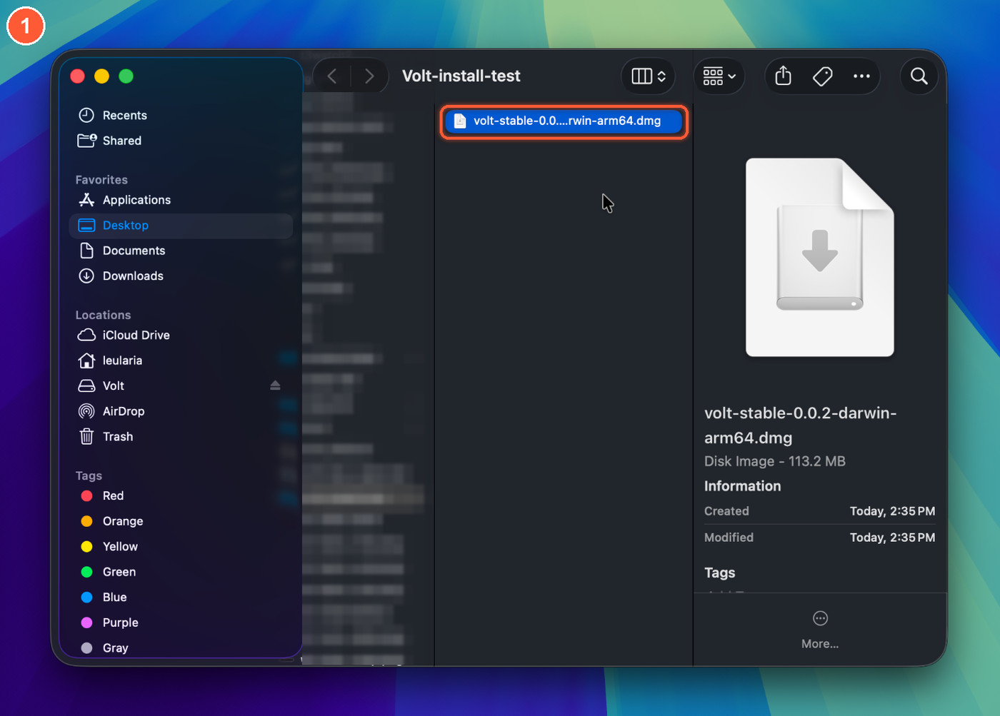

**2. Open the disk image** by double-clicking it. A window with **Volt** and an **Applications** shortcut opens.

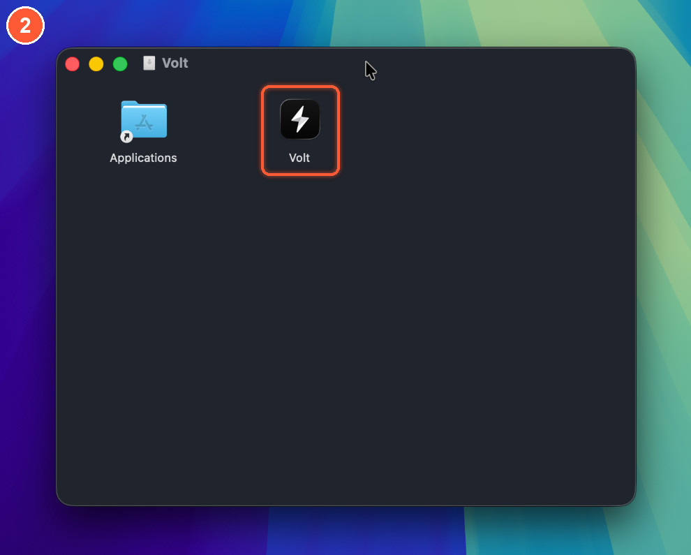

**3. Drag Volt onto Applications.** Then eject the disk image (Finder sidebar, or drag it to the Trash).

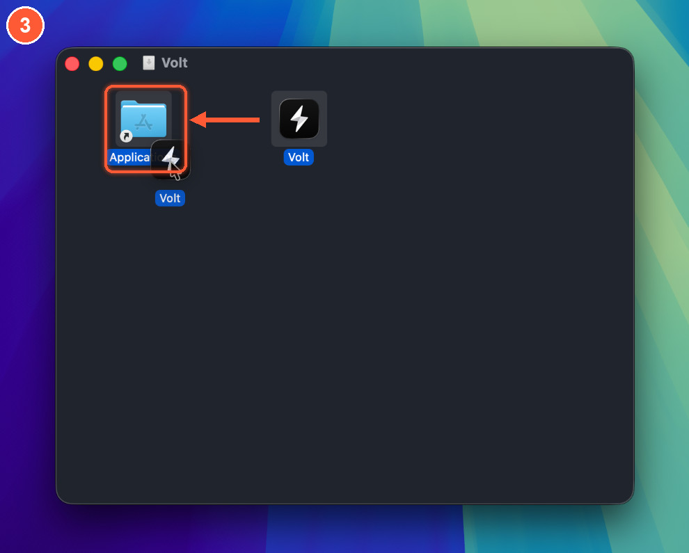

## 3. Open it for the first time

Browsers mark everything they download with a quarantine flag, so macOS checks Volt on first launch and stops it. You do the following once.

**4. Open Volt** from Applications, Launchpad or Spotlight (<kbd>⌘</kbd><kbd>Space</kbd>, then type *volt*).

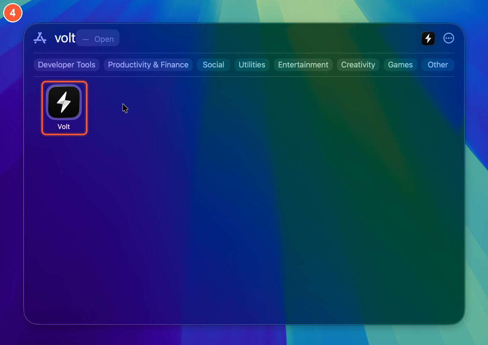

**5. macOS says "Volt" Not Opened.** It could not verify that Volt is free of malware. That is the warning for any app without an Apple Developer ID.
Click **Done**. The **?** in the corner opens Apple's own page about this, which is the quickest way to the next step.

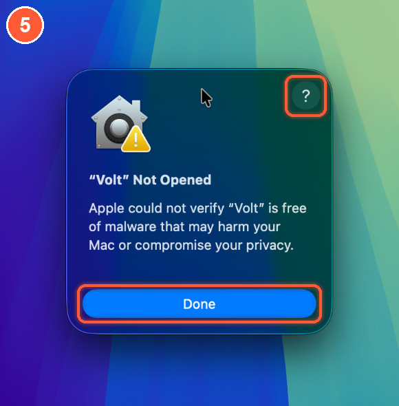

**6. Open the Privacy & Security settings.** In Apple's help page, click **Open Privacy & Security settings for me**. You can also open **System Settings** yourself.

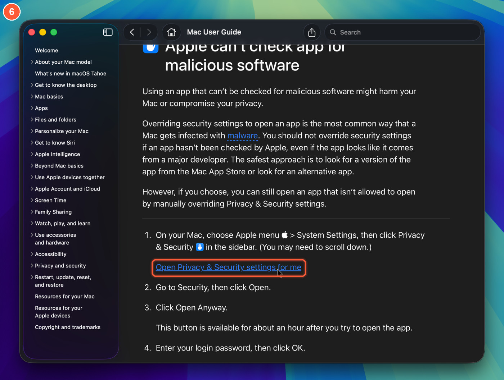

**7. Go to Privacy & Security.** In System Settings, choose **Privacy & Security** in the sidebar, or search for it.

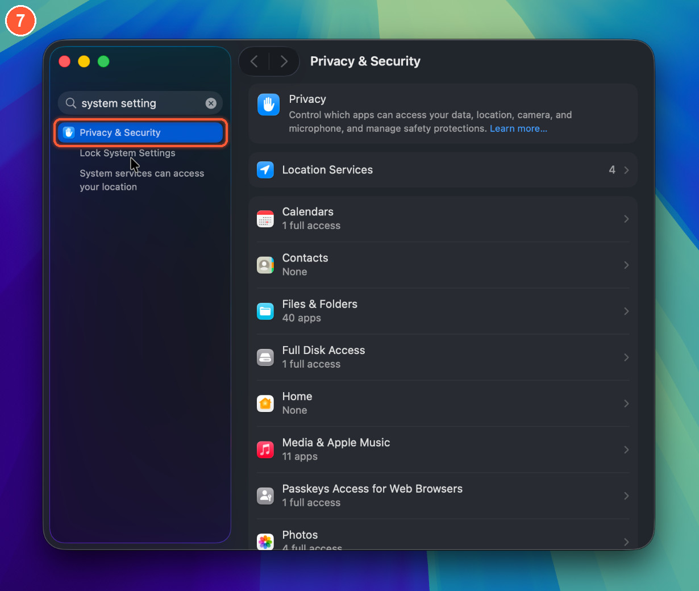

**8. Scroll down to Security and click Open Anyway.** Next to *"Volt" was blocked to protect your Mac* there is an **Open Anyway** button.

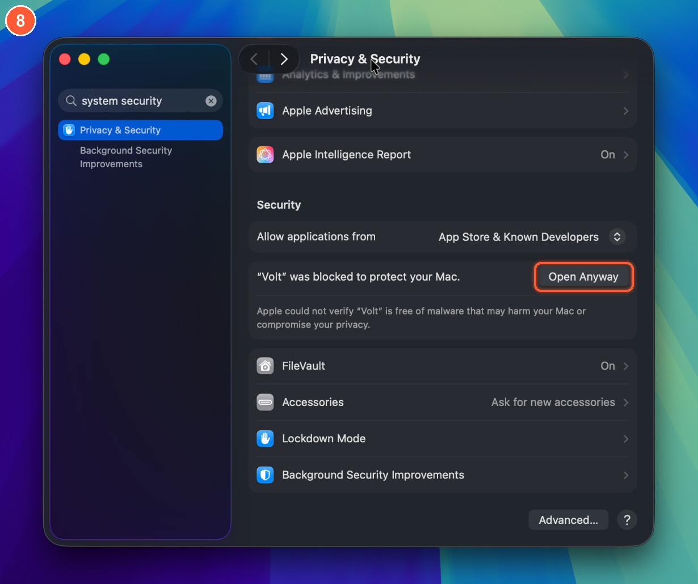

> The **Open Anyway** button shows for about an hour after you try to open the app. If you do not see it, open Volt again (step 4) and come straight back.

**9. Confirm with Open Anyway again.** A dialog asks *Open "Volt"?* The **blue** button is **Move to Trash**: do not click that one. Click **Open Anyway**.

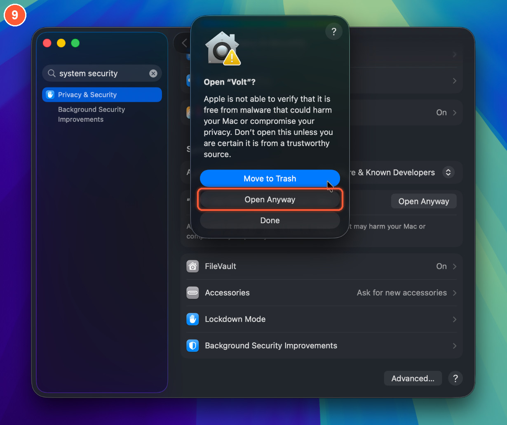

**10. Verify it is you.** Use Touch ID, or click **Use Password…** and type your Mac password.

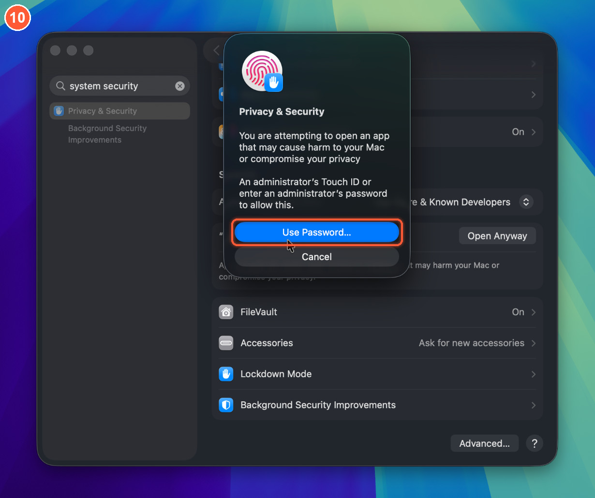

**11. Volt opens.** macOS may ask whether Volt can access files in a folder such as Documents. Click **Allow** so Volt can open your projects. Volt opens normally from now on.

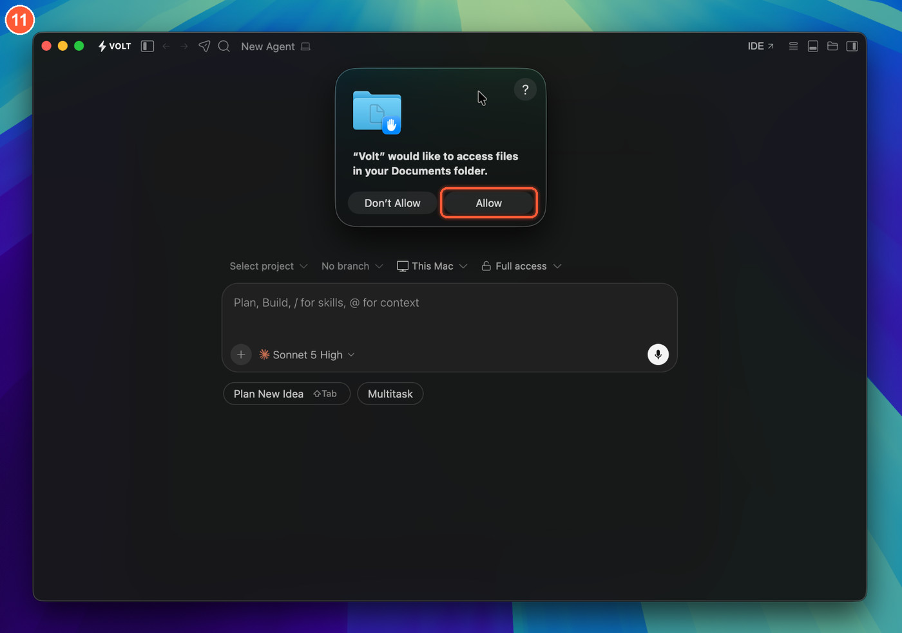

### Right-click, Open (macOS 14 and earlier)

On macOS 14 and earlier you can skip steps 5 to 10: Control-click (or right-click) **Volt** in Applications, choose **Open**, then click **Open** in the dialog.
macOS 15 removed this shortcut, so on newer versions use System Settings as above. On macOS 12 the same button is in System Preferences > Security & Privacy > General.

### "Volt is damaged and can't be opened"

The app is not damaged. macOS shows this when the quarantine flag and the ad-hoc signature disagree, most often after a download was unpacked by a tool that changed
the app. Remove the flag in Terminal and open it again:

```bash
xattr -dr com.apple.quarantine /Applications/Volt.app
open -a Volt
```

## The Terminal route (no dialogs)

Files downloaded with `curl` or `gh` are not quarantined, so macOS never shows the warning. This installs Volt for your Mac in one paste:

```bash
# Apple silicon: arm64. On an Intel Mac use x64.
ARCH=arm64
VERSION=0.0.3

curl -fL -o ~/Downloads/Volt.dmg \
  "https://github.com/LeulAria/volt/releases/download/v${VERSION}/volt-stable-${VERSION}-darwin-${ARCH}.dmg"

hdiutil attach ~/Downloads/Volt.dmg -nobrowse -quiet
cp -R /Volumes/Volt/Volt.app /Applications/
hdiutil detach /Volumes/Volt -quiet

# Only needed if you downloaded the dmg in a browser:
xattr -dr com.apple.quarantine /Applications/Volt.app

open -a Volt
```

Check the download before you open it, if you like. Every asset's SHA-256 is listed in the release feed:

```bash
shasum -a 256 ~/Downloads/Volt.dmg
curl -s https://raw.githubusercontent.com/LeulAria/volt/volt-update-feed/stable/latest.json | grep -A3 "darwin-${ARCH}.dmg"
```

## Use Volt from the Terminal

Open Volt, press <kbd>⇧</kbd><kbd>⌘</kbd><kbd>P</kbd> and run **Shell Command: Install 'volt' command in PATH**. macOS asks for your password once because it links
`volt` into `/usr/local/bin`. Open a new terminal window afterwards:

```bash
volt .                     # open the current folder
volt ~/code/my-app         # open a project
volt --new-window ~/code/my-app
volt --version
volt --help
```

You can also start Volt without installing the command:

```bash
open -a Volt                 # launch Volt
open -a Volt ~/code/my-app   # open a folder in Volt
/Applications/Volt.app/Contents/Resources/app/bin/code --version
```

To remove the command, run **Shell Command: Uninstall 'volt' command from PATH** from the same palette.

## Connect an agent

Open **Volt Settings** (<kbd>⇧</kbd><kbd>⌘</kbd><kbd>P</kbd>, then *Volt Settings*) and pick how you want to run agents: an agent CLI you already use
(Claude Code, Codex, OpenCode and others), an API key, or a local model. Then press <kbd>⌘</kbd><kbd>N</kbd> for a new chat.
The [README](../../README.md#connect-an-agent) has the details.

## Updating

Because the build is not signed with a Developer ID, macOS will not let Volt replace itself. When a new version is out, Volt tells you and opens the download.
Install it the same way as above: drag the new **Volt** into Applications and choose **Replace**. Your settings, chats and projects live in
`~/.volt` and `~/Library/Application Support/Volt`, so they carry over. You may need to confirm **Open Anyway** again for the new build.

## Uninstall

```bash
osascript -e 'quit app "Volt"'
rm -rf /Applications/Volt.app
rm -f /usr/local/bin/volt                 # only if you installed the shell command
rm -rf ~/.volt "$HOME/Library/Application Support/Volt"
```

The last line deletes your Volt settings and chats. Leave it out to keep them.

## Troubleshooting

| What you see | What to do |
| --- | --- |
| *"Volt" Not Opened* / *Apple could not verify "Volt"* | Use **Open Anyway** in System Settings > Privacy & Security, as in steps 6 to 10. |
| **Open Anyway** is not in Privacy & Security | Try to open Volt again first; the button only shows after a blocked attempt, and only for about an hour. |
| The *Open "Volt"?* dialog has a blue **Move to Trash** button | Click **Open Anyway** below it instead. Pressing <kbd>Return</kbd> would choose Move to Trash. |
| *"Volt" is damaged and can't be opened* | Run `xattr -dr com.apple.quarantine /Applications/Volt.app`. |
| The icon bounces and nothing opens | You may have the wrong build. Use `arm64` on Apple silicon and `x64` on Intel, or the universal build. Check with `uname -m` (`arm64` or `x86_64`). |
| *You do not have permission to open the application* | A managed Mac (work or school) can block apps from outside the App Store. Ask your administrator, or run Volt from source. |
| `volt: command not found` | Run **Shell Command: Install 'volt' command in PATH** in Volt, then open a new terminal. |
| Prompts for a folder, the microphone, speech recognition or screen access | Volt asks for a folder when you open a project in it, for the microphone and speech recognition for dictation, and for screen access when an agent controls the desktop. Change any of them in System Settings > Privacy & Security. |

If something else goes wrong, [open an issue](https://github.com/LeulAria/volt/issues/new/choose) and include your macOS version, chip (`uname -m`), and the Volt
version (**Volt > About Volt**).
