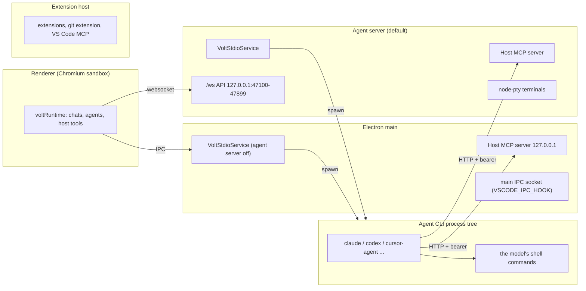

# Volt Sandbox: Assessment and Threat Model

Status: Phase 1 deliverable, written before the sandbox rework. File and line references are from `main` at `de2ea41` (Volt 0.0.6).

## 1. What Volt runs, and where

Volt is a VS Code fork with an agent layer. Code runs in five kinds of process. None of them is sandboxed by the OS, and all of them run with the user's full privileges.

- **Renderer.** Chats, the agent runtime (`voltRuntimeService.ts`), and the host tool implementations. It is sandboxed by Chromium, so it reaches processes only over IPC.
- **Electron main.** Hosts `VoltStdioService` when the agent server is off (`app.ts:1098`, `voltStdioMainService.ts:26`). Also hosts the host MCP server (`app.ts:1101`) and the main IPC socket.
- **Agent server** (`agentServerMain.ts`, on by default via `volt.agentServer.enabled`). Hosts `VoltStdioService` (`:242`), the host MCP server (`:246`), node-pty terminals (`serverTerminals.ts`) and a `/ws` API on loopback. The API's token is stored at `<userData>/agentServer/token` (`agentServerFiles.ts:30-63`).
- **Extension host.** Stock VS Code with no sandbox: the git extension, VS Code's MCP contribution (`extHostMcpNode.ts:94`), and every installed extension.
- **Agent CLI trees.** Every agent (ACP providers: claude-code, codex, cursor-acp, grok, opencode, pi, kimi, antigravity, fx, muse, generic ACP) starts in `AcpAgentProvider.createSession` (`acpProvider.ts:753-758`), which calls `VoltStdioService.spawn` (`voltStdioService.ts:101-170`).

## 2. Execution pathway map

Every place Volt starts a process or runs code that an agent, a repository or a stranger can influence. **Sandboxed today** describes the existing `voltSandbox` before this work.

| # | Pathway | Where | Who controls the code | Sandboxed today |
|---|---|---|---|---|
| E1 | Agent CLI process tree, including the model's own shell commands and the CLI's own MCP servers | `acpProvider.ts:753` → `voltStdioService.ts:101` | model output, repo content (prompt injection) | Only when the chat's level is not `off` (the default is `off`). Seatbelt `(allow default)` on macOS; a runtime-compiled Landlock helper or bubblewrap on Linux; nothing on Windows |
| E2 | Codex at `workspace-write` | `sandboxPolicy.ts:339` | model | Codex's own sandbox ("native"). Volt passes no network or writable-root settings, and `fs/*` checks pass because no launch is registered |
| E3 | Agent resumed elsewhere (worktree handoff, relocate) | `voltRuntimeService.ts:4946` → `acpProvider.ts:569` | model | **No.** Starts with no sandbox |
| E4 | Parked agent reused after a settings change | `voltRuntimeService.ts:856-867`, `:1488` | model | **No.** Gets the current key stamped onto a process started with a different one |
| E5 | Child chats: `delegate_task`, `thread_launch`/`fork`/`send`, run groups, automations | `voltRuntimeService.ts:2196`, `serverRunGroups.ts:130`, `automationService.ts:782` | model | **No inheritance.** A child chat falls back to the default level (`off`) |
| E6 | Host MCP tools: `terminal_*`, `task_watch`, `app_open`, `docker_ensure`, `device_*`, `desktop_*`, `worktree_handoff` | `managedTerminals.ts:812-1008`, `serverTerminals.ts:150`, `agentDesktopTools.ts:88` | model | **No.** They run in Volt's own processes |
| E7 | Host MCP file tools: `browser_run` edits, `skill_write`, `memory_write`, `html_render`/`image_inspect` reads | `hostToolService.ts:179-311`, `voltMemoryService.ts:205` | model | **No.** Only `..` is checked |
| E8 | Volt-run commands: titles, commit/PR text, model probes, `codex app-server` | `voltRuntimeService.ts:1273`, `acpProvider.ts:1085`, `codexAppServer.ts:118` | repo config files read by the CLIs | No |
| E9 | Native-model shell and git tools | `shellTool.ts:181`, `gitTools.ts:117` | model | No (no sandbox option on `exec`) |
| E10 | Volt's own stdio MCP servers (`.mcp.json`, `.volt/mcp.json`, `.cursor/mcp.json`) | `mcpHost.ts:111-165` | repository | No, and no workspace-trust check |
| E11 | Browser preflight dev server (runs `package.json` scripts before a turn) | `workspaceRunPlan.ts:13-45`, `devServers.ts:82` | repository, model | No |
| E12 | Worktree setup scripts (`t3.json`, `volt.json`, `.volt/worktrees.json`, `.cursor/worktrees.json`) | `worktreeSetupPlan.ts:26`, `agentWorktreeSetupService.ts:287` | repository; the new worktree's copy is read first | No, and no trust check |
| E13 | Workflows shell nodes, hooks (`voltHooksService.ts:336`), Run rows | `workflowExecutors.ts:625` | user, repository | No. Hooks are trust-gated except plugin hooks |
| E14 | Git: Source Control, PR tools, `propose_commits`, `stack_branch`, `restack` | `voltGitService.ts:727`, `voltPullRequestService.ts:1450`, `voltPrStackGit.ts:233` | repository config, hooks | No. They run hooks and `core.fsmonitor` from repo config |
| E15 | Extension host and VS Code tasks/terminals/launch configs | VS Code core | extensions, `.vscode/` | No (VS Code's model: Workspace Trust only) |
| E16 | Helpers: code index child, ripgrep, speech helper, computer-use helper (compiled at runtime), device hub (`npm install`), emulator, `adb`, `xcrun simctl`, `gh` | various | Volt | No; these are trusted code with untrusted inputs |
| E17 | Remote relay runner | `apps/relay/src/runner/agents.mjs:23,32` | model | **Container only.** Claude runs with `--permission-mode bypassPermissions`, Codex with `--dangerously-bypass-approvals-and-sandbox`, and both get the full env, including the relay enrol key |

## 3. Trust boundaries

1. **User ↔ Volt.** Volt and its extensions act with the user's authority. A malicious extension is out of reach of anything in this document until extensions run in a sandboxed host (future work, see `05-limitations.md`).
2. **Volt ↔ agent process tree.** The agent CLI binary is semi-trusted: the user installed it from its vendor. **Its actions are untrusted.** They are steered by model output, and model output is steered by whatever the agent reads: repository files, web pages, issue text, tool results.
3. **Agent ↔ Volt host tools.** Every host MCP tool is a deputy acting with Volt's full privileges. Today the boundary is a single bearer token per server, and the session id is chosen by the caller.
4. **Workspace contents ↔ the host.** Files in the workspace are executed or trusted later by unsandboxed code: git (hooks, `core.fsmonitor`, `core.hooksPath`), VS Code (tasks, settings, devcontainer), shells (rc files, direnv), agent CLIs (hooks, MCP lists, plugins), Volt (worktree setup, MCP lists, dev-server scripts).
5. **Sandbox ↔ host IPC endpoints.** These are unix sockets (Docker, ssh-agent, tmux/screen, D-Bus, X11, the VS Code IPC handle) and loopback services (the agent-server API, the host MCP server, dev databases, cloud metadata through a proxy).

## 4. Threat model

### Attackers

| Id | Attacker | Controls | Wants |
|---|---|---|---|
| T1 | **Prompt injector**: the author of a repository, dependency, issue, web page or tool result an agent reads | Text the model reads, and therefore the agent's commands | Run code outside the sandbox, steal credentials, persist |
| T2 | **Malicious or compromised model output** (including a compromised model provider) | Every command and file write the agent makes | Same as T1 |
| T3 | **Malicious workload author**: future plugin/extension/MCP server publishers; today a stdio MCP server listed in a repo's `.mcp.json` | Arbitrary code in a process Volt starts | Credentials, persistence, lateral movement, cryptomining |
| T4 | **Malicious repository policy**: a `.volt/sandbox.json` or similar committed to a repo | Policy text Volt reads | Widen its own sandbox |

Out of scope: malware already running as the user outside any sandbox (it already has everything), kernel and hypervisor 0-days (we reduce attack surface but do not defend against them), physical access, and supply-chain attacks on Volt's own build (covered by release signing, see `volt-release-pipeline`).

### Assets

1. Credentials: SSH keys, cloud CLI credentials, git credential stores, `gh` tokens, browser cookies, Keychain items, `.env` files, environment variables, Volt's own tokens (agent-server token, host MCP token, `~/.volt/accounts`).
2. Code that runs later on the host: git config and hooks, shell rc files, editor and agent configs, agent CLI binaries and caches, Volt's worktree-setup and MCP lists.
3. The user's files outside the task's workspace.
4. Availability: CPU, memory, disk, and process slots.

### What the attacker must not achieve (security goals)

- **G1** No code execution outside the sandbox, immediately or deferred.
- **G2** No reading credentials or files outside the granted set.
- **G3** No writing outside the granted set; no writing protected paths inside it.
- **G4** No network access beyond the policy; no loopback, private-range or metadata access unless granted.
- **G5** No processes surviving the sandbox; resources bounded.
- **G6** No widening of the policy by the workload or by repository content.

## 5. Gaps in the existing sandbox

Severity: **C** means a sandboxed agent can run code outside the sandbox now; **H** means credential theft or deferred escape; **M** means partial weakening.

| # | Sev | Gap | Evidence |
|---|---|---|---|
| G-1 | C | **Fail-open.** With no mechanism (Windows, Linux without Landlock or bwrap) the agent runs unsandboxed. The warning fires 250 ms later and is dropped because the session isn't registered yet. The env still says `VOLT_SANDBOX=<level>` | `sandboxLauncher.ts:156-158`, `acpProvider.ts:901-912` |
| G-2 | C | **Landlock helper fails open.** It never gets `--require`; a ruleset or restrict failure is printed with `perror` and the agent runs anyway. The compiled helper binary in user data is reused without verification | `landlock.ts:154,169-171,185-203`; `sandboxLauncher.ts:274` |
| G-3 | C | **Host MCP tools ignore the sandbox** (E6, E7). `terminal_start` runs any command unsandboxed; `app_open` defeats `deny lsopen`; `browser_run` edits write `.git/config`, even at the read-only level | §2 |
| G-4 | C | **Forgeable MCP identity.** One token per server; the session id is the URL path, so an agent can act as any chat, including its approvals | `voltHostMcpService.ts:109,273,286` |
| G-5 | C | **Unix sockets are open.** Seatbelt allows every unix-socket connect even with network off, which reaches `docker.sock` (`docker run -v /:/host`), tmux/screen servers, ssh-agent, and the **VS Code main IPC socket**. Volt passes that socket's path in `VSCODE_IPC_HOOK`, and its `launch` channel accepts `extensionDevelopmentPath`, so an agent can start an unsandboxed extension host | `seatbelt.ts:85`; `main.ts:238`; `launchMainService.ts:50,141` |
| G-6 | C | **Agent-server API reachable.** Its token is readable inside the sandbox and `localhost:*` is allowed, so `upsertProfile` (any command) and `send` are reachable | `agentServerFiles.ts:30`; `seatbelt.ts:84`; `serverApi.ts:83-89` |
| G-7 | C | **Sandbox dropped across lifecycle** (E3, E4, E5); children can be unsandboxed | §2 |
| G-8 | H | **Deferred escapes through files the host runs.** Not protected: nested repos' `.git/config` (`core.fsmonitor` runs in the git extension), `.git/modules/*`, `core.hooksPath` folders (`.husky`), `.pre-commit-config.yaml`, `lefthook.yml`, worktree-setup files, `.volt/mcp.json`, `opencode.json`, `.envrc`. Also writable: shared caches Volt executes later (`~/.npm/_npx`, the adapters Volt launches), Claude's install folder (`~/.local/share/claude`), and `~/.claude/plugins` (hooks). The preflight dev server runs `package.json` scripts | `sandboxPolicy.ts:81-86,102-111`; `cliAgents.ts:199-215` |
| G-9 | H | **Credentials readable.** `~/.ssh` private keys, `~/.config/gh`, `~/.volt/accounts`, browser profiles, `.env` files and Volt's user data are all readable. The env carries every variable (cloud keys, `GITHUB_TOKEN`, `VSCODE_IPC_HOOK`, `ELECTRON_RUN_AS_NODE`) | `sandboxPolicy.ts:86`; `voltStdioService.ts:469-484` |
| G-10 | H | **Proxy SSRF.** The proxy always allows `localhost`/`127.0.0.1`, and a `*` allow reaches private ranges and `169.254.169.254`. Names are resolved without pinning the address | `sandboxPolicy.ts:309`; `sandboxProxy.ts:68` |
| G-11 | H | **"Allow folder" is chosen by the agent.** The folder is the parent of the denied path, and `/Users` is accepted | `agentEditor.ts:5337`; `sandboxPolicy.ts:213` |
| G-12 | M | **Network overclaim on Linux.** Landlock ABI 4 limits only TCP connect: UDP (DNS exfiltration) and unix sockets stay open, but the UI reports network as limited | `sandboxLauncher.ts:100` |
| G-13 | M | **No resource limits, and process-tree cleanup relies on the process group.** A `setsid` daemon survives | `voltStdioService.ts:685-711` |
| G-14 | M | **macOS escape hatches under `(allow default)`.** `launchctl submit`, synthetic input through WindowServer (Volt holds the Accessibility permission for computer use), the pasteboard, and signals to other processes are all allowed. Only Apple Events and `lsopen` are denied | `seatbelt.ts:72-78` |
| G-15 | M | **No policy model.** Settings are four fields, there is no versioning or validation, and nothing a repository could ship is defined, so there is nothing for plugins to build on | `sandboxPolicy.ts:24` |
| G-16 | M | **Windows shows sandbox levels it cannot enforce** | `agentAccessPicker.ts:90-128` |

## 6. Existing controls worth keeping

- One spawn chokepoint (`VoltStdioService`) for agent processes, with per-window ownership and a crash ledger.
- Seatbelt denials attributed per spawn through `(with message "VOLTSBX-<tag>")` and `log stream`, plus the denial UI in the transcript.
- Host MCP request checks: loopback `Host`, no `Origin`/`Sec-Fetch-*`, constant-time token comparison.
- A filtering HTTP proxy that already names the blocked host in its 403.
- Workspace Trust is on; project hooks are trust-gated.
- An agent footprint table (each CLI's state folders and API hosts), which the agent profile needs.

## 7. What must be covered, in priority order

**P0: escapes available today.** A sandboxed run must not be able to execute code on the host.
1. Fail closed everywhere: no mechanism, a refused probe, or a dimension the backend can't enforce means the agent does not start (G-1, G-2, G-16).
2. Deny unix sockets and loopback by default; strip IPC and credential variables from the env; make Volt's user data, including the agent-server token, unreadable (G-5, G-6, G-9).
3. Per-session MCP credentials, and every host tool gated by the calling chat's sandbox (G-3, G-4).
4. Carry the sandbox through every agent lifecycle path, and make children inherit it (G-7).

**P1: deferred escapes and credentials.**
5. A complete protected-write set, including nested `.git`, `core.hooksPath`, hook managers, worktree setup, MCP lists, and agent install folders and plugins. Redirect shared caches. Skip the preflight for sandboxed chats. Read worktree setup only from the main checkout (G-8).
6. Deny credential reads, including `.env` at any depth and SSH private keys (G-9).
7. Harden the proxy: no loopback/private/link-local/metadata targets, pinned resolution, ports 80/443 by default (G-10).
8. Validate "Allow folder" grants (G-11).

**P2: the foundation.**
9. A versioned, strictly validated policy with narrow-only layering, plus capabilities for future plugins (G-15).
10. A backend interface with honest capability reporting: bubblewrap with namespaces and seccomp on Linux (replacing Landlock), deny-default Seatbelt for workloads on macOS, and Windows refusing (G-12).
11. Resource limits and whole-tree termination (G-13, G-14).
12. An adversarial test suite that checks host state, in CI on Linux and macOS.

**Not covered here** (the marketplace phase; recorded in `05-limitations.md`): a sandboxed extension host (E15); sandboxing Volt's own helpers (E16) and its stdio MCP servers (E10, which needs a trust decision UX); the relay runner (E17); Codex's native sandbox configuration (E2); and Volt-run CLI probes (E8).
