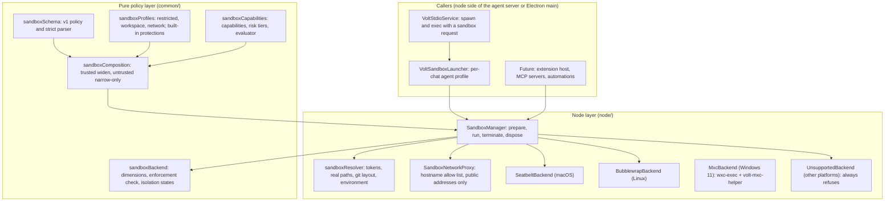

# Volt Sandbox: Design and Reference

The foundation every Volt workload that runs untrusted code goes through: agent CLIs today, and MCP servers, extensions and automations later. Sources are in `src/vs/platform/voltSandbox/`.

## Architecture



### A run, step by step

1. **Policy.** A caller supplies a composed `IVoltSandboxPolicy`. That is a built-in profile plus layers, or the agent profile.
2. **Probe.** `SandboxManager.prepare` probes the backend once and caches it. If it is unavailable, the run is refused (`unavailable`).
3. **Enforcement check.** `checkEnforcement` compares the dimensions the policy uses with the backend's matrix. A dimension that isn't enforced and isn't in `policy.bestEffort` refuses the run.
4. **Resolve.** `resolveSandboxPolicy` turns the policy into concrete paths and a complete environment:
   - expands tokens and resolves every path through `realpath`;
   - refuses `/`, the home folder, or a parent of it as a workspace or write root;
   - refuses any path containing `"` or a control character;
   - adds git protections from the repository's real layout (worktree pointer, common dir, `core.hooksPath`);
   - anchors `**/` patterns at roots;
   - builds the environment from nothing.
5. **Proxy.** With network `proxy`, the manager starts a `SandboxNetworkProxy` for this run only.
6. **Launch.** `backend.launch` builds the bubblewrap argument vector or the Seatbelt profile from the resolved policy only.
7. **Spawn.** The caller spawns it detached (its own process group), with the backend's extra file descriptors.
8. **Confirm.** `confirm(child)` waits for the backend's proof: bubblewrap's `--json-status-fd`, or the macOS prologue's marker on fd 3 written after `sandbox_init`. A run is only reported `initialized`/`partial` after that.
9. **Terminate.** `terminate(child)` kills the whole tree; it is called on exit, timeout, cancel and shutdown.
10. **Clean up.** `dispose()` stops the proxy and removes the run's folder.

`SandboxManager.run` does steps 2–10 and returns an `ISandboxRunResult`:
- the status (`unavailable`, `partial`, `initialized`, `failed`, `completed`);
- the exit code or signal, and stdout/stderr (capped, middle dropped);
- `timedOut` and `cancelled`;
- the unenforced dimensions;
- denials (kernel log, proxy, limits);
- timings (prepare, start, total);
- an error message, with the home folder replaced by `~` and secret-looking values removed.

## Policy schema (version 1)

JSON. Every field is optional except `schemaVersion`. An absent field takes its **most restrictive** value. Unknown fields are errors, and so are type errors, out-of-range numbers and malformed paths. Policy text larger than 256 KB is refused before it is parsed, and lists over 256 entries are refused.

```jsonc
{
  "schemaVersion": 1,
  "name": "my-tool",                        // diagnostics only
  "filesystem": {
    "read":    ["${system}", "${path}"],    // readable, with everything below; "/" = everything except deny
    "write":   ["${workspace}", "${tmp}"],  // writable and readable; never "/", "${home}", "${system}", "${path}"
    "deny":    ["${home}/.ssh", "**/.env"], // neither readable nor writable, even inside read/write
    "protect": ["${workspace}/.vscode", "**/.git/hooks"], // readable, never writable
    "unmask":  []                           // lifts built-in credential denies; trusted layers only
  },
  "network": {
    "mode": "none",              // none | proxy | host
    "allow": [],                 // proxy only: "example.com", "*.example.com", "example.com:8443", "1.2.3.4", "*"
    "loopbackPorts": [],         // host loopback ports reachable directly (Volt's MCP server)
    "listen": false              // may listen on loopback (dev servers)
  },
  "process": { "limits": { "cpuSeconds": 300, "memoryMB": 512, "processes": 512, "fileSizeMB": 1024, "openFiles": 4096, "wallClockSeconds": 600 } },
  "env": { "inherit": ["LANG", "TERM"], "set": { "HOME": "${tmp}/home" } },
  "host": { "unixSockets": [], "systemServices": false },
  "bestEffort": ["limits.processes"]       // dimensions allowed to run unenforced (reported as `partial`)
}
```

### Path entries

- **Allowed forms.** A path is absolute, or starts with one of these tokens:
  - `${workspace}`: each workspace root;
  - `${home}`: the real home folder;
  - `${tmp}`: a private folder for this run, always writable, removed afterwards;
  - `${storage}`: the workload's own persistent folder;
  - `${system}`: the platform's binaries, libraries, certificates and time zones;
  - `${path}`: the install prefixes of the programs on the host PATH.

  `${system}` and `${path}` must stand alone.
- **Refused:** relative paths; `.`, `..` and empty segments; trailing slashes; backslashes as separators; control characters; text that is not in Unicode NFC; tokens in the middle.
- **Patterns.** `**/a/b` is allowed in `deny` and `protect` only. It means the entry `a/b` at any depth below a root, and everything inside it. It takes one to four literal names, with no globs.
- **After expansion**, every path is resolved with `realpath`. A path that does not exist yet is resolved through its nearest existing parent. On macOS, denies and protections match case-insensitively, because APFS is case-insensitive by default.

### Environment

- **Nothing is inherited unless named.**
- `inherit: ["*"]` copies every host variable that is not secret-like. Secret-like means: tokens, keys, passwords, cloud and CI credentials, database URLs, `SSH_AUTH_SOCK`, `VSCODE_*`, `ELECTRON_*`, `LD_*`/`DYLD_*`, `NODE_OPTIONS`, `BASH_ENV`, and proxy variables. The full list is `isSecretEnvName` in `sandboxProfiles.ts`.
- A trusted layer may name a secret-like variable explicitly; an untrusted one may not.
- **Manager-only variables.** `*_PROXY` and `VOLT_SANDBOX*` are set only by the manager. The proxy variables point at Volt's proxy and are present only with network `proxy`.

## Profiles

| | `restricted` | `workspace` | `network` | agent (`agentSandboxPolicy`) |
|---|---|---|---|---|
| Read | system | system, PATH toolchains, workspace | as workspace | everything except credentials |
| Write | its temp | workspace, temp | as workspace | workspace (`workspace-write`), allowed folders, temp, the CLI's own state |
| Credentials (SSH keys, cloud, `gh`, browsers, `.env`, other agents' tokens, Volt's user data) | denied | denied | denied | denied (`~/.ssh` config readable when network is on) |
| Protected writes | — | yes | yes | yes, plus the CLI's binaries, plugins and hooks |
| Network | none | none | proxy, empty allow list | proxy with the agent's API hosts, or host when the chat's network is on |
| Unix sockets | none | none | none | none; ssh-agent with network on |
| OS services (macOS) | denied | denied | denied | allowed, with escape hatches denied |
| Limits | 600 s wall, 300 s CPU, 1 GB files, 4096 fds, 512 processes | same | same | none (long-lived) |
| Best effort | processes, process tree | + protectNew | + protectNew | protectNew, process tree |

**Protected-write set.** These are what the host runs or trusts later:
- **Workspace root:** shell rc files, `.gitconfig`, `.gitmodules`, `.envrc`, `.mcp.json`, `.vscode`, `.idea`, `.devcontainer`, and hook managers (`.husky`, `.githooks`, `.pre-commit-config.yaml`, `lefthook.yml`).
- **Agent config:** Claude, Cursor and Volt hook files and MCP lists; worktree-setup files (`volt.json`, `t3.json`, `.volt/worktrees.json`, `.cursor/worktrees.json`); OpenCode config and plugins.
- **Bare-repo files** at the root: `HEAD`, `objects`, `refs`.
- **Git internals at any depth:** `.git/config`, `.git/config.worktree`, `.git/hooks`, `.git/modules`.
- **From the repository's real layout:** a worktree's `.git` pointer file, and the `core.hooksPath` folder.
- **New repositories:** on macOS, no new `.git` entry can be created below a workspace, since a new repository brings its own config.

## Layering (narrow-only)

`composeSandboxPolicy(base, layers)` applies the layers in order:

| Layer | Trusted | May |
|---|---|---|
| built-in profile | — | the base |
| user settings (`~/.volt/sandbox.json`, capped by the managed policy) | yes | widen or narrow; `unmask`; `systemServices`; `bestEffort` |
| repository (`.volt/sandbox.json` and anything shipped in a repo) | **no** | narrow only |
| per-run request | trusted only when Volt issues it on an explicit user grant | as its trust |

**What narrowing means for each field:**
- `read`/`write`: intersect. An entry survives only if it is provably inside an existing one. Different tokens are never treated as provably inside each other.
- `deny`/`protect`: union; they only grow.
- Network `mode`: the minimum of `none` < `proxy` < `host`.
- Network `allow`: only hosts covered by the hosts already allowed.
- `loopbackPorts` and `unixSockets`: intersect.
- `listen` and `systemServices`: AND.
- Limits: the minimum.
- `env.inherit`: only names already inherited (secret-like names never come in through `*`).
- `env.set`: trusted layers any value except reserved names; untrusted layers only new variables that are not secret-like and not already set or inherited.
- `bestEffort`: can only shrink.

Every dropped widening is returned in `ignored` with its field, value and reason.

## Capabilities

The words for a future install sheet. A manifest *requests* them, the user *grants* them, and `evaluateCapabilities(requested, granted)` builds the policy from `restricted` plus the intersection. A grant that wasn't requested adds nothing; an unknown id is an error.

| Capability | Risk | Becomes |
|---|---|---|
| `fs.read:workspace` | low | read `${workspace}` |
| `fs.write:workspace` | medium | write `${workspace}` (protections stay) |
| `fs.read:<path>` / `fs.write:<path>` | medium–critical (home: high/critical) | read/write that path; `/` and writing the home folder are refused |
| `net.connect:<host>` | medium | proxy, allow `<host>` |
| `net.connect:*` | high | proxy, any public host |
| `net.host` | critical | unfiltered network |
| `net.listen` | low | listen on loopback |
| `net.loopback:<port>` | high | reach that local port |
| `process.exec` | low | (implied) |
| `git.local` | medium | write the workspace |
| `git.remote:<host>` | high | proxy, allow `<host>` |
| `env:<NAME>` | low, or high if secret-like | inherit `<NAME>` |
| `socket:<path>` | high, or critical for Docker/Podman | reach that unix socket |

**For later work.** The evaluator is reusable by any caller, but the grant UI and manifest format belong to the marketplace phase.

## Backends

### Support matrix

`enforced`: the backend enforces it and the adversarial suite checks it. `partial`: enforced with the stated gap. `—`: not enforced; a policy that requires it is refused.

| Dimension | Linux (bubblewrap) | macOS (Seatbelt) | Windows |
|---|---|---|---|
| filesystem.read (confine reads) | enforced: only bound paths exist | enforced: deny-default | enforced: listed folders only; never a drive root or the profile |
| filesystem.write | enforced | enforced | enforced |
| filesystem.deny | enforced for existing paths (tmpfs / `/dev/null` masks) | enforced, case-insensitive | enforced for existing paths (`deniedPaths`) |
| filesystem.protect | enforced for existing paths (read-only re-binds) | enforced | enforced for existing paths (read-only grant under the writable one) |
| filesystem.protectNew (paths created later, `**/` patterns, new repositories) | partial: patterns cover paths that exist at launch | enforced (regex and `file-write-create` rules) | partial: fixed at launch |
| network.none | enforced: empty network namespace | enforced: `deny network*` (also stops DNS) | enforced: egress denied, host loopback closed (DNS too) |
| network.proxy | enforced: a holder namespace runs socat bridges to the host proxy; the sandbox joins it with `nsenter` (needs socat, nsenter) | enforced: only the proxy port | enforced: MXC Model 2, only the proxy port; DNS still resolves (MXC#1666) |
| network.loopbackPorts | enforced through the bridge (needs socat) | enforced per port | — (MXC opens all loopback ports or none, MXC#1665) |
| network.listen (restricting) | enforced: the namespace's own loopback | enforced: `network-bind` denied | enforced: unreachable from the host |
| host.unixSockets | enforced: socket folders masked, seccomp blocks `socket(AF_UNIX)` | enforced: `remote unix-socket` denied | enforced: AF_UNIX sockets are files under the filesystem policy; socket grants are refused |
| process.tree | enforced: PID namespace, `--die-with-parent` | partial: process group, descendants, tagged processes and watchdog; an env-cleared setsid daemon survives, still sandboxed | enforced: MXC job, `KILL_ON_JOB_CLOSE` |
| process.isolation | enforced: PID namespace | enforced: signals and process info limited to the sandbox | enforced: AppContainer at Low integrity |
| syscalls (backend hardening) | enforced: seccomp filter | partial: Seatbelt mediates operations | partial: Win32k stays reachable (`ui.disable: false`) |
| env.clear | enforced (manager) | enforced (manager) | enforced (manager) |
| limits.cpu / fileSize / openFiles | enforced: prlimit inside the user namespace | enforced: `ulimit` before `exec` | partial (cpu, polled); — (fileSize, openFiles) |
| limits.processes | enforced: RLIMIT_NPROC per user namespace (Linux 5.14+) | — | partial: polled; "no new processes" refused |
| limits.memory | partial: RLIMIT_AS (virtual memory) | — | partial: job peak commit, polled |
| limits.wallClock | enforced (manager) | enforced (manager) | enforced (manager) |

The Linux column is what the bubblewrap backend's probe reports. The machine's own answer is in `SandboxManager.capabilities()`.

### macOS

- **Launch:** `/usr/bin/sandbox-exec -p <profile> -- /bin/sh -c <prologue> volt-sandbox <cpu> <fsize> <nofile> <command> <args…>`.
  - The prologue is constant text that receives values only as positional arguments. It sets rlimits, writes `volt-sandbox-ready` to fd 3, closes fd 3 and `exec`s.
  - `sandbox-exec` only `exec`s after `sandbox_init` succeeded, so the marker is the confirmation.
- **Watchdog:** a constant `/bin/sh` script holding a pipe from Volt. It kills the run's process group when Volt dies.
- **Denials:** read from `log stream`, attributed by the `VOLTSBX-<tag>` message.
- **Base profile:** deny-default, from Codex's Chrome-derived baseline, plus what macOS 26 needs:
  - read access to `/` itself (or dyld aborts with SIGABRT);
  - the opendirectoryd, logger and power-management lookups;
  - pseudo-terminals, POSIX semaphores and `sysctl` reads;
  - `file-read-metadata` everywhere (metadata only, never contents).
- **System services mode** (agent CLIs) is `(allow default)` with explicit denies:
  - writes outside the plan, protections, credentials;
  - unix sockets (except mDNSResponder with an open network, and granted sockets);
  - the network (unless the chat's network is on);
  - signals to other processes;
  - Apple Events, LaunchServices, `job-creation`, WindowServer (synthetic input), the pasteboard, and **cfprefsd** (preference writes otherwise land through the daemon, past the file rules).

### Linux

- **Namespaces:** user, PID, IPC, UTS, cgroup, and network (unless `host`), with `--die-with-parent` and `--disable-userns`.
- **Session:** `--new-session`, or on a PTY a seccomp TIOCSTI block instead.
- **Mounts:** fresh `/proc` and `/dev`; empty tmpfs over `/tmp`, `/var/tmp`, `/run`, `/dev/shm` and the user's runtime folder; minimal read-only system binds, then `--remount-ro /`. Then come the writable binds, read-only re-binds for protections (every folder between a writable root and a protected path pinned as a mount point, so it cannot be renamed away) and masks for denies.
- **Seccomp:** a classic-BPF program generated in TypeScript (`common/seccomp.ts`), passed on a pipe. It refuses mount, namespace, ptrace, keyring, bpf, perf, userfaultfd, io_uring and handle syscalls, TIOCSTI/TIOCLINUX, namespace flags on `clone` and `AF_UNIX` sockets unless granted; `clone3` gets `ENOSYS`. Syscall numbers are checked against kernel headers (`scripts/volt-sandbox-check-syscalls.mjs`).
- **Network bridge:** a small holder bwrap owns a fresh network namespace and runs one socat per port, forwarding to unix sockets in the run's control folder. The sandbox bwrap is spawned inside that namespace with `nsenter`, so every sandboxed process stays under seccomp, and the bridges listen before the workload starts.
- **Launcher environment:** bwrap is spawned with an empty environment; the workload's variables arrive as `--setenv` pairs on a pipe, so nothing reaches bwrap itself (`LD_PRELOAD`).
- **Limits:** `prlimit` inside the user namespace.
- **Confirmation:** bwrap's status line (namespace inodes differ from the host's), plus a line from inside the finished sandbox reporting `NoNewPrivs:1 Seccomp:2`.

Details are in `common/bwrap.ts` and `node/bubblewrapBackend.ts`, with ADR-3 and ADR-9. The probe refuses to run at all when:
- unprivileged user namespaces are unavailable;
- the architecture is neither x64 nor arm64 (there is no seccomp table for it);
- bubblewrap is missing.

Its diagnostics name the exact fix.

### Windows

`MxcBackend` (Windows 11 24H2 or later, client editions) launches Microsoft's signed `wxc-exec.exe` from the pinned `@microsoft/mxc-sdk` 1.0.1 with a `version: "1.0.0"` request (telemetry off). The request's process is Volt's own `volt-mxc-helper prologue`: it runs a canary, reports ready and waits; Volt attests it from outside (AppContainer token, Low integrity, job membership, image, parent) before it starts the workload. Git Bash, MSYS2, Cygwin and WSL programs are refused (MXC#1061), PowerShell or cmd suggested. Spec J.3 lists every dimension and residual; the WIN-* suite runs on the hosted `windows-11-arm` runner (`.github/workflows/volt-sandbox-windows.yml`).

## Integration with Volt

| Pathway | What happens now |
|---|---|
| Agent CLI processes (every ACP provider) | `VoltStdioService.spawn` → `VoltSandboxLauncher` → agent profile → `SandboxManager.prepare`. Refused when the sandbox can't be established; confirmed before trusted; the tree is killed on exit, kill, window close and app shutdown |
| ACP `fs/*` writes the agent routes through Volt | `resolvedPolicyAllows` on the given path and on its real path |
| Commands Volt runs for a sandboxed chat | `IVoltExecRequest.sandbox` runs the shell under the chat's agent profile; a refusal returns `exitCode: null` with the reason |
| Host MCP tools | per-session HMAC credentials; the calling chat's sandbox on every call; an allowlist gate (`hostToolSandbox.ts`) that refuses escapes for sandboxed chats |
| Child chats (subagents, `thread_launch`/`fork`, run groups, automations) | inherit a sandbox at least as strict as their parent's (`sandboxInheritance.ts`) |
| `thread_send`, `queue_*` to another chat | refused unless that chat is at least as strict |
| Resumed, relocated and parked agents | a process is reused only for the sandbox key it was started with |
| Browser preflight dev server | not started for sandboxed chats |
| Worktree setup files | read from the main checkout only |
| "Allow folder" | `folderGrantError` refuses `/`, home and its parents, system folders, credential folders, Volt's data and protected names |

**Deliberately not sandboxed:** the user's own terminal, and Volt's own git and UI operations started by the user. Sandboxing them would defend against nothing in the threat model and would break credential helpers and hooks. They are kept safe from planted code by the protected-write set (ADR, "Where we disagree").

## Installation requirements

- **macOS:** nothing to install. `/usr/bin/sandbox-exec` ships with macOS (tested on 26.6).
- **Linux:**
  - **bubblewrap** (0.8 or later recommended, for `--disable-userns`).
  - **socat**, for network `proxy` and loopback ports.
  - **util-linux** `prlimit`, for resource limits.
  - **Unprivileged user namespaces.** On Ubuntu 24.04+, AppArmor restricts them: either install an AppArmor profile for `bwrap` or set `kernel.apparmor_restrict_unprivileged_userns=0`. The probe's diagnostics say which.
  - **Containers** need `--security-opt seccomp=unconfined --security-opt apparmor=unconfined --security-opt systempaths=unconfined` (Docker masks `/proc` otherwise and bubblewrap cannot mount a fresh one).
- **Windows:** Windows 11 24H2 (26100.9278), 25H2 (26200.9278), 26H2 (26300.9550) or 26H1 (28000.2804) or later, client editions. Windows 10 and Windows Server are refused.

## Configuration

- **Per chat:** the access picker sets the level (`off`, `workspace-write`, `read-only`) and network on/off. "Allow folder" and "Allow host" from a denial add trusted grants for that chat.
- **Diagnostics:** `node scripts/volt-sandbox-inspect.mjs [workspace]` prints the backend's capability matrix and the resolved policy for a profile, without running anything. The benchmark is `node scripts/volt-sandbox-bench.mjs`.
- **Policy files:** `~/.volt/sandbox.json` (yours) and `.volt/sandbox.json` in a workspace root (the repository's); see "Policy files" below.

### Policy files

Two optional files in the policy schema above (strict JSON: no comments, no trailing commas, `schemaVersion: 1`):

| File | Layer | Trusted | May |
|---|---|---|---|
| `~/.volt/sandbox.json` | `user` | yes | widen or narrow the agent profile, capped by the managed policy |
| `<workspace root>/.volt/sandbox.json` | `workspace` (one per root) | **no** | narrow only |

- **Precedence.** The managed (admin) policy beats both: its gate runs first, and every widening in your file that it denies is dropped before composition (`capUserLayer`). Then the agent profile, your file and each repository's file are composed in that order with the narrow-only rules of "Layering", so a repository's file never widens what the profile or your file allows. The chat's own grants ("Allow folder", "Allow host") apply as before.
- **Tokens.** `${home}` is your home folder. In a repository's file `${workspace}` is that repository's own root, so it cannot name another workspace.
- **When they are read.** At every launch (agent chats, chat commands, stdio MCP hosts), before any folder is made. A file is parsed again only when its stat (`dev`, `ino`, size, `mtime`, `ctime`) changes; a warm launch costs one `stat` per file (0.026 ms for both, `POLFILE-CACHE-1`). An edit applies to the next launch, not to a running agent.
- **Errors.**
  - Your file: a JSON or schema error refuses the launch, naming the file and the line ("Your sandbox policy ~/.volt/sandbox.json has an error, so Volt did not start this sandboxed process: line 3: filesystem.write[0] ..."). Volt never runs without rules you asked for. Your file may be a symlink (dotfile managers) but must end at a regular file.
  - A repository's file: a JSON or schema error, a symlink, a FIFO, a directory or a file over 256 KB is ignored, with a warning in the transcript and the Access menu. A cloned repository must not be able to stop you from working, and ignoring a narrow-only file never widens anything.
- **Ignored entries are shown.** What the composition drops (a repository asking for more, your file asking for what the managed policy denies) is listed in the transcript at launch and as a quiet line in the chat's Access menu: "Ignored from .volt/sandbox.json: network.mode host, ...".
- **Symlinks cannot widen a narrowing (B-32).** A repository's narrowed `read`/`write` entry that resolves outside through a symlink is dropped at load, and the resolver checks again on its own canonical answers, so a link swapped in between refuses the launch.
- **Environment.** A repository's `env.set` may only add new variables that are not secret-like and not already set or inherited by the policy.
- **Protected.** Both files are protected paths: no sandboxed agent can modify, replace, move or remove them (Seatbelt, bubblewrap and the files broker), `~/.volt/sandbox.json` included when `~/.volt` is writable. macOS also refuses creating a missing one; on Linux that is best effort (`filesystem.protectNew` is reported partial).

Your file, opening one more folder and two hosts:

```json
{
  "schemaVersion": 1,
  "filesystem": { "write": ["${home}/src/shared-cache"] },
  "network": { "mode": "proxy", "allow": ["registry.npmjs.org", "*.example.com"] }
}
```

A repository keeping agents out of its fixtures and its release script, and to one of your hosts:

```json
{
  "schemaVersion": 1,
  "filesystem": { "deny": ["${workspace}/fixtures/customers"], "protect": ["${workspace}/scripts/release.sh"] },
  "network": { "allow": ["registry.npmjs.org"] }
}
```

With both, the agent reaches `registry.npmjs.org` only. Had the repository asked for `"mode": "host"` or another write root, that entry would be ignored and listed.
