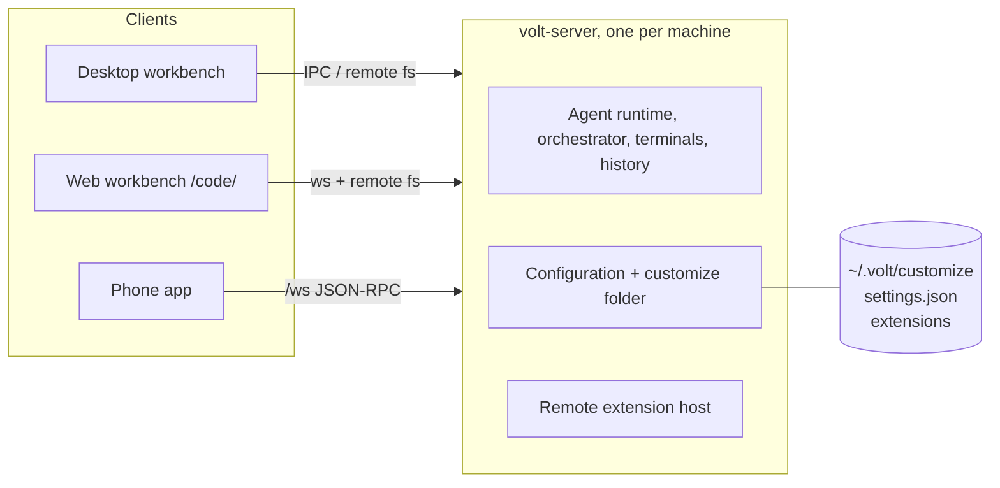

# Volt Customize: every piece is a plug

> **One line:** every look value, layout choice and panel in Volt's agent window comes from a file the user (or their agent) can change. Defaults are what Volt looks like today. A change can be tried in a Playground window, kept in your settings, or exported as an extension that other people install like any VS Code extension.

Status (2026-11-01, branch `volt/0c0666e8`): **built**: the configuration engine (look tokens as settings + CSS variables, looks, layouts, precedence, live reload, `.error` files), `~/.volt/customize` with a generated AGENTS.md, the `voltLooks` / `voltLayouts` contribution points, tokens in extension webviews, Settings > Customize Volt, and the Playground (draft window, Apply, Install as extension). **Designed, not built**: the slot system for extension panels (§6.3), the agent-window layout tree (§6.4), the server-side customize API for mobile (§5.3), permissions for UI extensions (§8). §10 lists exactly what is and isn't there.

Other extensible apps (Zed, Obsidian, Raycast, JetBrains, browser extensions, Figma, Electron/Tauri) are compared in [customize-research.md](customize-research.md).

---

## 1. What we copied, and from where

### 1.1 VS Code

| VS Code concept | What it does | What Volt takes from it |
|---|---|---|
| **settings.json + configuration registry** | Every setting is registered with a JSON schema (`type`, `default`, `description`). The Settings editor, JSON validation, IntelliSense, Settings Sync and profiles all come from that one registry. | Every look token is a registered `volt.look.*` setting. Nothing to build for UI, validation, sync or profiles. |
| **`workbench.colorCustomizations`** | Overrides any color token, globally or per theme (`"[Volt Dark]": { "sideBar.background": "#347890" }`). **Developer: Generate Color Theme From Current Settings** turns those overrides into a theme file. | Colors stay VS Code colors. "Make the left sidebar blue" = a color override. Playground export does the same as Generate Color Theme. |
| **Extensions: manifest + contribution points + API** | `package.json` declares static `contributes` (commands, configuration, configurationDefaults, themes, views, viewsContainers, menus, keybindings, colors, icons, walkthroughs, …). Code (`activate`/`deactivate`) runs only for behavior. `publisher.name` is the id. | Looks and layouts are new contribution points (`voltLooks`, `voltLayouts`). A look-only or layout-only extension is pure JSON, like a theme extension. |
| **`contributes.configurationDefaults`** | An extension changes the default of any setting; the user's own value still wins. | Looks are default changes, so a user setting always beats an installed look. |
| **Extension hosts (`extensionKind`)** | UI extensions run next to the window; workspace extensions run where the files are (the remote extension host inside VS Code Server). Commands are routed between hosts automatically. | Volt's web UI is the real workbench served by the agent server (`/code/`), so the same split applies: looks/layouts are read through the file service from the server machine, panels that need files run in the server's extension host. |
| **Webviews** | Extensions draw any HTML; VS Code passes every theme color as `--vscode-*` CSS variables and `vscode-dark/light` body classes. | Webviews also get every look token as `--volt-look-*` variables, so an extension panel matches the user's radius, spacing and fonts without code. |
| **Extension Development Host (F5)** | A second window that runs the extension being built; **Developer: Reload Window** picks up changes. | The Playground is that second window, except it reloads on every save and the user builds by prompting the agent in it. |
| **Profiles (`.code-profile`)** | A bundle of settings, keybindings, extensions, snippets, tasks and UI state; exported to a gist/file, opened in a new window with **New Window with Profile**. | Later: "Share my Volt" = export a profile that includes looks and layouts. |
| **Marketplace (Open VSX here)** | `vsce package` makes a `.vsix`; `ovsx publish` puts it on open-vsx.org; the Extensions view searches by name, tag and category. | Volt extensions are ordinary extensions with tags `volt-look` / `volt-layout` / `volt-panel`, installable from the Extensions view or a folder. |

What VS Code does **not** let you change: sizes, radii, paddings and fonts of the workbench chrome (only colors and a few font settings), and the arrangement inside a part (only which side the side bars and panel go on). Volt's agent window adds those.

Sources: [Extension anatomy](https://code.visualstudio.com/api/get-started/extension-anatomy), [Contribution points](https://code.visualstudio.com/api/references/contribution-points), [Remote extensions](https://code.visualstudio.com/api/advanced-topics/remote-extensions), [Themes / colorCustomizations](https://code.visualstudio.com/docs/configure/themes), [Custom layout](https://code.visualstudio.com/docs/configure/custom-layout), [Webviews](https://code.visualstudio.com/api/extension-guides/webview), [Your first extension](https://code.visualstudio.com/api/get-started/your-first-extension), [Profiles](https://code.visualstudio.com/docs/configure/profiles).

### 1.2 Herdr

Herdr (herdr.dev, `herdrdev/herdr-app`) keeps its whole interface as files in `~/.config/herdr-app/` and redraws within a second of a save:

```
~/.config/herdr-app/
├── AGENTS.md        written on every start: what an agent can change and how
├── settings.json    the person: zoom, sounds, fonts, theme
├── keys.json        { "global": {...}, "terminal": {...}, "layout:<name>": {...}, "mod:<name>": {...} }
├── layouts/<name>.json   the whole window: a tree of block / row / column / stack nodes
├── mods/<name>/main.js   panels: JS that describes native UI (gpui-kit), plus mod.json
└── themes/<name>.json
```

Ideas worth taking:

1. **AGENTS.md in the folder**, regenerated on every start, so any agent knows the files, the rules and how to check its work. The user says what they want; the agent writes files.
2. **Shipped layouts are read-only.** Change look through settings; to change structure, clone (`layout.clone`) and edit the clone. An edited shipped file is moved aside on next start.
3. **A bad file never breaks the window.** The last good version keeps running and the error goes to `<name>.error`. A fixed key combo (`ctrl-alt-shift-escape`) always resets to the default layout.
4. **Look cascades:** a layout's own look wins, settings fill what it leaves unset, a theme pick overrides both.
5. **Sharing is a folder in a GitHub repo** with `RECIPE.md` (a brief another agent can rebuild it from), `preview.png`, the layout and its mods, tagged `herdr-layout` / `herdr-mod`. Installing = an agent reads every file, copies it in, never overwrites (renames on clash).
6. **One command list** drives keys, menus, mods and the CLI (`herdr-app do tab.new …`).

Herdr's layout tree (from its `AGENTS.md`): nodes are `block` (content = a mod, a terminal, the active tab, or the focused agent), `row`, `column`, `stack`; every node takes `id`, `size` (`{px}` or `{weight}`), `min`/`max`, `hidden`, `background`, `border`, `radius`, `padding`, `gap`, `divider`, `floating` (drawers with `peek`). Example layouts: Board (agents as cards in Needs you / Working / Done / Idle columns over the live tab), Desk (one sticky agent column beside the space's tabs, Review tab opens when the agent finishes with uncommitted changes), Chat, Code, Mission, Threads.

What Volt does differently: Volt is a VS Code workbench, so panels are VS Code views and webviews (HTML, our design system) rather than a native UI DSL, and sharing uses the extension gallery instead of GitHub topics (a GitHub folder still installs, since an extension is a folder).

Sources: herdr.dev, herdr.dev/layouts, herdr.dev/mods, herdr.dev/core, `herdrdev/herdr-app` `defaults/AGENTS.md`, `defaults/herdr.d.ts`, `docs/security.md`, `herdrdev/herdr-layout-examples`.

---

## 2. Where Volt is today

| Area | What exists | What blocks "change anything" |
|---|---|---|
| **volt-server** | `src/vs/server/node/voltAgent/agentServerMain.ts` already owns the agent runtime, history, the orchestrator (delegation, queues, subagents), terminals (`ServerTerminals`), checkpoints and edits, MCP bridge, pairing and relay. Desktop is a client by default (`volt.agentServer.enabled` = true). The web UI is the real workbench served at `/code/` (code-server style). The phone app talks to the same server over `/ws` through `apps/client-core`. | Nothing for customization on the server: the phone can't read a look. Status for programs outside Volt (Herdr's OSC 7501) and SSH machines in one sidebar don't exist. |
| **Agent window** | The normal workbench with its parts rearranged: agent mode = `workbench.sideBar.location: right`, with the agent list in the auxiliary bar on the left, the chat in the editor part and the tools in `AgentSurfaceHost` (`layoutModeSwitch.ts`). | Agent mode is *derived from the sidebar's side*, so "agent list on the right" can't be expressed without decoupling them. Arrangement lives in about a dozen storage keys, not in a file. |
| **Look** | 106 `volt.*` settings, ~232 `--volt-*` CSS variables, but almost all are colors. Radius, spacing and sizes were literal values across 60 CSS files (51k lines). Agent colors are `color-mix()` over `--vscode-*`, not registered theme tokens. | No way to change a radius or spacing without editing CSS. Each config-to-CSS bridge was hand-written (appearance, chat width, contrast). |
| **Extensions** | Full VS Code extension support (Open VSX gallery). A webview panel an extension opens over a chat already lands in the agent window's right panel. | No Volt contribution points, no Volt API in the extension host, no slots in the agent window. |

## 3. Target architecture: five layers



| Layer | Made of | Can | Can't | Runs |
|---|---|---|---|---|
| 1. VS Code extensions | `package.json` + `activate()` | commands, views, webviews, themes, keybindings, `configurationDefaults`, any VS Code API | touch workbench DOM | extension host (on the server's machine for workspace extensions, beside the window for UI ones) |
| 2. Volt UI contributions | `contributes.voltLooks`, `contributes.voltLayouts` (built), `contributes.voltPanels` (designed) | change every look token and theme color, arrange the agent window, open panels in slots | run code (looks/layouts are data) | read by the workbench |
| 3. Volt native plugins | the built-in agent sidebar, chat, composer, tools, written in TS against workbench services | everything | be replaced without a slot (designed: §6.3) | renderer |
| 4. Files | `~/.volt/customize/{looks,layouts}`, settings.json, keybindings.json | everything layer 2 can, per person | run code | read live |
| 5. Agent changes | Playground drafts (extension folders) | become layer 4 (Apply) or layer 1+2 (Install) | change other windows before Apply | a separate window |

Rule for agents (in AGENTS.md): a file before an extension, an extension before Volt's source.

## 4. The configuration engine (built)

Code: `src/vs/workbench/contrib/voltCustomize/` (`common/voltLookTokens.ts`, `common/voltCustomizeModel.ts`, `common/voltCustomizeDocs.ts`, `browser/voltCustomizeService.ts`).

**Tokens.** 25 look tokens (chat text size and line height, chat gutter and gaps, user bubble radius and padding, card / code block / table / inline-code radius, composer radius, pill radius, min height, border, input padding, chip size and radius, send button, sidebar text and gap, toolbar buttons) plus 3 aliases onto existing settings (`chat.width` → `volt.chat.width`, `font.ui` → `volt.appearance.uiFontFamily`, `sidebar.compact`). Each token is:
- a registered setting `volt.look.<id>` (window scope, so a project can have its own in `.vscode/settings.json`), with today's value as its default and a range;
- a CSS variable `--volt-look-<id>`. The 44 migrated declarations read `var(--volt-look-…, <old value>)`, and Volt writes a variable only when its value differs from the default. **With nothing set, the CSS resolves to exactly the old values.**
- a webview variable: every extension webview gets all tokens next to `--vscode-*` colors (`contrib/webview/browser/themeing.ts`).

**Agent window colors.** The agent window painted everything from one base (`sideBar.background`), so "make the left sidebar blue" turned the whole window blue (found in the live test). Two theme colors now exist, unset by default so nothing changes: `voltAgent.sidebarBackground` (only the chat list) and `voltAgent.background` (the window base). The CSS reads `var(--vscode-voltAgent-…, <old value>)`.

**Looks and layouts.** JSON-with-comments files. A look is `{ tokens, colors, settings }`; a layout adds `sidebar`, `chat`, `filesSidebar`, `rightPanel` and an optional `look`. Both may `extends` another id. The full format is in the generated AGENTS.md and `reference/*.schema.json` (also registered as `vscode://schemas/volt-look|volt-layout`, so editing in Volt validates).

**Precedence** (low → high, key by key): Volt defaults → extensions' `configurationDefaults` → active layout (its `extends` chain, its `look`, its own values) → active look → user settings.json → workspace settings → Playground draft (its window only).

**Mechanism.** A layout plus a look become one set of *configuration default overrides* (`IConfigurationRegistry.deltaConfiguration`, the same path an extension's `configurationDefaults` takes). Why:
1. The user's settings.json wins with no extra code, and the Settings editor shows the look's value as the default.
2. `colors` go into `workbench.colorCustomizations` defaults, so the theme service applies them everywhere: CSS, editors, webviews, `getColor()`. The user's own color customizations merge over them.
3. Every existing feature keeps reading `getValue()`; nothing knows about looks.
The Playground writes its draft at `ConfigurationTarget.MEMORY`, which beats every file and is never saved.

**Window state.** `sidebar`, `filesSidebar` and `rightPanel` are not settings. They apply when a layout is picked or its file changes; a key per window (`volt.customize.appliedLayoutState`, workspace storage) prevents re-applying on every start, so clicks in between are kept (Herdr: "a deliberate layout-file edit beats a click").

**Inheritance.** `extends` + a deep merge (objects merge, `null` deletes, everything else replaces). A user's `layouts/mine.json` with `"extends": "acme.board/board"` holds only the differences, so an update to the extension changes everything the user didn't touch and keeps what they did. This is the patch-based override model the brief asked for, without a patch format: it is the same layering VS Code uses for settings.

**Failure handling.** JSONC parse errors carry line and column. Unknown tokens, bad colors, app-scoped settings and unknown layout fields are reported, not fatal. A file that doesn't parse keeps its last good value. Problems go to `<file>.error` and to Settings > Customize Volt. **Volt: Reset Customizations** (⌘⌥⇧Escape, bound at a weight above extensions) always returns to `volt/default` with no look.

**Startup.** The last applied overrides are cached in profile storage and registered synchronously in the service constructor (eager singleton), so a look from a file doesn't flash the default first. Files are re-read after, and the folder is watched (150 ms debounce).

## 5. Server and clients

1. **The server already is volt-server.** Agents, terminals and history outlive the window. Keep building on `agentServerMain.ts` rather than a second server.
2. **The customize folder lives on the server's machine.** The service resolves `~/.volt/customize` with `IPathService.userHome()` and reads it through `IFileService`. In the web workbench, that file service is the server's remote file system, so desktop and web read the same folder, and a phone-made change shows on the desktop.
3. **Phone (designed).** Add `customize.look` and a `customize.didChange` event to the server API (`AgentServerApi`, `/ws`), computed with the same `common/` modules (they import nothing from the browser). The phone maps tokens to its StyleSheet values (radius, spacing, text sizes). Colors map through `VOLT_THEMES` in client-core.
4. **Transport.** Keep the existing JSON-RPC over WebSocket with event streams and reconnect. A new protocol would add risk without adding capability. Typed contracts stay in `apps/client-core`.

## 6. UI contributions

### 6.1 Built
- Looks, layouts, tokens in webviews (§4).
- Tabs from extensions: `vscode.window.createWebviewPanel` over a chat opens in the right panel. A layout's `rightPanel.commands` opens them when it applies, e.g. "Linear issues beside the agent".
- `reference/sdk/volt-ui.css`: buttons, inputs, cards, badges, rows and status dots for webviews, built on the tokens and theme colors.

### 6.1b Slots (built for the agent sidebar)
`common/voltSlots.ts` lists slots (`sidebar.header`, `sidebar.footer`, `hidden`) and items (Volt's buttons with ids like `volt.settings`). A layout's `"slots": { "sidebar.header": [...] }` moves items; anything not named stays in its own slot in Volt's order, so a slot file is a delta, and `extends` replaces a parent's list only for the slots it names. `IVoltSlotService` holds the window's placement (set by the customize service from the active layout or the Playground draft). The agent sidebar renders its header and footer from it (`agentHomePane.ts renderSlots`): each button is inserted at a comment marker as a direct child, so the existing CSS (rail mode `> button`) still applies, and a moved button takes the look of the slot it lands in. This is what made "move the bottom-left icon to the top toolbar" doable by the agent (verified with Haiku 5.5).

### 6.1c Playground devtools (built)
`browser/voltDevtools.ts`, a tab in the right panel beside the chat:
- **Layers**: a `WorkbenchObjectTree` of the agent window's parts (`common/voltCustomizeParts.ts`: selector, tokens, colors, layout fields, slot), each slot's current items, hidden buttons, and plugins (looks and layouts by source: Volt, extensions, `~/.volt/customize`). Hover outlines the element(s) in the window and shows the part's config as a snippet; dragging a layer onto the composer (or **Add to Chat**) adds a chip whose hidden value is a `<volt_part>` block (element, current values with defaults and ranges, colors, slot items, CSS files, where to change it).
- **Inspector**: the selected part's tokens (number inputs, reset) and theme colors (swatch + hex), and for a button, its slot (Volt dropdown). Edits go into the draft's `look.json` / `layout.json` with `jsonEdit` (comments and order kept), so the agent and the devtools edit the same files.
- **Variables**: a `WorkbenchTable` (Name | Default | Value) with a grid line under every row and between columns; the Value cell is a square input filling its column; values that differ from the default show in the link color.
- **Inspect element**: the picker button left of the tabs. While on, hovering the window outlines the part under the pointer (a Volt button wins over its container, otherwise the closest part), a click selects that layer and never reaches the UI, Esc stops.
- **Chips lead back**: clicking a part chip in the composer or in a sent message runs `volt.devtools.reveal`, which opens the devtools (switching to Develop), selects the layer and outlines it for a moment.
- **Activity bar**: VS Code's icon column at the left edge of the agent list, as two slots, `activityBar.top` and `activityBar.bottom`. It is hidden while both are empty, which is Volt's default. Six items have no slot of their own and show only where a layout names them: `volt.explorer`, `volt.search`, `volt.sourceControl`, `volt.runAndDebug`, `volt.pullRequests` and `volt.extensions`. Each opens its view in the files sidebar (which now also lends Run and Debug and Extensions), and a second click closes it. Any other button can join the bar. `volt/vscode` is VS Code's arrangement. Its width is the `activityBar.width` token and its fill is `voltAgent.activityBarBackground` (unset: the sidebar shows through). The devtools list unplaced buttons under "More buttons (not shown)".
- **Title bar flask**: the Playground has no banner. A flask first among the agent title bar's toggles opens its menu: Develop / Preview, Pop Out Preview, Review Changes, Apply to My Volt, Install as Extension, Discard, then any problems; it turns the warning color while the draft has problems.
- **Review Changes**: every draft is a git repository whose first commit is its starting files (`ensureDraftRepository`; older drafts get it the first time they open), so the Changes view in the files sidebar shows what the agent or the devtools changed. Installing skips `.git`.
- **Modes**: the menu's Develop / Preview toggle shows or hides the devtools. **Pop Out Preview** opens `<draft>/.volt-preview.code-workspace` in a new window that shows the draft; the Playground window then shows plain Volt with the devtools and no toggle. The preview window beats in application storage every 4 s; when it closes (or its beat goes stale for 12 s) the toggle comes back.

### 6.2 Volt UI SDK
- **Built-in code** uses the workbench kit: `createVoltButton`, `createVoltDropdown`, `WorkbenchList` / trees (see the volt-ui-controls and volt-lists rules).
- **Extensions** get the same look in webviews through `volt-ui.css`, because the variables follow the person's look live.
- **Next:** ship `@volt/ui` as dependency-free web components (`<volt-button>`, `<volt-list>`, `<volt-agent-status>`, `<volt-chat-message>`) that wrap those classes, plus a `volt-ui.d.ts`.

### 6.3 Slots and replacement (designed)
```jsonc
"contributes": { "voltPanels": [
  { "id": "linear", "title": "Linear", "icon": "media/linear.svg", "webview": true,
    "slot": "rightPanel" },                 // rightPanel | sidebar.top | sidebar.bottom | chat.aboveComposer | titlebar.end
  { "id": "files", "title": "My Files", "webview": true, "replaces": "volt.filesSidebar.explorer" }
] }
```
- A layout decides what fills each slot: `"slots": { "sidebar.bottom": ["acme.usage/meter"] }`. Without an entry, Volt's own view stays, so the default is unchanged.
- Panels are `WebviewView`s in Volt-owned containers. That buys isolation: a separate origin with its own CSP, no access to workbench internals, and a crash that takes down only the panel ("Panel stopped · Reload").
- Panels are created lazily and don't retain context when hidden, so idle panels cost nothing.
- React-in-the-renderer was rejected: it would share the window's process and DOM, so one bad extension could freeze or break Volt, and it would bypass VS Code compatibility.

### 6.4 The layout tree (designed)
Today a layout can only set the knobs the agent window already has. To move the agent list to the right or stack panels Herdr-style:
1. Decouple agent mode from `workbench.sideBar.location`: store the mode itself.
2. Describe the agent window as a tree of `row` / `column` / `stack` nodes with `size` and `slot`, mapped onto the workbench grid. Today's arrangement becomes the default tree.

This is the riskiest change; it touches `layout.ts` and the grid's serialized state.

## 7. Extension lifecycle
- **Manifest:** a standard `package.json`. The Volt contribution points sit beside VS Code's, with keywords `volt-look` / `volt-layout` / `volt-panel` for gallery search. `publisher.name` is the id; a look or layout is `<id>/<contribution id>`.
- **Install:** from the Extensions view (Open VSX), from a folder, or with Playground **Install**. Install snapshots the draft to `~/.volt/customize/extensions/<id>-<version>` and calls `installFromLocation`, so deleting the draft never breaks the installed copy.
- **Update / rollback / uninstall / dependencies:** VS Code's own (`extensionDependencies`, Install Another Version, auto-update). The user's changes live in their own files (`extends`), so updates never overwrite them.
- **Export:** `npx @vscode/vsce package` → `.vsix`; `npx ovsx publish`. Herdr's `RECIPE.md` (a brief another agent can rebuild it from) is recommended in the draft's AGENTS.md.

## 8. Security
- **Looks and layouts are data.** They may set window-scoped settings only (the same rule VS Code applies to `configurationDefaults`); app- and machine-scoped settings (updates, proxies, telemetry) are refused.
- **`rightPanel.commands`** runs commands. An extension's layout has that extension's trust; home files are the person's own.
- **Extension code** follows VS Code's model: trusted once installed, run in the extension host, not in the window. Designed:
  - a Volt API in the extension host gated by `contributes.voltCapabilities` (`agents.read`, `agents.send`, `terminals.run`, `network`), checked in the main-thread proxy and shown on install;
  - panels get only `postMessage`.
- **The Playground** edits only its draft folder and previews at memory level. Nothing reaches other windows before Apply or Install.

## 9. Testing
- **Unit:** `contrib/voltCustomize/test/common/voltCustomizeModel.test.ts` covers token names, ranges and clamping, the no-change guarantee, JSONC errors, look and layout validation, inheritance (chains, loops, missing parents), overrides, built-in files, AGENTS.md coverage and the draft template.
- **Type check:** `npm run compile-check-ts-native`.
- **Live (done 2026-11-01, fresh profile, HOME=/tmp/vcz-home, CDP 9947):**
  - An untouched Volt sets no `--volt-look-*` variable; the composer stays at 20px.
  - `volt.look.composer.radius: 6` in settings.json gives 6px, live.
  - `looks/ocean.json` with `extends: volt/soft`, picked through `volt.customize.look`, applies its own radius (28px), the inherited card radius (16px), the chat width (960px) and both theme colors.
  - An unparsable save keeps 28px and writes the line and column to `ocean.json.error`. A file with bad values applies its good values and lists the rest.
  - Settings > Customize Volt renders.
  - Open Customize Playground makes `playground/blue-sidebar/` and opens a window on it. Editing its `look.json` / `layout.json` turns only that window's sidebar blue at 280px with a 10px composer, while the main window is unchanged.
  - Install as Extension adds `local.blue-sidebar`, and its look shows in the picker.
  - Apply to My Volt switches the main window too.
- **Not verified:**
  - The web workbench, because `/code/` on this branch needs a paired device.
  - A real agent prompting inside the Playground. Draft files were edited directly, as an agent would.
  - Vibrancy with a colored sidebar (CDP screenshots don't show vibrancy).

## 10. Built vs. not built

| Piece | State |
|---|---|
| Token engine, 25 tokens + 3 aliases, CSS migration (44 declarations) | built |
| `volt.look.*` settings, `volt.customize.layout` / `volt.customize.look` | built |
| Looks / layouts: files, `extends`, validation, `.error`, last-good, live reload | built |
| `voltLooks` / `voltLayouts` contribution points + JSON schemas | built |
| `~/.volt/customize` with AGENTS.md, CLAUDE.md, reference/, SDK css | built |
| Tokens in extension webviews | built |
| Settings > Customize Volt (pickers, steppers for every token, drafts, problems, files) | built |
| Playground: draft as extension folder, window, live preview at memory, Apply, Install, Discard, escape hatch | built |
| Slots: Volt's own buttons (sidebar header/footer: filter, open workspace, new chat, settings, usage, automations, skills) moved, reordered or hidden by a layout's `slots` | built (other toolbars next) |
| Playground devtools: Develop/Preview toggle, Layers tree (parts, slot items, plugins by source) with hover outline + config snippet, drag or Add to Chat as a context chip, Inspector editing the draft's tokens/colors/slot in place, Variables table | built |
| Pop-out preview window (own workspace file on the draft), heartbeat so closing it brings the toggle back; the devtools window shows plain Volt meanwhile | built |
| Open Customize Playground lists existing drafts | built |
| Remaining hardcoded values (most of the 51k CSS lines) | not yet: tokenized area by area |
| Agent window colors: `voltAgent.background`, `voltAgent.sidebarBackground` | built (the other agent surfaces are still `color-mix()` over VS Code colors) |
| `voltPanels` slots, replace, error boundary UI | designed (§6.3) |
| Layout tree, agent list on the right | designed (§6.4) |
| Server `customize.*` API for the phone | designed (§5.3) |
| Volt extension API + capabilities | designed (§8) |
| Playground element inspector, before/after split, history | designed. Per-message undo already works when the draft is a git repo |
| Program status protocol (OSC 7501-style), SSH machines in one sidebar | not started; delegation and per-thread attention already exist in the orchestrator |

## 11. Roadmap (re-ordered by dependency)
1. **Tokens everywhere.** Tokenize the rest of the agent CSS by area (sidebar, tools, cards, markdown, settings). Add a lint that flags new literal radius, spacing and font-size values in `voltAgent/browser/media`. Register agent surfaces as theme colors.
2. **Server customize API.** Phone parity for looks; the same API lets other clients read layouts.
3. **Decouple agent mode** from the sidebar side, then the **layout tree** (§6.4).
4. **Slots:** `voltPanels` with replace and error boundaries (§6.3), then `@volt/ui` components.
5. **Volt extension API** (agents, threads, status, delegation, terminals), gated by capabilities. Extensions get what MCP tools give agents today.
6. **Playground v2:** pick an element to see its token or slot, a before/after split, and `git init` drafts for history.
7. **Agent-native:** an OSC 7501-compatible status for any terminal program, then machines over SSH as more volt-servers in one sidebar.

## 12. Risks
- **Agent mode depends on the sidebar's side.** The layout tree can't ship until that is split.
- **Tokenizing 51k lines by hand** risks small regressions. The fallbacks equal the old values, and a parity screenshot per area guards the rest.
- **Restyle cost.** Changing a variable on the root restyles the window, but only when a value changes (rare). Measure with CDP `UpdateLayoutTree` as for the `:has()` work.
- **Ordering with extension defaults.** Two default registrations of the same primitive setting resolve by order, so Volt re-registers after extensions load. A value an extension's `configurationDefaults` set can still win until the next reload.
- **No sandbox for Node extensions.** This is the same as VS Code, Herdr and Obsidian. Capabilities (§8) limit the Volt API, not Node.
