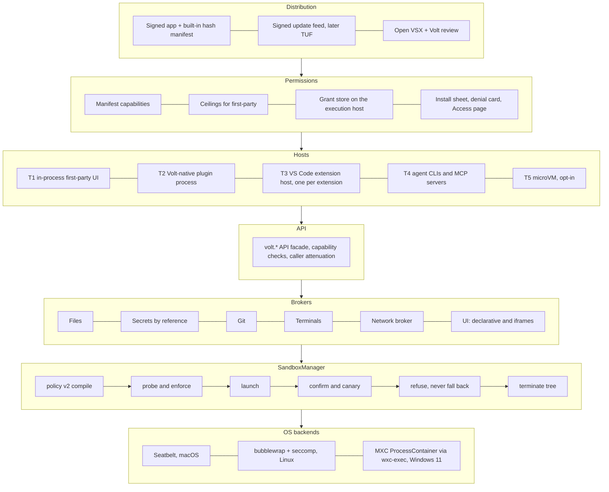

# PRD: Volt sandbox and plugin platform

Status: draft for the user's decisions (§16). Date: 2026-11-08.
Written by the orchestrator (Opus 5.5) from five proposals and their round-2 critiques in this folder:
- `grok`: Grok 4.7, Cursor.
- `claude-a` and `claude-b`: Opus 5.5, Claude Code.
- `sol`: GPT 5.6 Sol, Cursor.
- `terra`: the build-plan seat. GPT 5.6 Terra (Codex) failed in both rounds, and Opus 5.5 took over each time.

The brief they worked from is [`00-brief.md`](00-brief.md). The full arguments are in [`proposals/`](proposals/) and [`critiques/`](critiques/). §17 records each dispute and how it was settled.

How to read citations:
- `main:` is this checkout (Volt 0.0.6, VS Code 1.105.1, Electron 37.6.0).
- `sbx:` is the unmerged branch `feat/volt-sandbox`.
- I checked every code fact marked **verified** myself while writing this. **Guess** marks what nobody verified.

---

## 0. Summary

**What we are building.**
- Every way untrusted code runs in Volt goes through one `SandboxManager`, which turns a policy into an OS sandbox:
  - agent CLIs and the commands they run;
  - MCP servers;
  - extension hosts;
  - Volt-native plugins.
- Seatbelt on macOS, bubblewrap + seccomp on Linux, Microsoft MXC on Windows.
- Volt's own network broker enforces hostname rules on every OS.
- Volt's features become plugins with declared capabilities. Third-party plugins and VS Code extensions run in per-plugin sandboxed hosts with permissions the user can see and revoke.

**What changed from the original ask, and why.** All five models agreed on both changes:

| You asked for | The PRD does | Why |
|---|---|---|
| "First migrate everything into plugin extensions, then build the sandbox" | **Parallel tracks.** Harden and merge the existing sandbox *now* (it protects against today's real threat: prompt-injected agents and MCP servers). Migrate the *boundary* (API facade, manifests, contribution points) in parallel. **No code moves out of process until its host can be sandboxed.** | Moving code into today's extension host first would put Volt's features in a process with *more* exposure than `contrib/`: the unsandboxed `cp.fork` / `utilityProcess` host shared with third-party extensions (`grok` §6). |
| "Volt's internal plugins allow all by default, by signing" | **Signed ceilings, auto-granted, still enforced.** Each first-party plugin declares its capabilities. A per-plugin ceiling table compiled into the core binary caps them. Volt's signature grants `requested ∩ ceiling` with **zero prompts**. | Same zero friction. But a bug in a first-party plugin (for example agent-written HTML in Visuals, or a PR body parsed by Pull Requests) or a stolen plugin key reaches only that plugin's ceiling, not your whole account. Android does the same for privileged system apps (`claude-b` §7.3). |

**The stack:**



**The rules everything else follows:**
1. **Refuse, never fall back.** If a policy can't be enforced, the run is refused. A failed check never offers an override button. Running unsandboxed is a separate, deliberate control (the chat's sandbox level `Off`), recorded and shown in the status bar (`grok` critique, objection 6).
2. **Identity comes from the launcher, never from the workload.** One principal per process or channel. No payload-supplied ids, no shared hosts for untrusted code.
3. **Two independent layers on every critical path.** At least one is not a user prompt.
4. **Loopback is not authentication.** Every Volt listener authenticates every request.
5. **Signing proves origin, not correctness.** It grants a bounded ceiling, never "everything".
6. **The machine that runs the code decides.** The web workbench and the phone propose grants; the execution host enforces them.

---

## 1. Goals, non-goals, success metrics

**Goals:**
- **G1.** No untrusted workload runs without an OS sandbox the backend has *confirmed*. Untrusted means agent CLIs, model-run commands, MCP servers, third-party extensions and plugins. The exception is an explicit, recorded user override.
- **G2.** "Everything is a plugin" for lifecycle and contribution. Every Volt feature has a manifest, declared capabilities and an on/off switch, and can be replaced through slots.
- **G3.** Isolation is honest. Every host shows its real state: `Sandboxed`, `Partial (dims)`, `Not sandboxed (reason)`. No UI shows a level the backend can't enforce (finding F-16).
- **G4.** Zero prompts for Volt's own plugins. Third-party plugins prompt rarely and in context.
- **G5.** Building for the sandbox is as easy as writing a VS Code extension. The Android SDK Runtime was retired on 2025-10-17 for low adoption; we must not repeat that.

**Non-goals for v1:**
- TLS interception.
- UDP for plugins.
- A per-session VM by default.
- Sandboxing the user's own terminal and git.
- Sandboxing deep-UI first-party features out of process. Those are browser, scratch, visuals, devices, computer use and customize; see §8.

**Metrics:**
- 100% of agent, MCP and third-party launches go through `SandboxManager`. Enforced by the spawn-audit CI gate.
- 0 confirm-canary failures across beta for 7 days before any stable promotion.
- Less than 2% "Run outside sandbox" overrides among the top 200 extensions before the default flip.
- Every adversarial case in §13 passes on every supported OS row.

---

## 2. Threat model

**Assets:**
- Credentials (`~/.ssh`, cloud CLIs, keychain, `.env*`, provider tokens).
- Volt's own secrets: the agent-server token, the host MCP HMAC secret, pairing and device tokens, `~/.volt/**`.
- Code that runs later: git hooks and config, shell rc, `.vscode/tasks.json`, `.mcp.json`, and **build-entry files** (`package.json` scripts, `Makefile`, `build.rs`, `.cargo/config.toml`, `.github/workflows/**`).
- Volt's privileged positions: macOS TCC grants (Accessibility, Screen Recording, Microphone), the update channel, the ability to start unsandboxed processes.
- Other chats and transcripts.
- Release keys.
- Availability and money (agent tokens).

**Attackers:**
1. Prompt injector and malicious model output. The most frequent.
2. A malicious third-party extension. GlassWorm, 2025-10: self-propagating via stolen npm and GitHub tokens.
3. A compromised third-party publisher or registry (Open VSX CVE-2025-6705).
4. A compromised first-party supply chain (CI, a dependency, the feed branch).
5. A malicious repository.
6. A network attacker.
7. A malicious MCP server.
8. A buggy first-party plugin used as a confused deputy.
9. A stolen paired device or token.

**Trust boundaries:**
- User ↔ core TCB.
- Core ↔ every plugin host, first-party included.
- Plugin ↔ plugin.
- Volt ↔ agent and MCP process trees.
- Sandboxed anything ↔ Volt's listeners and helpers.
- Workspace content ↔ anything that executes it later.
- Volt ↔ network.
- Volt's build ↔ users.
- Client (web, phone) ↔ execution host.

**Out of scope:**
- Malware already running unsandboxed as the user.
- Kernel, hypervisor and CPU 0-days. We still shrink the surface with seccomp and deny-default profiles.
- Physical access.
- Exfiltration through the agent's own provider channel. We limit what it can read instead.
- A compromised OS signing chain.

**The finding that shaped the design** (verified):
- `MainThreadSecretState.$getPassword(extensionId, key)` takes the extension id **from the extension host's RPC payload** (`main:src/vs/workbench/api/browser/mainThreadSecretState.ts:38-44`).
- So inside any shared extension host, one extension can read another's secrets with the OS sandbox fully intact.
- This decides host granularity (§3): untrusted code never shares a host.

---

## 3. Trust tiers and host model

| Tier | What | Runs where | Isolation | Who grants |
|---|---|---|---|---|
| **T0 core (TCB)** | Chats, queue, subagents, run groups, questions, worktrees, terminals, workspace context, images (`main:voltFeatures.ts`, entries with no `extensionId`); `SandboxManager`; brokers; API facade; grant store; loader and signature checks; feature catalog and enablement; installer; ACP and Codex app-server clients; pairing and tokens | Renderer, Electron main, volt-server | It *is* the monitor; kept small | n/a |
| **T1 first-party in-process UI** | **Only** browser, scratch board, visuals, devices, computer use, customize, plus the *UI half* of other first-party features (views that render data the out-of-process logic returns) | Renderer, lazy-loaded | Facade + import lint + lazy load. This is **not a sandbox**; it is labelled trusted core code. Agent-authored content it shows (HTML, charts, diagrams, PR bodies) is parsed in an opaque-origin iframe or worker, never on the renderer main thread | App signature + built-in hash manifest |
| **P1-H native helpers** | Computer use, speech, device hub, tunnels, code index | Own process launched by core | Its own OS profile where TCC allows; authenticated RPC over an inherited fd or peer-credential check | Core, per helper |
| **T2 Volt-native plugin** | First-party *logic* (memory, usage, provider probes, automations scheduler, PR/commit-review services, agent-resources reader, code intelligence) and third-party Volt plugins | **One OS-sandboxed process per plugin principal** on the execution host. Empty OS profile: no fs except its bundle, no network, no spawn. SES `lockdown()` inside. RPC on an inherited fd, opened only after confirm. Plugins whose capabilities are all `low` and identical may share a process | OS sandbox + SES + API capability check | Ceiling (first-party) or user grant |
| **T3 VS Code extension** | Open VSX extensions | **One sandboxed `bootstrap-fork` host per extension** on volt-server. Desktop routes to the local server. Extensions with only a `browser` entry go to the web-worker host. Extensions with no `main` (themes, grammars) need no host | OS sandbox + network broker + core-owned webview CSP | Inferred default + user grants + signed presets |
| **T4 processes** | Agent CLIs, stdio MCP servers, language servers, tasks | `SandboxManager` long-lived principal each | OS sandbox + network broker | Chat settings / server profile + user |
| **T5 VM** | Opt-in strict mode | microVM per session | Hardware virtualisation; same broker protocol | User |

**Rules:**
- **Electron main runs no plugin code, ever.** Its Volt services (`platform/volt*/electron-main`) are brokers.
- **The renderer runs no third-party code outside iframes.**
- **UI in, logic out.** First-party features split a T1 view from T2 logic wherever the feature has non-trivial logic. This settles the claude-a / claude-b / terra dispute:
  - deep UI can't leave the workbench without webview rewrites (`terra` critique O1);
  - logic shouldn't stay in-process, because facade + lint contain mistakes, not compromise (`sol` O10, `claude-b`).
- **No pooling of mutually untrusted code.** Memory is managed by lazy start and idle stop (5 min). If the process budget is exhausted, Volt refuses with a message; it never co-hosts (`sol` O4, `claude-a` O4, `claude-b` O2).
- **The sandboxed extension host is a new host kind.** VS Code's built-in extensions (git, TypeScript, …) stay in the existing host until the git and file brokers exist. Wrapping the shared `/code/` host first would break `git push` over ssh (`terra` O2).
- **`MainThreadSecretState`, `MainThreadAuthentication` and every `MainThreadVolt*`** take the caller id from the connection and reject a mismatched payload id.

---

## 4. SandboxManager core

Keep `sbx:`'s shape: `prepare/run/dispose`, `IPreparedSandbox`, `ISandboxBackend`, fail-closed `SandboxUnavailableError`. Extend it as follows.

### 4.1 API

```ts
export interface IVoltSandboxService {               // node, on the execution host (volt-server or Electron main)
  capabilities(): Promise<ISandboxBackendReport>;    // real trial per backend; cached per (backend, OS build, binary hash)
  run(req: ISandboxRequest, o?: ISandboxRunOptions): Promise<ISandboxRunResult>;   // one-shot; never throws, refusal = status
  start(req: ISandboxHostRequest): Promise<ISandboxedProcess>;                       // long-lived; resolves only after confirm + canary
  readonly onDidChangeStatus: Event<ISandboxStatusChange>;                           // UI, attestation, telemetry
  list(): readonly ISandboxedProcessInfo[];                                          // Settings → Security
}

export interface ISandboxPrincipal {                 // minted by the manager; the workload never names itself
  readonly id: string;                               // random 128-bit
  readonly kind: 'agent' | 'mcp' | 't2-plugin' | 't3-extension' | 'helper' | 'task';
  readonly packageId?: string; readonly packageDigest?: string; readonly signer?: string;
  readonly parent?: string;                          // attenuation chain
}

export interface ISandboxHostRequest extends ISandboxRequest {
  readonly principal: ISandboxPrincipal;
  readonly fork?: { modulePath: string; execArgv: readonly string[] };   // NODE_CHANNEL_FD assigned by the launcher, last
  readonly restart?: { maxPerMinute: number };                           // crash loop → stays down; never restarts looser
}

export interface ISandboxedProcess {
  readonly principal: ISandboxPrincipal;
  readonly backend: 'seatbelt' | 'bubblewrap' | 'mxc';
  readonly status: 'initialized' | 'partial';
  readonly unenforced: readonly SandboxDimension[];
  readonly evidence: string;                         // redacted confirm evidence, kept for attestation
  readonly launchPolicyHash: string;                 // immutable: mounts, env, process, IPC
  readonly brokerGrantEpoch: number;                 // mutable: network + broker handles
  grant(g: ILiveGrant, expectedEpoch: number): Promise<'applied' | 'needs-restart' | 'stale'>;
  revoke(grantId: string): Promise<void>;
  relaunch(reason: string): Promise<void>;           // widening that the OS profile can't take live
  terminate(reason: string): Promise<void>;
  readonly onDenial: Event<ISandboxDenial>;          // {denialId, principal, dimension, target, reason}
  readonly onExit: Event<{ code: number | null; signal: string | null }>;
}
```

### 4.2 Policy schema v2

v1 stays parseable forever and is read as generation 0.

**v2 adds:**
- **`targetPolicy`.** Like Android's targetSdk:
  - a plugin declares the policy level it was built for;
  - new restrictions apply at `targetPolicy ≥ N`;
  - security fixes apply to everyone;
  - `product.json` `minimumTargetPolicy` rises over time, and plugins below it stop loading with a clear message.
- **`principal`.** Filled by core only.
- **`network.mode`:** `none | broker | host`.
  - `host` is critical class: first-party or explicit user choice only, and on Windows and macOS it still denies Volt's own ports.
  - Plus `network.local: none | ask | allow` and `network.loopbackPorts`.
  - `network.udp` is reserved; only `none` in v1.
- **`filesystem.brokerWrites`:** no writable bind at all; writes go through the file broker. This is the default for untrusted writers.
- **`ipc.volt`:** which Volt channels the host may open (`extHost`, `hostMcp:<session>`). Replaces ad-hoc socket grants for Volt's own sockets.
- **`process.spawn: any | none`.** `none` for T2. **This is new enforcement, not something the branch has** (`grok` critique, objection 2):
  - the branch's seccomp filter is a denylist that allows `execve`;
  - the Seatbelt profiles allow `process-exec` / `process-fork`.

  `none` needs a seccomp `execve`/`execveat` deny installed after the initial exec, plus `(deny process-exec process-fork)` on macOS and a job-object active-process limit of 1 on Windows. It is a dimension the parent must confirm. If it isn't confirmed, the host fails to start; it is never reported `partial`.

**Never in the OS policy:**
- An `audit` field. bubblewrap and MXC can't audit, and Seatbelt `(with report)` allows everything.
- Audit / report mode exists **only at the API capability check** (`claude-a` O1, `claude-b` O6).

**Environment** (fixes `grok` E12, **verified**):
- Today untrusted `env.set` checks only reserved and injection names (`sbx:sandboxComposition.ts:224-232`). An untrusted repo policy can therefore set `VSCODE_EXTHOST_IPC_HOOK`, because `isReservedEnvName` covers only proxy and `VOLT_SANDBOX*` names.
- v2:
  - untrusted `env.set` also drops `isSecretEnvName` names;
  - a launcher-owned **reserve list** that no layer may set: `NODE_CHANNEL_FD`, `NODE_OPTIONS`, `VSCODE_EXTHOST_IPC_HOOK`, `VSCODE_EXTHOST_WILL_SEND_SOCKET`, `VSCODE_WILL_SEND_MESSAGE_PORT`, `VSCODE_IPC_HOOK*`, `ELECTRON_RUN_AS_NODE`, proxy variables;
  - the launcher writes them **last**;
  - the variables `bootstrap-fork` needs are computed by core from a fixed list. To confirm against `bootstrap-fork.ts` in the host PR; a test diffs the host's `process.env` against the list;
  - **the wrapper gets its own environment** (`grok` critique, objection 8, checked):
    - `sandboxResolver.ts:272-280` (sbx) applies `policy.env.set` and the caller's `context.env` with a reserved-only check. So a provider launch spec or a repo policy can put `VSCODE_EXTHOST_IPC_HOOK` or `NODE_OPTIONS` into the workload.
    - On Linux the branch already spawns `bwrap` with `env: {}` (`bubblewrapBackend.ts:338`), so loader variables can't reach the wrapper there.
    - The rule matters for `sandbox-exec` and the future `wxc-exec`, which run as the user before the sandbox exists.

    Rule:
    - every wrapper is spawned with a Volt-built minimal environment;
    - the workload's variables reach the workload only through the wrapper's own channel (bwrap `--setenv` on a pipe, which the branch already uses; the equivalent for Seatbelt and MXC);
    - injection and secret names are dropped from `context.env` as well as from `policy.env.set`.

### 4.3 Composition

```
floor (core, deny-only)
  ∩ tier base
  ∩ (first-party ceiling | user grants)
  ∩ caller policy            ← attenuation: a plugin acting for a chat gets plugin ∩ chat
  ∩ admin/MDM layer          ← narrow-only cap, wins over the user
  ∩ repo layer               ← untrusted, narrow-only, trusted workspaces only
  ∩ request layer            ← narrow-only
```

**The floor** applies to every profile, first-party included, from day one:
- credential paths and `.env*`;
- `~/.volt/**` except the principal's own storage;
- the app bundle and helper folders;
- Volt's listeners and sockets;
- LaunchAgents, systemd user units and Run keys;
- signals to processes outside the same sandbox;
- escape mach services (cfprefsd, appleevents, windowserver, pasteboard, launchservicesd).

`compile()` is a pure function in `common/`, property-tested for these invariants:
- `out ⊆ caller`;
- untrusted layers never widen;
- the floor is present in every output;
- first-party output ⊆ ceiling.

### 4.4 Lifecycle

**probe → enforce → resolve → broker setup → launch → confirm → refuse → terminate.**

`sbx:` already does this for one-shot runs. Additions:
- **Probe** is a real trial per backend, cached per backend × OS build × binary hash, and re-run after an OS update. A probe result is `available | unsupported | broken`.
  - `unsupported` means the platform can't do it; this is known before launch and the attacker can't influence it.
  - `broken` means the trial didn't match the policy. That always refuses for the session.
- **Confirm** needs evidence from outside the workload:

  | Backend | Evidence |
  |---|---|
  | Seatbelt | ready line on fd 3 |
  | bubblewrap | JSON status with fresh namespace inodes, plus `NoNewPrivs:1 Seccomp:2` from inside |
  | MXC | container SID / id and WFP filter in the status |

  Long-lived hosts also run a **canary** before they get any work: a direct connect to a public IP and a read of a sentinel credential file must both fail. Otherwise the host is killed.

  The canary runs **in the launcher prologue, before any workload code**, and reports on the status fd, which the parent reads. It carries the same trust as the ready line. A canary the workload runs and reports itself is worthless, because the workload can lie (`grok` critique, objection 6).
- **The channel opens only after confirm.** Core accepts no RPC on a host's fd before then.
- **Terminate kills the whole tree.**
  - Linux: pid namespace with `--die-with-parent`.
  - macOS: process group + parent-chain walk + run tag, plus a reaper for `setsid` double-forks (spike). Until the reaper passes, `process.tree` stays `partial`.
  - Windows: job object with kill-on-close and no breakaway.

**The fallback rule** settles `claude-a` O2 against `terra` O8:

| Situation | Untrusted (agents, MCP, third-party) | First-party T2 logic |
|---|---|---|
| Platform `unsupported` (Windows below the MXC floor, Linux without userns or bwrap) | Refuse. The user can set a chat's sandbox level to `Off`, a separate, recorded control. Third-party plugins don't run | **Asked once per machine** at first launch: "This system can't sandbox Volt's own plugins. Run them as before, without a sandbox?" On yes, they run **in-process as T1**, labelled `Not sandboxed (OS unsupported)`, which is exactly today's exposure. On no, those features are off. Decided from the probe, never per launch |
| Probe `broken`, confirm failed, canary failed | Refuse, kill. **No override button** | **Refuse, kill. Never fall back** (a failed confirm can be attacker-induced, e.g. by filling `$TMPDIR`) |

How the two critiques were reconciled:
- `claude-a` showed that refusing outright removes features that work today on every Windows 10 machine.
- `grok` and `terra` showed that an *automatic* fallback is the F-01 pattern.
- Asking once, explicitly, on a platform that is unsupported by fact, satisfies both.

The dual build applies only to the first-party T2 logic modules (memory, usage, provider probes, a few services). Both bindings run the same test suite in CI to stop drift.

### 4.5 Live grants

**Only the network widens live.** Seatbelt profiles are fixed at `sandbox_init`, and bwrap mounts at clone.

| Grant | Live? | Mechanism |
|---|---|---|
| Network host | Yes | Broker rules on the principal, compare-and-swap on `brokerGrantEpoch`. Revoking closes matching tunnels |
| Local network | Yes | Same, `network.local` |
| File or folder | Through the broker | A picker or handle; the core opens with no-follow flags and passes the fd |
| Workspace write, exec, sockets, loopback port | No | `relaunch()` with the new policy; the UI says so |

- The launch key is `launchPolicyHash` only. It excludes network grants (`sbx:` already does this deliberately at `sandboxPolicy.ts:522-530`).
- Network grants never restart a process (`claude-b` conceded this in round 2).
- **The live bug to fix first** (verified): `allowSandboxDomains` (`sbx:voltStdioService.ts:219`) has no caller in the window, so "Allow host" saves the setting but the running proxy never hears about it.

---

## 5. Backends per OS

| OS | Backend | Minimum | Refuses when |
|---|---|---|---|
| macOS | Seatbelt via `/usr/bin/sandbox-exec`. Deny-default for plugins and MCP; the agent profile's `(allow default)` stays a labelled weaker tier with explicit denies. Plan a signed `sandbox_init` helper in case Apple removes `sandbox-exec` | The probe trial, not a marketing version. CI on macOS 15 + newest (26.x); tested on 26.6 | A trial write succeeds |
| Linux | bubblewrap ≥ **0.8** (`--disable-userns`) + TS-generated seccomp + socat bridge holder. **No Landlock fallback.** main's old helper (`main:voltSandbox/common/landlock.ts:12-21`) keeps reads open, has network only on ABI 4, and runs the agent unsandboxed with a warning when Landlock is missing. C1 removes it (`grok` critique, objection 3) | x64/arm64 (the seccomp tables), unprivileged userns. Ubuntu 24.04+ needs an AppArmor profile for bwrap or the sysctl; the probe names the fix | bwrap missing or old, userns blocked, other architecture, bridge tools missing when `broker` network is needed |
| Windows 11 | **MXC ProcessContainer via pinned `wxc-exec.exe`**, Authenticode-checked (`WinVerifyTrust`) plus a pinned hash. Not the Node SDK, which needs Node 24; Electron 37.6.0 ships Node 22 | 24H2 26100.9278+, 25H2 26200.9278+, 26H2 26300.9550+, 26H1 28000.2804+ | Below the floor; trial mismatch; confirm or canary failure |
| Windows 10 / older 11 | **None in v1.** Refuse + "Run outside sandbox" per chat | n/a | Always |

**Windows chooser** (`grok` §4.1, with round-2 corrections). The image class is decided **before** launch:
- `wsl.exe` → refuse. It starts a VM outside the sandbox.
- MSYS2 / Git Bash / Cygwin → refuse with the `0xC0000005` reason and offer PowerShell.
  - This is the srt PR #766 crash under MXC.
  - Agents on Windows often use Git Bash, so a **Git Bash smoke test is a C4 acceptance criterion**.
- PE → MXC.
- A broken MXC trial → refuse for the session. Never another backend.

**The srt-win style sandbox-user backend is not in v1.** Grok's version shared one SID across all sandboxes, so file-access entries from chat A let chat B write A's project, and it needs a SYSTEM service (`claude-b` O8, `sol` O5). If built later, it needs:
- a **run-unique SID** in a restricted token;
- file-access entries removed when the job closes, plus a startup sweep;
- no SYSTEM service;
- its own threat model.

**Windows network route (open risk).** AppContainer normally blocks loopback; an exemption is usually an admin operation (**guess**). The srt PR notes that proxy routing under MXC is guaranteed only by 25H2 behaviour. So:
- the design starts with **one proxy port + a per-principal `Proxy-Authorization` token** on Windows;
- per-principal routes come only if the C4 trial proves them;
- the canary is the release gate for each Windows build.

**Escape catalogue.** `grok` §4.4 E1–E18 is adopted as the acceptance list. Each item has a test that fails if its mitigation is removed:
- loopback services;
- the VS Code IPC socket;
- `utilityProcess`;
- the macOS double fork;
- DNS;
- rebinding;
- DoH and domain fronting;
- `/proc`;
- symlink/TOCTOU;
- abstract unix sockets;
- `(allow default)`;
- env injection;
- Windows broker binaries;
- time-shifted hooks;
- DLL search order;
- cross-sandbox proxy reuse;
- setuid bwrap;
- `host` mode.

---

## 6. Network broker

Replace "one HTTP proxy with a mutable list" with a `NetworkBroker` on the execution host (`sol` §5).

**Identity:**
- Each principal gets its own route: on Linux, its own unix-socket bridge in its network namespace; on macOS, its own loopback port allowed only in its Seatbelt profile; on Windows, see §5.
- A manager-minted token authenticates setup.
- Caller-supplied ids are ignored.
- T2 plugins have **no socket at all**; they use `volt.net.fetch` over RPC.

**Protocols in v1:** HTTP forward and CONNECT only, which is what the branch proxy already does. No SOCKS5, no UDP (so QUIC falls back to TCP), no raw sockets.
- SOCKS5 CONNECT comes later behind its own adversarial corpus. It is the path for non-HTTP TCP clients.
- SOCKS5 UDP ASSOCIATE is out. Its datagram header carries a second destination that the TCP grant never named (`grok` critique, objection 7).

**Hostname rules:**
- IDNA-normalised exact host.
- `*.x` matches descendants only, and never a public suffix (bundle the PSL).
- No port means 443 (and 80 only for an explicit `http://` grant).
- IP literals need an IP rule.
- Redirects are re-checked.

**DNS:**
- The broker is the only resolver. The workload gets no answers.
- Every A/AAAA result must be public.
- Each connection does exactly **one** lookup and connects to the address it checked (`sbx:sandboxProxy.ts:110-126`). No TTL cache and no connect-by-name, so the check and the connect can't drift apart (rebinding).
- Port 53, DoH and DoT are ordinary denied traffic.
- On macOS, deny the `mDNSResponder` and `dnssd` mach services outside `host` mode (closes the `sbx:` gap).

**Three separate permissions:**
1. `net.loopback.connect` to one manager-issued port.
2. `net.local.connect` to an exact private IP or CIDR and port, with a "devices on your local network" grant. This copies Android 17's `ACCESS_LOCAL_NETWORK`, which is enforced for API 37+ apps in the network stack (verified at developer.android.com).
3. Public `net.connect`.

Cloud metadata (`169.254.169.254`), link-local, CGNAT, multicast and NAT64-private are **always** denied.

**TLS:**
- Pass-through and opaque: no interception, and no ClientHello parser.
- The proposed "SNI must equal the CONNECT host" check is dropped. It doesn't stop fronting behind a shared CDN, and the parser is new attack surface (`grok` critique, objection 8).
- Domain fronting through an allowed CDN is a documented residual risk.
- CDN, paste, webhook, tunnel and object-storage hosts are on an **exfil-capable list** that needs the high-class grant flow.

**Denials and approval:**
- A denial is `{denialId, principal, epoch, destination, reason}`.
- The card offers Allow once / this session / project / always, or Refuse.
- Approval sends `denialId + expectedEpoch`. The broker re-derives the rule from its recorded denial, so a client can't substitute a host.

**Special identities:**
- `mcp-http:<configDigest>` for remote MCP.
- `package-fetch:<lockDigest>` for package installs: a registry plus artifact origins and checksums.
- No `npx -y` outside containment.

---

## 7. Brokers instead of raw access

| Resource | Broker | Rule |
|---|---|---|
| Files | `volt.files`: picker = grant; the core holds a directory fd and opens with `openat2(RESOLVE_BENEATH\|RESOLVE_NO_SYMLINKS)` on Linux, `O_NOFOLLOW` + path recheck on macOS, and refuses reparse points on Windows | Credential and protected lists enforced in the broker too. A hard-link scan at launch is bounded (20k files); past the cap the run is `partial` |
| Secrets | `volt.secrets.ref(key)` + `volt.net.fetch(url, {auth: ref})`: the broker injects the header, so the plugin never sees the value. Raw `secrets.read` is critical class | Namespaced per principal |
| Git | `volt.git`: runs git with `-c core.hooksPath=<empty> -c core.fsmonitor=`; hooks run only for the user's own actions | Push needs `git.push`, prompted per repo |
| Terminals | `volt.terminals.run`: always under the **caller's** attenuated policy | The user's own terminals are outside |
| Clipboard | Write is free; read needs a gesture in the last second + `clipboard.read` | |
| UI | Declarative trees rendered by core (`WorkbenchList`, `createVoltButton`, `createVoltDropdown`), then iframes for rich panels. Opaque origin, CSP without `connect-src`, `postMessage` only | No workbench DOM, ever |
| **Webview egress** (`claude-b` O1) | Core writes the CSP for every T3 webview; `connect-src`, `img-src`, `frame-src`, `form-action` and `font-src` are limited to the extension's granted hosts. Electron main filters webview requests by frame origin → extension id (**guess** on the mechanism). `openExternal` / `asExternalUri` to a host without `net.connect` shows Volt's own confirm with the full URL, a length cap and a budget | Until the filter ships, attestation shows "webview egress: partial". Without it, "network none" for T3 is not true (verified: `main:mainThreadWindow.ts:69` opens with `fromExtension: true`) |
| **Build-entry guard** (`grok` E14 + `claude-b` O4) | Snapshot hashes of hooks, tasks **and** build entries (`package.json` scripts, `Makefile`, `build.rs`, `.cargo/config.toml`, `pyproject.toml` build-system, `.github/workflows/**`) when a sandboxed writer starts. Before Volt itself runs a task, install or commit, changed entries show a diff and wait | The user's own terminal stays out of scope; the card says so once |

---

## 8. Migration: features into plugins

**Definition of done per feature:**
1. Its manifest is the source of truth: tools, commands, settings, slot items, surfaces, dock sections, providers, all in Volt contribution points.
2. It activates through `IVoltPluginContext`.
3. It imports only `base/`, its own broker interfaces, the facade and the UI kit. Enforced by an import-pattern lint.
4. Its manifest capabilities are tested: activation under exactly those grants hits no denial.
5. Disabling really unloads its code.
6. Its ceiling entry lands in the same PR.

**API surface:** `claude-a` §6.2's 21 namespaces, shipped in `terra`'s v0 order:
- first: tools, chats/agents, storage, secrets-as-refs, providers, ui (declarative + panels);
- then: context, git, hosting, files, terminals, net, browser, devices, automations, usage, hooks, commands.

Rules:
- Tool **schemas** come from the manifest, so an agent's tool list is complete before lazy activation.
- `commands.execute` of foreign commands is never granted by default (`workbench.action.terminal.sendSequence` is an escape).

**Where the code lives** (`terra` O1, `claude-a` §6.4):
- First-party in-process code stays in the workbench, split into `contrib/volt<Feature>/`.
- The manifest in `extensions/volt-*` points at it with `voltModule`, honoured only for `publisher: volt` built-ins whose hash matches.
- Code moves into `extensions/volt-*/src` only when it is T2-shaped.
- Built-in extensions compile separately and can't import workbench code.

**Providers are signed data, not code** (`sol` O7, `claude-a` O3). `contributes.voltAgents[]` holds:
- a bare binary name, resolved and pinned by core and shown on the install sheet;
- an argument template with core-defined substitutions only;
- API hosts and a state directory;
- declarative auth probes and model listing.

Core launches the CLI through `SandboxManager`. A third-party provider gets its own profile, not the shared agent profile. A provider never returns an arbitrary `{command, args}` spec.

**Tier per feature:**

| Extension | End state | Notes |
|---|---|---|
| provider-claude, -codex, -cursor, -grok, -opencode, -pi, -antigravity, -kimi, -muse, -fx | Data + declarative probes | Parity test: contributed definitions deep-equal `CLI_AGENT_DEFINITIONS` (`main:cliAgents.ts:402`) |
| provider-local, -openrouter | T2 model providers | `local` needs `net.loopback.connect` to 11434/1234 |
| memory | **T2 first** (tools + storage, no UI) | The first real T2 plugin. `agents.context` output is labelled by source and capped |
| usage | T1 page + T2 logic after the secrets broker | Today OAuth tokens are fetched in Electron main (`main:platform/voltUsage/electron-main`); never raw tokens in T2 |
| agent-resources | T1 views + T2 reader (scoped read of harness dirs, never credentials) | |
| code-intelligence | T1 settings + P1-H index child (fs read workspace, write `${storage}/index`, no network) | |
| git-graph | T1 editor pane + git broker | A webview rewrite isn't worth it |
| pull-requests, commit-review | T1 UI + T2 services; split `voltAgent/browser/pullRequests/` first | |
| automations | T1 pages + T2 scheduler on volt-server | Shell nodes run attenuated to the automation's sandbox |
| skills-and-plugins | T1 marketplace UI; **the installer and verifier stay core** | `claude-a` O7: the TCB must not sit under the thing it administers |
| customize | T1 pages; **the feature catalog, enablement and look engine stay core** | |
| claude-accounts | Core broker / P1-H (writes `~/.claude*` under Claude's locks) | |
| remote-devices | T1 Devices page; **pairing, tokens and tunnels are core** | |
| browser, scratch-board, visuals, devices, computer-use | **T1 in-process, fence-only** (user decision D5) | Agent-authored content renders in iframes or workers. Computer use keeps TCC attribution through its helper |
| playgrounds | T1 + browser broker | |

**Order:** see §14 Track M. The first step is the facade in report mode plus providers as data. Nothing first-party enters an out-of-process host before that host is sandboxed (Track C5–C6). Each PR is one feature and revertible, and lands with its manifest, ceiling and capability test.

**Prerequisite:** a server-side enablement mirror. Today, a feature disabled in the window keeps its tools on volt-server (`customize.md` §6.1d).

---

## 9. Signing and trust

**First-party: signed ceilings** (replaces "allow all"):
- Each first-party plugin declares `voltCapabilities`.
- A **ceiling table** `pluginId → max capabilities` is compiled into the core binary and owned through CODEOWNERS.
- **CI fails if a manifest ⊄ its ceiling** (`terra` O10). A load-time check is only a tamper backstop.
- Volt's signature grants `requested ∩ ceiling` with **no prompt and no install sheet**.
- Widening needs a core release. That is a two-key rule: a stolen plugin key alone can't widen.
- Critical capabilities (`desktop.control`, `screen.capture`, `secrets.manage`) exist only for P1-H helpers and still need per-chat approval when acting for an agent.
- First-party rows appear in the Access page as "Granted by Volt" and can be switched off.

**Built-ins:**
- Trusted by app signature + a `builtin-manifest.json` of file hashes checked at load.
- A tampered built-in is refused.
- `voltModule` (in-process code) is honoured only for built-ins, **never** for anything downloaded.
- **v1 has no out-of-band first-party plugin updates.** Built-ins ship with the app.

**Distribution, in this order** (the cheap parts are urgent; verified gaps on `main`):
1. **S1.** Move signing secrets into a protected GitHub `release` Environment with required reviewers.
   - Today every release workflow uses `secrets: inherit` with no `environment:`: `volt-stable.yml:30,43`, `volt-beta.yml:29`, `volt-nightly.yml:46`, `volt-build.yml:599`.
   - Also: split build from signing, pin actions by SHA in signing jobs, add artifact attestations.
2. **S3.** Sign the update feed with a pinned Ed25519 key, separate keys for nightly and stable.
   - Today the feed is unsigned JSON on the `volt-update-feed` branch (`build/volt/release/publish.mjs:9`), and the sha256 comes from the same feed.
   - Builds without certificates are ad-hoc signed on macOS (`darwin-package.sh:43-51`) and unsigned on Windows (`win32-sign.ps1:15-16`).
3. **Later, when the marketplace or out-of-band plugin updates ship:**
   - TUF roles: offline threshold root, a targets key in KMS behind the protected Environment, a revoke-only key, short timestamp expiry;
   - threshold-2 first-party plugin targets with an independent rebuilder of reproducible esbuild bundles.

   With one maintainer today, a 2-of-3 offline root is theatre (`terra` O6). Deferring it is honest.

**Third-party:**
- Open VSX signatures where present, plus signer pinning (TOFU). **A signer change drops all grants.**
- Updates that widen capabilities never auto-install.
- A 72-hour auto-update cooldown (setting).
- Unsigned gallery entries currently return `NotSigned` instead of failing (`extensionDownloader.ts:73-75`). Change that to refuse unsigned updates of a previously signed extension.

**Reserved namespace.** `volt.*` ids load only with a first-party signature; otherwise they are refused. First-party updates never come from the gallery. Claim the `volt` namespace on Open VSX.

**Dev and unsigned:**
- Packaged builds honour no dev flags.
- Developer mode lives in Volt user data, not `settings.json`, and shows a persistent badge.
- Unsigned or unpacked plugins load **as third-party**, never T1.
- Playground drafts with code install as publisher `local`, third-party tier, with a sheet. An agent may have written them.

**Security switches** (`claude-b` O7):
- Every switch lives in Volt user data (`~/.volt/trust/`, denied to every sandbox), or is an `APPLICATION`-scoped setting that workspaces and remotes can only **narrow**. That covers sandbox mode, the Windows backend, sandboxed hosts and unsigned plugins.
- Otherwise a cloned repo's `.vscode/settings.json` could turn the sandbox off.

**Kill switch.** A remote or feed switch can only move a tier from `enforce` to `ask`, never silently to off (`terra`). It does not ship before the feed is signed (S3). On an unsigned feed, a network attacker would hold the switch (`grok` critique).

**Revocation.** A signed list. When metadata is stale beyond its expiry, first-party plugins lose *silent* high and critical grants (they prompt instead); nothing is bricked. Revoked means disabled, never deleted.

**No Electron fuse changes in this programme** (`terra` O5, verified):
- volt-server starts with `ELECTRON_RUN_AS_NODE: '1'` (`agentServerLauncher.ts:168`), so turning off `RunAsNode` breaks every chat.
- `--disable-sigusr1` goes on packaged volt-server and Node hosts only after a test under `RUN_AS_NODE`.
- `grok` and `claude-b` also want `EnableNodeCliInspectArguments` and `EnableNodeOptionsEnvironmentVariable` off in release builds. That is a separate, evaluated item, because it breaks `--inspect-extensions` and the team's agent-server inspector debugging. The listener floor and the signal deny already block a sandbox from reaching an inspector.

---

## 10. Permissions model and UX

**Manifest:**

```jsonc
"contributes": {
  "voltCapabilities": {
    "targetPolicy": 2,
    "required": [ { "id": "net.connect", "hosts": ["api.linear.app"], "why": "%why.sync%" }, { "id": "agents.read" } ],
    "optional": [ { "id": "agents.send", "why": "%why.send%" }, { "id": "files.read", "scope": "workspace" } ]
  }
}
```

Unknown ids fail install. `why` is required for high and critical. Volt writes the main sentence; plugin text appears only as a quoted reason.

**Classes:**

| Class | Examples | Third-party | First-party |
|---|---|---|---|
| none | UI contributions, own storage, own commands, own config | automatic | automatic |
| low | `files.read:workspace` (trusted folder), `net.connect` to named non-exfil hosts, `agents.read:current` | install sheet | ceiling |
| medium | `agents.send`, `git.read`, `files.write` (broker), `terminals.run` (sandboxed) | install sheet + first-use | ceiling |
| high | `git.write`/`git.push`, `secrets.use:<svc>`, exfil-capable hosts, `net.local.connect`, `agents.context`, `agents.hooks`, schedule | runtime, in context; "once" is the default button | ceiling |
| critical | `desktop.control`, `screen.capture`, `secrets.manage`, `files.read:home`, `spawn.unsandboxed`, run with full access | **never by prompt**: Settings → plugin → Advanced access, typed confirmation, re-acknowledged on **every update** | P1-H helpers only |

**Grant kinds:**
- Install-time (low and medium `required`).
- Runtime (`optional` and high, in context, only during a user gesture or the plugin's foreground UI).
- One-time.
- While this chat.
- Picker = grant.

**Storage:**
- `~/.volt/trust/grants.json` on the **execution host** (volt-server), keyed by `(principal package, signer fingerprint, capability, scope)`.
- Each entry records who granted it (user, ceiling, developer mode) and when it was last used.
- A signer change drops grants.
- Auto-revoke unused third-party grants after 30 days.

**Against prompt fatigue:**
- Pickers instead of file prompts.
- Install-time bundles.
- No prompts from background code; those are denied silently and counted on the plugin's page.
- 2-second coalescing per principal.
- At most 1 prompt per plugin per minute and 3 per day.
- Auto-deny after 2 refusals until the user opens the Access page.
- No modal during an agent run; one inline card per turn.
- Buttons inert for 500 ms and needing pointer movement.
- First-party never prompts.

**What the user sees:**
- On every Extensions entry, a tier chip (`Built-in`, `Sandboxed`, `Partial`, `Not sandboxed: reason`) and the publisher state.
- A plugin page with Permissions and Activity tabs (denials, hosts reached, last 7 days).
- Settings → Security lists every running principal with its backend, status, unenforced dimensions and confirm evidence.

All lists follow the Volt rules: `WorkbenchList`, edge to edge, `createVoltButton` and `createVoltDropdown`.

---

## 11. Third-party code

**VS Code extensions without a Volt manifest (T3 default):**

| Dimension | Default |
|---|---|
| Read | Its own folder and storage; the workspace if the folder is trusted; Node system dirs; a curated, signed toolchain-read list (`~/.cargo`, `~/.rustup`, `~/go`, `~/.nvm`…) |
| Write | Its storage and tmp. **No raw workspace write**: formatters and refactorings already return `TextEdit` / `WorkspaceEdit` through the API, which the main thread applies (`claude-b` O4). Raw write is a medium grant |
| Network | **None**, then a live "Allow host" naming the destination. Signed per-extension presets pre-grant known hosts. Never `public *` (`sol` O2, `terra` O4) |
| Exec | Allowed inside the sandbox (language servers, linters); children inherit |
| Webviews | Core-owned CSP + egress filter; `openExternal` gated (§7) |
| `extensionKind: ui` | Goes to the web-worker host if it has a `browser` entry; otherwise it doesn't activate until a critical-class "Run with your full access" acknowledgement, **per version** (`claude-b` O5) |

**What breaks**, documented and shown as hints on denial:
- Extensions reading `~/.gitconfig`, `~/.kube`, `~/.aws` → declared paths or the config broker.
- Docker and Remote-SSH → critical grant.
- Debuggers attaching to host pids → critical.
- Global tool installs → "Allow folder" with Volt-validated scope.

T3 telemetry records extension id + denied dimension (no paths) to learn the top breakages before the default flip.

**Volt-native third-party plugins (T2 only in v1):**
- No native code, no Node built-ins.
- Wasm through jco components.
- Network only through `volt.net`.
- The SDK must be easy:
  - `npm create volt-plugin`;
  - a Playground "New plugin" flow;
  - a local runner with the real sandbox;
  - `--inspect` through the channel.
- Kill criterion: if fewer than about 10 registry plugins use T2 after two releases, make T3-with-manifest the recommended path (`terra`).

**MCP servers:**
- Every stdio server is a T4 principal under `SandboxManager`.
  - Today it is spawned with no sandbox settings (`main:mcpHost.ts:165`, verified).
  - Default: workspace read if declared, no home, no network until granted, no loopback.
- Repo `.mcp.json` needs Workspace Trust and a prompt.
- Pin a hash of the tool list (names, descriptions, schemas) at approval; any change asks again with a diff.
- Tool names are namespaced; a server can't register a name in Volt's namespace.
- Effective rights = server ∩ calling chat.
- The connection cache is partitioned by principal.
- HTTP MCP is reached through `mcp-http:<digest>` with secret refs.

**Agent CLIs:**
- Already sandboxed on `sbx:` with the agent profile.
- Next steps:
  - live "Allow host";
  - per-provider profiles from the manifest;
  - route Volt-run probes, titles, commit-message generation and relay runners through the manager;
  - a deny-default agent profile per CLI using the footprint table. The `(allow default)` + full-disk-read agent profile is the largest standing exposure (`claude-b` R2).
- Inner CLI sandboxes are turned off only when Volt's own backend confirmed (no nesting).

**Marketplace review:**
- Volt doesn't run a registry; it is a thin index over Open VSX.
- Client-side scan at install: invisible/PUA Unicode (GlassWorm), obfuscation, `child_process`/native modules versus declared capabilities.
- A signed "Volt-reviewed" list. A badge is not a capability.

---

## 12. Remote: volt-server, web, phone, relay

- **The execution host is the only policy and grant authority.**
  - Local desktop execution: Electron main.
  - Otherwise volt-server, which already owns agent stdio and the host MCP (`main:agentServerMain.ts:236-247`).
- **Clients propose; they never mutate broker state.** An approval RPC carries only `denialId`, a choice and `expectedEpoch`. The server re-derives the rule, commits, and broadcasts the new epoch.
- **Device tokens need scopes and expiry.** Today pairing tokens carry only `owner | device` (`main:serverPairing.ts:30-39`). High-risk remote escalations need recent step-up and, by default, confirmation from a local owner session (`sol` O8):
  - persistent grants;
  - `net.local`;
  - secret use;
  - process exec;
  - "Run outside sandbox".
- **Relay and cloud tasks.** v1 fails and asks to resubmit with predeclared grants; no live grants across the relay. The relay runner's raw `spawn` (`apps/relay/src/runner/runner.mjs`) moves under the manager.
- **Listener hardening (S2).**
  - Inventory every Volt listener, including volt-server, which binds `0.0.0.0` when network access is on (`agentServerLauncher.ts:165`).
  - One shared listener library: a bearer from a 0600 file in a folder every profile denies, loopback `Host` only for local listeners, refuse `Origin`/`Sec-Fetch-*`, constant-time compare.
  - A lint refuses raw `http.createServer` / `net.createServer` in Volt code outside the library.

---

## 13. Verification

**Adversarial suite** (extends `sbx:sandboxSecurity.test.ts`; every run proves it ran). One case per attack leaf:

| Scenario (source) | Must hold |
|---|---|
| DeepSeek CVE-2026-82533: unauthenticated loopback API with `Host` trust | From every profile (agent, T2, T3, MCP, helper): every Volt port and socket with no token, a forged token and a forged `Host` all fail; a fake `127.0.0.1:3080` server on the host is unreachable |
| DSec: forge control RPC | IPC socket paths unreachable; the inherited fd still works |
| DSec: overwrite `/bin/bash` / app bundle | Write denied; hash unchanged |
| DSec: recursive `grep /proc` | Host stays responsive; host pids invisible (pid namespace) |
| DSec: `yes > file` | Killed at `RLIMIT_FSIZE` / tmp quota; disk delta < cap |
| DSec: port scan, leftover hunt | RFC1918/loopback/metadata refused (one coalesced denial); other chats' tmp and grants unreadable |
| DeepSeek `run_code` in a worker | Spawn-audit gate: every `child_process` / `utilityProcess` / `Worker` / `vm` call site is allowlisted with a reason |
| Cross-extension secret theft | Extension A calling `$getPassword` with B's id fails (id checked against the connection) |
| Webview exfil | A T3 webview `fetch` to an ungranted host fails; `openExternal` shows Volt's confirm |
| Build-entry persistence | A planted `package.json` `prepare` script is shown as a diff before Volt runs `npm install` |
| Env injection (E12) | An untrusted layer setting `NODE_CHANNEL_FD` / `VSCODE_EXTHOST_IPC_HOOK` is ignored; the live fd is the parent's pipe |
| Repo flips a security switch | `.vscode/settings.json` with `volt.sandbox.mode: off` has no effect |
| Supply chain | A feed entry with a valid sha256 but no signature is refused; a nightly signature on stable is refused; a local `volt.browser` without a first-party signature does not load; an edited installed file refuses to load |
| Live grant | Allow host → the next CONNECT succeeds, **same PID**; chat B can't use A's grant |
| Android order lesson | Fault-inject every launch step; the child is dead and the status is `failed`, never `initialized` |
| Windows | `wsl.exe` refused; Git Bash refused with a reason (or PowerShell offered); `ShellExecute notepad` stays in the container; a DLL planted in the workspace does not load |

**Properties (fast-check):**
- the parser never throws unexpectedly;
- `compile ⊆ caller`;
- untrusted layers never widen;
- the floor is in every output;
- first-party ⊆ ceiling.

1k runs per PR, 1M nightly. Seatbelt and bwrap generators get snapshot + differential tests.

**CI matrix:**

| Runner | Runs | When |
|---|---|---|
| `ubuntu-24.04` x64 + arm, Docker rig (Debian 12, Fedora with SELinux, Ubuntu 22.04, Arch) | Full suite, seccomp, namespaces | Every PR touching sandbox, brokers, listeners, loader, grants |
| `macos-15` + newest | Full suite incl. Seatbelt, cfprefsd, signals | Same, path-filtered |
| **`windows-11-arm` hosted (25H2, 10.0.26200)** | MXC suite | Required once the image's build clears the floor (**guess**: last seen 26200.9168, below 26200.9278) |
| Self-hosted Windows 11 x64, ephemeral VM | MXC suite x64 | Nightly; required for releases |
| `windows-2022` (existing, `volt-build.yml:472`) | Refusal suite: nothing claims "sandboxed" without a backend | Every PR above |
| Packaged-binary smoke, all OSes | volt-server starts under `RUN_AS_NODE`; listener matrix | Release workflows |

**Attestation:**
- Every host keeps its confirm evidence, shown on its page ("Sandboxed: confirmed, macOS Seatbelt, 2 min ago").
- Opt-in telemetry sends backend, status, unenforced dimensions and the result (`confirmed | refused | userOverride | canaryFailed`), with no paths or hosts.

**Release gates:**
- All mandatory dimensions enforced.
- 0 canary failures for 7 days of beta.
- Refusal rate < 2%.
- Every host tool classified.

---

## 14. Roadmap

Four tracks. **Every PR keeps `main` shippable:** the new path is off, or in report mode, until its gate passes. Effort is in engineer-weeks with agents, and every number is a **guess**.

### Track S: supply chain and listeners (no dependencies; start now)

| PR | Scope | Acceptance | ew |
|---|---|---|---|
| S1 | Signing secrets → protected `release` Environment; build/sign split; SHA-pinned actions in signing jobs; artifact attestations | A workflow on a throwaway branch can't read the secrets; `gh attestation verify` passes | 0.5 |
| S2 | Listener inventory + shared auth library + lint; `--disable-sigusr1` on packaged volt-server after a `RUN_AS_NODE` test | Listener matrix on mac/linux; the server still starts | 1.5 |
| S3 | Ed25519-signed update feed, pinned key, nightly ≠ stable | Unsigned feed refused; cross-channel signature refused | 1 |

### Track C: sandbox core

| PR | Scope | Acceptance | ew |
|---|---|---|---|
| C1 | **Merge `feat/volt-sandbox`** (needs your OK). Replaces main's older `voltSandbox` copy | Branch suite green on mac + linux; Windows sandboxed chats refuse; a chat at `off` behaves as today | 1 |
| C2 | E12 env reserve list; wrapper env built by Volt, injection and secret names dropped from `context.env`; wire "Allow host" live; launch key = immutable hash; principal-keyed proxy grants | Allow host keeps the PID; chat B can't use A's host; `VSCODE_EXTHOST_IPC_HOOK` or `NODE_OPTIONS` in a launch spec doesn't reach the workload or the wrapper | 1.5 |
| C3 | OS gaps (macOS DNS mach deny, reaper spike, Linux cgroup memory where delegated) + **spawn-audit gate** + policy files (`~/.volt/sandbox.json` trusted, repo narrow-only, admin cap) | Spawn audit in CI; dropped widenings shown | 2 |
| C4 | **`mxcBackend.ts` + Windows chooser**; `wxc-exec` pinned + Authenticode; refusal below the floor; Git Bash smoke; network route trial (§5) | `grok` §4.1 cases; canary green on `windows-11-arm` | 4 |
| C5 | `start()` long-lived hosts + `IVoltSandboxService` + canary + Settings → Security + attestation | A test host confirms on all three OSes; `NODE_CHANNEL_FD` round-trips; the IPC pipe is unreachable from inside | 2.5 |
| C6 | Policy v2 + `compile()` with attenuation + principals + CAS grant store | Property tests | 3 |
| C7 | Host MCP session-bound capability + **stdio MCP under the manager** + tool-list pinning | A malicious repo `.mcp.json` can't read home, spawn bare or reach the network | 3 |
| C8 | NetworkBroker v2: per-principal routes, HTTP + CONNECT (no SOCKS, no UDP), one lookup per connection, `net.local`, metadata deny, exfil list | `sol`'s network corpus on mac/linux/Windows-arm | 3 |

### Track M: facade and in-process migration (after C1)

| PR | Scope | Acceptance | ew |
|---|---|---|---|
| M1 | Facade `IVoltPluginContext` + `IVoltCapabilityService` (**report mode**) + Volt contribution points + manifests filled + server enablement mirror | Catalog parity test; disabling a feature in the window also stops its server tools | 3 |
| M2 | Providers as signed data (`contributes.voltAgents`, declarative probes) | Deep-equal parity with `CLI_AGENT_DEFINITIONS`; all 12 detected; live check with Grok 4.7 | 2 |
| M3 | One PR per feature: `contrib/volt<Feature>/` + `voltModule` + import lint (git-graph, PR/commit-review split, usage UI, code-intelligence, agent-resources, automations UI, skills UI, remote-devices page, claude-accounts broker) | Lint clean; runs with only its manifest grants in report mode | ~12 |
| M4 | Fence-only for browser, scratch, visuals, devices, computer use, customize; agent content parsed in iframes or workers | Lazy load; no behaviour change | 3 |
| M5 | Ceiling table + CI `manifest ⊆ ceiling` + per-feature report → enforce after 0 would-be denials over one release | CI fails on an over-wide manifest | 1.5 |

### Track P: plugin hosts (needs C5 + C6; P1 also C8)

| PR | Scope | Acceptance | ew |
|---|---|---|---|
| P1 | **New** sandboxed T3 host kind, **one per extension**, on volt-server; T3 default policy; only Open VSX installs and manifest extensions use it; `MainThreadSecretState` / `Authentication` id check | Top-50 Open VSX smoke with a breakage report; cross-extension secret test; git sync from `/code/` still works | 4 |
| P2 | T2 host (process per principal, SES, RPC after confirm, `MainThreadVolt*` for tools/storage/context); **memory is the first T2 plugin**; the §4.4 fallback rule | Identity-forging test; simulated SES escape hits OS denials; memory works from desktop, web and phone | 4 |
| P3 | Brokers: files, secrets by ref, git, terminals; build-entry guard | Planted hook and `prepare` script don't run unseen; TOCTOU tests | 4 |
| P4 | Permission UX: install sheet, denial card, Access page, budgets, critical class, security switches in user data | Usability check with 5 users; a signer change drops grants | 3 |
| P5 | Webview CSP ownership + egress filter + `openExternal` gate | The webview exfil test | 2 |
| P6 | Desktop routes third-party extensions to the local server's sandboxed hosts; with the server off, third-party Node extensions refuse | Same smoke list from desktop | 2 |
| P7 | Reserved `volt.*` + built-in hash manifest + third-party signer pinning + revocation | AT-4 / AT-13 cases | 2 |
| P8 | **Default flip per OS**: sandbox required for third-party on mac/linux; Windows only when C4's job is required and green | Release gates (§13) | 1 |
| Later | TUF + threshold signing (with the marketplace); Volt registry + review; per-run-SID Windows legacy backend; UDP / SOCKS UDP; enterprise TLS inspection; VM tier; relay parity | Their own corpora | — |

**Dependencies:**

```
S1, S2, S3                      start now, independent
C1 → C2 → C3                    C1 → C4 (Windows track, parallel)
C2 → C5 → C6 → C7;  C6 → C8
C1 → M1 → M2;  M1 → M3 → M5;  M1 → M4
C5 + C6 → P2 → P3 → P4
C5 + C6 + C8 → P1 → P5 → P6
M1 → P7;  P1 + P4 + C4 green → P8
```

**Total, guess:** S about 3 ew, C about 20, M about 21, P about 22, so **about 66 ew** before the "later" row. Tracks S + C (about 23 ew) protect users from today's threats and should not wait for migration.

---

## 15. Risks

1. **The agent profile stays the weakest link.** `(allow default)` + full-disk read; deny-default per-CLI profiles must be on the roadmap.
2. **Git Bash under MXC** may make Windows agents unusable even on supported builds. Mitigation: refuse with a clear reason, offer PowerShell, and measure.
3. **The Windows loopback route** may not support per-principal ports. Fallback: one port plus per-principal tokens.
4. **T3 breakage.** Network `none` and no raw workspace write will break extensions. Signed presets plus live grants plus breakage telemetry before the default flip.
5. **Memory cost** of one process per extension and per T2 plugin. Lazy start, idle stop, budget, measured in P1/P2 (**guess**: 30–80 MB each).
6. **SES on `worker_threads` in Node 22** has few production miles. The OS layer is the real wall.
7. **`sandbox-exec` deprecation.** Plan the signed `sandbox_init` helper.
8. **Webview egress filtering** depends on mapping frame origin to extension in Electron's session (**guess**). Until it ships, label it `partial`.
9. **T2 adoption.** The kill criterion (§11) is in the plan.
10. **One maintainer for keys.** Defer TUF thresholds until there are people and a channel to protect.
11. **Migration cost is still months.** Fence-only for deep UI keeps it from doubling.

---

## 16. Decisions for you

Each has a recommendation; the models agreed unless noted.

| # | Decision | Recommendation |
|---|---|---|
| D1 | Replace "first-party allow all" with **signed ceilings, auto-granted, zero prompts, still enforced** | **Yes** (5/5) |
| D2 | Order: **tracks in parallel** (S and C now, M after the merge, P after C5/C6), instead of "migrate everything, then sandbox" | **Yes** (5/5 after round 2) |
| D3 | **Merge `feat/volt-sandbox` to main** (C1) | Your call; the branch has 10 commits, main moved 11 |
| D4 | Windows below the MXC floor and Git Bash: **refuse** (the chat's sandbox level can be set to Off); no sandbox-user backend in v1 | **Yes** (4/5). `grok` still wants a sandbox-user backend in v1 for Windows 10 and MSYS2. If you want Windows 10 sandboxed sooner, build it with per-run SIDs and no SYSTEM service (§5) |
| D5 | Browser, scratch, visuals, devices, computer use and customize **stay in-process** (fenced, lazy), never out-of-process plugins | **Yes** (4/5; `sol` wanted all out of process) |
| D6 | First-party T2 logic on an OS with no sandbox: **ask once per machine**, then run in-process labelled "Not sandboxed (OS unsupported)"; confirm failures never fall back | **Yes** (synthesis; `grok` would rather turn those features off) |
| D7 | T3: **one host per extension**, network `none` + live grants + signed presets, no raw workspace write | **Yes** |
| D8 | Desktop routes third-party extensions to the **local volt-server's sandboxed hosts**; with the server off, third-party Node extensions refuse | **Yes** |
| D9 | Start **S1–S3 now** (release secrets, listener auth, signed feed). They fix live gaps independent of plugins | **Yes** |
| D10 | Claim the `volt` namespace on Open VSX | **Yes** |
| D11 | Who approves remote escalations: **local owner session by default**, scoped device tokens | **Yes** |
| D12 | Fund a self-hosted Windows 11 x64 runner (arm64 is hosted) | Your call |

---

## 17. Debate record: what was disputed and how it was settled

| Dispute | Positions | Settled as | Deciding argument |
|---|---|---|---|
| First-party "allow all" | All five rejected it in round 1, with different limits | Ceiling compiled into core + CI check | `claude-b` O3: a limit signed by the same key as the code is no limit. `terra` O10: a load-time drop ships silently broken features, so fail in CI |
| Migration order | User: migrate then sandbox. `grok`: sandbox the host first. `terra`: core first, migration in parallel | Parallel tracks; nothing moves out of process before its host is sandboxed | `grok` §6: features would land in a worse place than `contrib/` |
| Where first-party code lives | `grok`/`sol`: `extensions/volt-*/src`. `claude-a`/`terra`: `contrib/` + pointer | `contrib/volt<Feature>/` + `voltModule`; `extensions/*/src` only for T2-shaped code | `terra` O1: built-in extensions can't import workbench code; the rewrite would add 20+ ew |
| In-process first-party | `claude-a`: 15 features in T1. `claude-b`: almost none. `terra`: 6 deep-UI | 6 deep-UI in-process; **UI in, logic out** for the rest | `sol` O10: a lint is not a boundary. `claude-a` O6: deep UI can't leave the workbench |
| Fallback when the sandbox is unavailable | `claude-a`: first-party T1 fallback. `terra`: never | Platform-unsupported → in-process (first-party only); confirm failure → never | Both are right about different failures: unsupported is static and known; confirm failure can be attacker-induced |
| T3 granularity | `grok`: per trust label. `terra`: per publisher + pool. `claude-a`/`sol`/`claude-b`: per extension | One per extension; no pool | Verified: `mainThreadSecretState.ts:38` trusts the payload's extension id |
| T2 unit | `sol`: worker per plugin. `claude-a`: process per publisher. `claude-b`: process per high-capability plugin | Process per principal; only low-only identical plugins share | `claude-b` O9: same signer ≠ same limits. `claude-a` O5: a worker shares the process's rights (DeepSeek `run_code`) |
| T3 default network | `claude-a`: public `*` logged. Others: none | None + live grants + presets | `sol` O2 / `terra` O4: logging is detection after exfiltration |
| T3 workspace write | Most: write workspace | No raw write; `WorkspaceEdit` | `claude-b` O4: build-entry files become persistence |
| "Network none" truth | All four T3 designs | Core-owned webview CSP + egress filter + `openExternal` gate | `claude-b` O1: webviews and `openExternal` bypass the host's sandbox |
| OS audit mode | `terra`: audit field for first-party | API-layer report mode only; OS floor from day one | `claude-a` O1 / `claude-b` O6: bwrap and MXC can't audit |
| Launch key | `claude-b`: every grant. Others: immutable only | Two epochs | `sol` O6 / `claude-a` O10: restarting the agent on every Allow host loses the turn |
| Windows sandbox-user | `grok`: explicit second backend. Others: not in v1 | Not in v1; a later design needs per-run SIDs | `claude-b` O8: a shared SID lets one project write another; SYSTEM service risk |
| Provider launches | `terra`: provider returns a launch spec | Signed data: binary name + arg template | `sol` O7 / `claude-a` O3: a returned spec makes core a process deputy in the widest profile |
| Signing infrastructure timing | `claude-b`: TUF + threshold first | Protected Environment + signed feed now; TUF with the marketplace | `terra` O6: one maintainer; no out-of-band channel in v1 |
| Electron fuses | `claude-b`: turn off `RunAsNode`, inspect args | No fuse changes | `terra` O5, verified: volt-server runs under `ELECTRON_RUN_AS_NODE` |
| Security switches | `terra`/`grok`: settings | User data or application-scope, narrow-only | `claude-b` O7: a cloned repo's `.vscode/settings.json` |
| Remote grants | Server-owned (`claude-a`, `terra`) | Server-owned + scoped tokens + step-up for escalation | `sol` O8: authority location ≠ authorization policy |
| Override on failure | `terra`: "Run outside sandbox (this time)" on the refuse card | No override on a failed check; `Off` is a separate chat control | `grok` O6: on Windows with Git Bash, the button becomes the backend |
| Confirm canary | `terra`: the host self-tests | Prologue canary before workload code, read by the parent | `grok` O6: a workload grading itself can lie |
| "No spawn" for T2 | `claude-a`: "the branch already denies execve" | New seccomp/Seatbelt/job rules, parent-confirmed | `grok` O2, verified: the branch filter allows `execve` |
| Wrapper environment | Not covered | Wrappers get a Volt-built env; injection and secret names are dropped from `context.env` too | `grok` O8 (checked): `context.env` is reserved-only. bwrap already gets `env: {}`; `sandbox-exec` / `wxc-exec` need the same |
| SOCKS5, UDP, SNI in v1 | `sol`: SOCKS5 + UDP ASSOCIATE. `terra`/`claude-a`: SNI check | HTTP + CONNECT only; opaque TLS | `grok` O7/O8: new parsers are new bypasses; SNI doesn't stop fronting |

---

## Sources

- Code: `main` (this checkout) and `feat/volt-sandbox`, paths cited inline.
- Team docs: [`00-brief.md`](00-brief.md), `docs/volt/customize.md`, `sbx:docs/security/sandbox/00–05`.
- MXC: <https://github.com/microsoft/mxc>, <https://learn.microsoft.com/en-us/windows/apps/develop/mxc/>, <https://learn.microsoft.com/en-us/windows/apps/develop/mxc/platform-support>, <https://github.com/microsoft/mxc/blob/main/docs/backends/process-container/os-version-support.md>, VS Code PR <https://github.com/microsoft/vscode/pull/317669>.
- srt: <https://github.com/anthropics/sandbox-runtime>, PR <https://github.com/anthropics/sandbox-runtime/pull/766>. Codex Windows: <https://learn.chatgpt.com/docs/windows/windows-sandbox.md>.
- Android: <https://source.android.com/docs/security/app-sandbox>, <https://developer.android.com/privacy-and-security/local-network-permission>, <https://source.android.com/docs/core/permissions/perms-allowlist>, <https://privacysandbox.google.com/blog/update-on-plans-for-privacy-sandbox-technologies>, Mayrhofer et al. <https://arxiv.org/abs/1904.05572>.
- DeepSeek: DSec <https://arxiv.org/abs/2609.22978>; CVE-2026-82533 <https://www.ox.security/blog/cve-2026-82533-deepseek-harness-ai-agent-sandbox-escape/>; <https://github.com/deepseek-ai/deepseek-harness>.
- GlassWorm: <https://www.truesec.com/hub/blog/glassworm-self-propagating-vscode-extension>. Open VSX CVE-2025-6705: <https://www.securityweek.com/vulnerability-exposed-all-open-vsx-repositories-to-takeover/>.
- GitHub hosted Windows 11 arm image: <https://github.com/actions/partner-runner-images/blob/main/images/arm-windows-11-image.md>.
