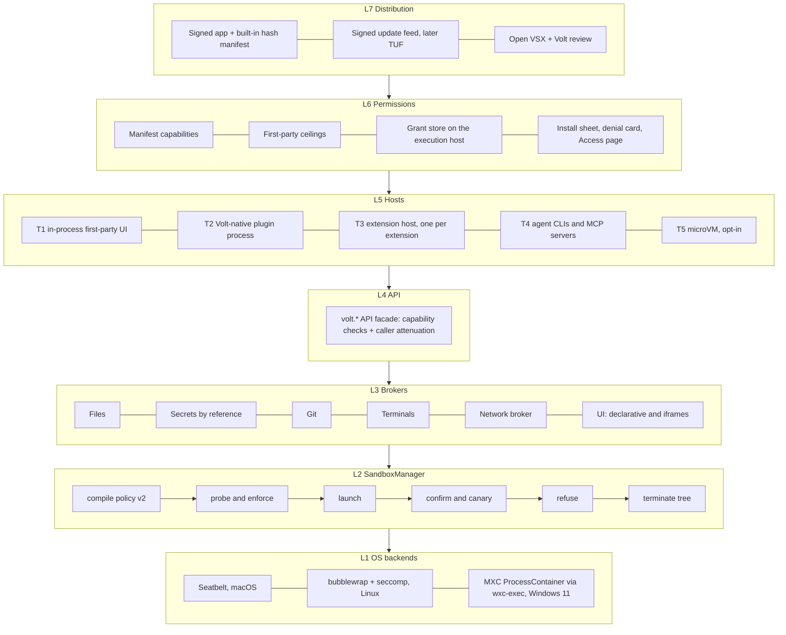
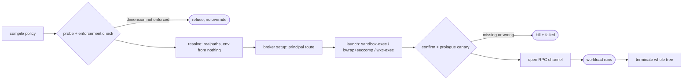

# Volt sandbox and plugin platform: specification

Status: draft. The open decisions are in §17. Date: 2026-11-08.

**Scope:**
- The sandbox core (`SandboxManager`, policy, OS backends, network broker).
- Moving every Volt feature into a plugin.
- Running plugins inside the sandbox with permissions.
- First-party trust and signing.
- How third-party extensions, Volt-native plugins, MCP servers and agent CLIs are handled.

**What this replaces.** This one document merges:
- `sandbox-prd/PRD.md`, its brief, five proposals and five critiques. These came from a design debate between Grok 4.7, two Opus 5.5 instances, GPT 5.6 Sol and the Terra seat (GPT 5.6 Terra on Codex failed both rounds, and Opus 5.5 took over).
- The plugin-platform parts of [`customize.md`](customize.md) (§3 layers, §6 contributions, §7 lifecycle, §8 security).

The look and layout engine stays documented in `customize.md`.

**Citations:**
- `main:` is the main branch (Volt 0.0.6, VS Code 1.105.1, Electron 37.6.0).
- `sbx:` is the unmerged branch `feat/volt-sandbox`.
- Facts marked **verified** were read in the code while this was written.
- **Guess** marks what nobody has verified.

---

## Contents

1. [Summary and rules](#1-summary-and-rules)
2. [Goals, non-goals, metrics](#2-goals-non-goals-metrics)
3. [Threat model](#3-threat-model)
4. [Architecture: tiers and hosts](#4-architecture-tiers-and-hosts)
5. [SandboxManager](#5-sandboxmanager)
6. [OS backends](#6-os-backends)
7. [Network broker](#7-network-broker)
8. [Brokers](#8-brokers)
9. [Volt extension API and contributions](#9-volt-extension-api-and-contributions)
10. [Migration: every feature becomes a plugin](#10-migration-every-feature-becomes-a-plugin)
11. [Signing and trust](#11-signing-and-trust)
12. [Permissions and UX](#12-permissions-and-ux)
13. [Third-party code](#13-third-party-code)
14. [Remote: volt-server, web, phone, relay](#14-remote-volt-server-web-phone-relay)
15. [Verification](#15-verification)
16. [Roadmap](#16-roadmap)
17. [Open decisions](#17-open-decisions)
18. [Risks](#18-risks)
19. [Decision log](#19-decision-log)
20. [Sources](#20-sources)

---

## 1. Summary and rules

**What we build.**
- One `SandboxManager` turns a policy into an OS sandbox for every way untrusted code runs:
  - agent CLIs and the commands they run;
  - MCP servers;
  - extension hosts;
  - Volt-native plugins.
- Backends: Seatbelt on macOS, bubblewrap + seccomp on Linux, Microsoft MXC on Windows 11.
- Volt's own network broker enforces hostname rules on every OS.
- Every Volt feature becomes a plugin with a manifest and declared capabilities.
- Third-party extensions and plugins run in per-plugin sandboxed hosts, with permissions the user can see and revoke.

**Two changes from the original ask.** All five models agreed on both.

| Asked for | This spec | Why |
|---|---|---|
| Migrate everything into plugin extensions first, then build the sandbox | **Parallel tracks.** Harden and merge the existing sandbox now. Migrate the *boundary* (API facade, manifests, contribution points) in parallel. **No code moves out of process until its host can be sandboxed** | Today's extension hosts are an unsandboxed `cp.fork` (`main:src/vs/server/node/extensionHostConnection.ts:277`) and an Electron `utilityProcess` (`main:src/vs/platform/extensions/electron-main/extensionHostStarter.ts:77`), shared with third-party extensions. Moving features there first is *worse* than leaving them in `contrib/` |
| Volt's internal plugins allow all by default, through signing | **Signed ceilings: auto-granted, zero prompts, still enforced.** A per-plugin ceiling table compiled into the core binary caps what each first-party plugin can get | Same zero friction. A bug in a first-party plugin, or a stolen plugin key, reaches only that plugin's ceiling, not the whole account. This mirrors Android's privileged-permission allowlist |

**Rules everything else follows:**
1. **Refuse, never fall back.**
   - A policy the backend can't enforce is refused.
   - A failed check never offers an override button.
   - Running unsandboxed is a separate, deliberate control: the chat's sandbox level `Off`. It is recorded and shown in the status bar.
2. **Identity comes from the launcher, never from the workload.** One principal per process or channel. No payload-supplied ids. Untrusted code never shares a host.
3. **Two independent layers on every critical path.** At least one of them is not a user prompt.
4. **Loopback is not authentication.** Every Volt listener authenticates every request.
5. **Signing proves origin, not correctness.** It grants a bounded ceiling, never "everything".
6. **The machine that runs the code decides.** The web workbench and the phone propose grants; the execution host enforces them.
7. **UI in, logic out.** First-party UI may stay in the workbench. Logic, parsers of agent-written content, and anything holding tokens leave the renderer.

**The stack:**



**Alternatives kept on record:**
- **B. MXC everywhere.** Revisit if MXC gains hostname rules and live denials. On macOS and Linux it wraps the same Seatbelt and bubblewrap Volt already calls.
- **C. Anthropic sandbox-runtime (srt).** Kept as the reference for its Windows design.
- **D. A microVM per session.** Opt-in strict tier only (T5).

---

## 2. Goals, non-goals, metrics

**Goals:**
- **G1. Confirmed sandbox for untrusted code.** No untrusted workload runs without an OS sandbox the backend has confirmed, except under an explicit, recorded user choice.
- **G2. Everything is a plugin, for lifecycle and contribution.** Every feature has a manifest, declared capabilities and a switch, and can be replaced through slots. This is not a claim about isolation; §4 says which tier isolates what.
- **G3. Isolation is honest.** Every host shows its real state: `Sandboxed`, `Partial (dims)` or `Not sandboxed (reason)`. No UI offers a level the backend can't enforce.
- **G4. Zero prompts for Volt's own plugins.** Third-party plugins prompt rarely, and in context.
- **G5. Building for the sandbox is as easy as writing a VS Code extension.** Android's SDK Runtime, which ran third-party SDKs in their own sandboxed process, was retired on 2025-10-17 for low adoption.

**Non-goals for v1:**
- TLS interception.
- UDP or SOCKS for plugins.
- A VM by default.
- Sandboxing the user's own terminal and git.
- Moving the deep-UI first-party features out of process (browser, scratch, visuals, devices, computer use, customize).
- A Windows sandbox below the MXC build floor.

**Metrics:**
- **Coverage:** 100% of agent, MCP and third-party launches go through `SandboxManager`. The spawn-audit CI gate enforces this.
- **Canary:** 0 confirm-canary failures across 7 days of beta before any stable promotion.
- **Overrides:** fewer than 2% "run outside sandbox" overrides among the top 200 extensions before the default flip.
- **Adversarial suite:** every case in §15 passes on every supported OS row.

---

## 3. Threat model

### 3.1 Assets

| Id | Asset | Examples |
|---|---|---|
| A1 | Credentials | `~/.ssh`, cloud CLIs, keychain, `.env*`, provider tokens, browser profiles |
| A2 | Volt's own secrets | agent-server token, host MCP HMAC secret, pairing and device tokens, `~/.volt/**` |
| A3 | Code that runs later | git hooks/config, shell rc, `.vscode/tasks.json`, `.mcp.json`, **build-entry files** (`package.json` scripts, `Makefile`, `build.rs`, `.cargo/config.toml`, `pyproject.toml` build-system, `.github/workflows/**`) |
| A4 | Volt's privileged positions | macOS TCC grants (Accessibility, Screen Recording, Microphone, Speech), the update channel, the ability to start unsandboxed processes |
| A5 | Other chats | transcripts, queues, terminals |
| A6 | Release keys | Developer ID, Authenticode, future plugin keys, the feed branch |
| A7 | Files outside the task | the rest of home |
| A8 | Availability and money | CPU, disk, process slots, provider quotas |

### 3.2 Attackers

1. **Prompt injection and malicious model output.** The most frequent attacker.
2. **A malicious third-party extension.** For example GlassWorm (2025-10), which spread itself with stolen npm and GitHub tokens.
3. **A compromised third-party publisher or registry.** For example Open VSX CVE-2025-6705.
4. **A compromised first-party supply chain:** CI, a dependency, the feed branch.
5. **A malicious repository.**
6. **A network attacker.**
7. **A malicious MCP server.**
8. **A buggy first-party plugin used as a confused deputy.**
9. **A stolen paired device or token.**

### 3.3 Trust boundaries

1. User ↔ core TCB.
2. Core ↔ every plugin host, first-party included.
3. Plugin ↔ plugin.
4. Volt ↔ agent and MCP process trees.
5. Sandboxed anything ↔ Volt's listeners and helpers.
6. Workspace content ↔ anything that executes it later.
7. Volt ↔ network.
8. Volt's build ↔ users.
9. Clients (web, phone) ↔ execution host.

### 3.4 Out of scope

- Malware already running unsandboxed as the user.
- Kernel, hypervisor and CPU 0-days. The surface is still shrunk with seccomp and deny-default profiles.
- Physical access.
- Exfiltration through the agent's own provider channel. The control is what the agent can read.
- A compromised OS signing chain.
- Side channels.

### 3.5 Attack trees and the layer that stops each

Layers:
- **L-OS:** backend.
- **L-POL:** policy composition.
- **L-NET:** network broker.
- **L-RPC:** API capability check and attenuation.
- **L-AUTH:** listener auth.
- **L-JS:** SES.
- **L-SIGN:** signatures.
- **L-UX:** prompts.
- **L-REV:** review and revocation.

| Id | Attack | Mitigation (layers) |
|---|---|---|
| AT-1 | A malicious Open VSX extension reads `~/.ssh` and `~/.npmrc`, persists in `~/.zshrc`, republishes itself | T3 per-extension host with credential floor (L-OS). Network none by default; registry publish hosts are exfil-capable (L-NET). Secret calls keyed by connection identity (L-RPC). Invisible-Unicode scan (L-REV) |
| AT-2 | A compromised update of a trusted extension | Signer pinning (L-SIGN). Capability-widening updates never auto-install. 72 h cooldown. Still runs in T3 (L-OS) |
| AT-3 | A compromised first-party update: feed rewrite, stolen certs, malicious build dependency, rollback | Protected release Environment. Signed feed with a pinned key, later TUF (L-SIGN). **The ceiling lives in the core binary**, so a stolen plugin key can't widen (L-POL + L-SIGN) |
| AT-4 | Squatting `volt.*` on Open VSX, or a local folder claiming `publisher: volt` | `volt.*` loads only with a first-party signature. First-party never updates from the gallery. Claim the namespace (L-SIGN) |
| AT-5 | A sandboxed process attacks Volt's loopback and IPC services: the agent-server `/ws`, host MCP, the VS Code IPC socket, a Node inspector via SIGUSR1, CDP ports. This is DeepSeek CVE-2026-82533's class | Every listener authenticates (L-AUTH). The floor denies loopback except named ports, unix sockets, and signals to other sandboxes (L-OS). `--disable-sigusr1` |
| AT-6 | A prompt-injected agent uses a first-party plugin as a confused deputy (automations shell node, pull-request push, agent HTML posting to a plugin, "show account details") | **Caller attenuation: effective rights = plugin ∩ caller** (L-RPC). Commands private by default. Secrets never returned raw (§8) |
| AT-7 | Malicious repo files: hooks, fsmonitor, tasks, `.mcp.json`, a widening `.volt/sandbox.json`, a repo look with commands, hard links | Repo layers narrow-only (L-POL). Repo MCP needs trust and runs sandboxed. Build-entry guard (§8). Bounded hard-link scan |
| AT-8 | A network attacker: MITM of the feed or Open VSX, hostile DNS, rebinding, a stolen device token, domain fronting | Signed feed (L-SIGN). One lookup + public-address check (L-NET). Scoped, expiring device tokens (L-AUTH). Fronting is a documented residual |
| AT-9 | A malicious MCP server: tool poisoning, rug pull, shadowing a Volt tool, exfiltration, host code execution | T4 sandbox (L-OS + L-NET). Pinned tool-list hash (L-SIGN). Namespaced tools (L-RPC) |
| AT-10 | A plugin attacks another plugin: shared realm, forged extension id, foreign commands, `exports` | **One host per extension** (L-OS). Id taken from the connection (L-RPC) |
| AT-11 | A sandboxed process attacks native helpers and TCC grants: computer-use IPC, replacing the speech helper, `ELECTRON_RUN_AS_NODE` as the responsible process | `~/.volt/**` and helper folders in the floor (L-OS). Helpers accept only their launching process (L-AUTH). Helper signatures checked (L-SIGN) |
| AT-12 | Permission-UX attacks: fatigue, misleading text, benign-looking exfil hosts, prompt timing | Volt-authored text, budgets, 500 ms inert buttons, exfil-capable list, critical class never prompt-grantable (L-UX + L-POL) |
| AT-13 | Persistence and rollback: edit installed plugin files, edit grants, downgrade | File hashes at load (L-SIGN). Grants in user data denied to every sandbox (L-OS). Monotonic versions |
| AT-14 | Resource and cost exhaustion (DSec: `yes` filling tens of GB, `grep /proc` crashing the kernel, port scans) | rlimits, tmpfs caps, pid namespace (L-OS). Connection and byte budgets (L-NET). Per-plugin turn budgets |

**Verified finding that shapes §4.**
- `MainThreadSecretState.$getPassword(extensionId, key)` takes the extension id **from the extension host's RPC payload** (`main:src/vs/workbench/api/browser/mainThreadSecretState.ts:38-44`).
- So inside any shared extension host, one extension can read another's secrets while the OS sandbox stays intact.

---

## 4. Architecture: tiers and hosts

| Tier | What | Runs where | Isolation | Who grants |
|---|---|---|---|---|
| **T0 core (TCB)** | Chats, queue, subagents, run groups, questions, worktrees, terminals, workspace context, images (the `voltFeatures.ts` entries with no `extensionId`). Also `SandboxManager`, brokers, the API facade, the grant store, the loader and signature checks, the feature catalog and enablement, the installer, the ACP and Codex app-server clients, pairing and tokens | Renderer, Electron main, volt-server | It *is* the monitor; kept small | n/a |
| **T1 first-party in-process UI** | Only browser, scratch board, visuals, devices, computer use, customize, plus the **UI half** of other first-party features (views that render what their out-of-process logic returns) | Renderer, lazy-loaded | Facade + import lint + lazy load. **Not a sandbox**: labelled trusted core code. Agent-authored content (HTML, charts, diagrams, PR bodies) is parsed in an opaque-origin iframe or a worker, never on the renderer's main thread | App signature + built-in hash manifest |
| **P1-H native helpers** | Computer use, speech, device hub, tunnels, code index | Own process launched by core | Own OS profile where TCC allows. Authenticated RPC over an inherited fd or a peer-credential check | Core, per helper |
| **T2 Volt-native plugin** | First-party **logic** (memory, usage, provider probes, automations scheduler, PR and commit-review services, agent-resources reader) and third-party Volt plugins | **One OS-sandboxed process per plugin principal** on the execution host. Empty OS profile: read its bundle only, no network, no spawn. SES `lockdown()` inside. RPC on an inherited fd, opened only after confirm. Plugins whose capabilities are all `low` and identical may share a process | OS + SES + API checks | Ceiling (first-party) or user grant |
| **T3 VS Code extension** | Open VSX extensions | **One sandboxed `bootstrap-fork` host per extension** on volt-server; desktop routes there. A `browser`-only extension goes to the web-worker host. Extensions with no `main` (themes, grammars) need no host | OS + network broker + core-owned webview CSP | Inferred default + user grants + signed presets |
| **T4 processes** | Agent CLIs, stdio MCP servers, language servers, tasks | One `SandboxManager` long-lived principal each | OS + network broker | Chat settings or server profile + user |
| **T5 VM** | Opt-in strict mode | microVM per session | Hardware virtualisation; same broker protocol | User |

**Rules:**
- **Electron main runs no plugin code.** Its Volt services (`platform/volt*/electron-main`) are brokers.
- **The renderer runs no third-party code outside iframes.** React in the renderer was rejected in `customize.md` §6.3.
- **No pooling of mutually untrusted code.**
  - Memory is managed by lazy start and stopping after 5 minutes idle.
  - When the process budget runs out, Volt refuses with a message; it never co-hosts.
- **The sandboxed extension host is a new host kind.**
  - VS Code's built-in extensions (git, TypeScript, …) stay in the existing host until the git and file brokers exist.
  - Wrapping the shared host first would break `git push` over ssh in `/code/`, because the credential floor denies `~/.ssh`.
- **Caller identity comes from the connection.** `MainThreadSecretState`, `MainThreadAuthentication` and every `MainThreadVolt*` take the caller id from the connection, and reject a payload id that doesn't match.
- **Desktop with the agent server off.** Third-party Node extensions refuse. Desktop's `utilityProcess` host keeps only T0 helpers.

**The five layers from `customize.md` §3, mapped to tiers:**

| Layer | Tier |
|---|---|
| 1. VS Code extensions | T3 |
| 2. Volt UI contributions (looks, layouts, panels) | Data. Panels are iframes in Volt-owned containers |
| 3. Volt native plugins | T1 (UI) + T2 (logic) |
| 4. Files in `~/.volt/customize` | The user's own data |
| 5. Playground drafts | Third-party tier until installed |

---

## 5. SandboxManager

The manager keeps `sbx:`'s shape:
- `prepare`, `run` and `dispose` (`sbx:node/sandboxManager.ts:86,149,237,358`);
- `IPreparedSandbox` with `confirm`, `terminate`, `allowDomains` and `onDenial` (`:50-70`);
- `ISandboxBackend.probe/launch` (`node/sandboxBackends.ts:30-62`);
- `checkEnforcement` (`common/sandboxBackend.ts:91`);
- fail-closed `SandboxUnavailableError`.

It runs as a plain Node class on the execution host: volt-server by default, Electron main otherwise.

### 5.1 API

```ts
export interface IVoltSandboxService {
  capabilities(): Promise<ISandboxBackendReport>;    // real trial per backend; cached per (backend, OS build, binary hash)
  run(req: ISandboxRequest, o?: ISandboxRunOptions): Promise<ISandboxRunResult>;   // one-shot; refusal is a status, never a throw
  start(req: ISandboxHostRequest): Promise<ISandboxedProcess>;                       // long-lived; resolves only after confirm + canary
  readonly onDidChangeStatus: Event<ISandboxStatusChange>;                           // UI, attestation, telemetry
  list(): readonly ISandboxedProcessInfo[];                                          // Settings → Security
}

export interface ISandboxBackendReport {
  readonly platform: NodeJS.Platform;
  readonly backend: 'seatbelt' | 'bubblewrap' | 'mxc' | 'unsupported';
  readonly state: 'available' | 'unsupported' | 'broken';   // unsupported = platform fact; broken = trial mismatch
  readonly dimensions: Readonly<Record<SandboxDimension, 'enforced' | 'partial' | 'unsupported'>>;
  readonly windows?: { build: string; mxc: 'available' | 'unsupported' | 'broken'; notes: readonly string[] };
}

export interface ISandboxPrincipal {                 // minted by the manager; the workload never names itself
  readonly id: string;                               // random 128-bit
  readonly kind: 'agent' | 'mcp' | 't2-plugin' | 't3-extension' | 'helper' | 'task';
  readonly packageId?: string; readonly packageDigest?: string; readonly signer?: string;
  readonly parent?: string;                          // attenuation chain
}

export interface ISandboxHostRequest extends ISandboxRequest {
  readonly principal: ISandboxPrincipal;
  readonly fork?: { modulePath: string; execArgv: readonly string[] };   // NODE_CHANNEL_FD set by the launcher, last
  readonly restart?: { maxPerMinute: number };                           // crash loop → stays down; never restarts looser
}

export interface ISandboxedProcess {
  readonly principal: ISandboxPrincipal;
  readonly backend: 'seatbelt' | 'bubblewrap' | 'mxc';
  readonly status: 'initialized' | 'partial';
  readonly unenforced: readonly SandboxDimension[];
  readonly evidence: string;                         // redacted confirm evidence, kept for attestation
  readonly launchPolicyHash: string;                 // immutable: mounts, env, process, IPC
  readonly brokerGrantEpoch: number;                 // mutable: network + broker handles
  grant(g: ILiveGrant, expectedEpoch: number): Promise<'applied' | 'needs-restart' | 'stale'>;
  revoke(grantId: string): Promise<void>;
  relaunch(reason: string): Promise<void>;
  terminate(reason: string): Promise<void>;
  readonly onDenial: Event<ISandboxDenial>;          // { denialId, principal, dimension, target, reason }
  readonly onExit: Event<{ code: number | null; signal: string | null }>;
}

export type ILiveGrant =
  | { id: string; kind: 'net.connect'; host: string; port?: number }
  | { id: string; kind: 'net.local.connect'; address: string; port: number }
  | { id: string; kind: 'file.handle'; path: string; mode: 'r' | 'rw'; once: boolean };   // through the file broker
```

`run` is `start` + wait for exit + `terminate`. Existing `prepare` callers keep working.

### 5.2 Policy schema v2

**Versioning:**
- v1 (`sbx:common/sandboxSchema.ts:17`) stays parseable forever and is read as generation 0.
- The strict parser rules stay:
  - unknown fields fail;
  - NFC text;
  - no `..` and no control characters;
  - list caps;
  - `write` can't be `/` or `${home}`;
  - a missing field means the most restrictive value.

```ts
export const SANDBOX_POLICY_SCHEMA_VERSION = 2 as const;

export interface IVoltSandboxPolicy {
  readonly schemaVersion: 2;
  /** Like Android's targetSdk. New restrictions apply at targetPolicy ≥ N; security fixes apply to everyone.
   *  product.json `minimumTargetPolicy` rises over time; plugins below it stop loading with a message. */
  readonly targetPolicy: number;
  readonly principal?: string;                       // filled by core only
  readonly lifetime: 'command' | 'host';
  readonly filesystem: {
    readonly read: readonly string[]; readonly write: readonly string[];
    readonly brokerWrites: boolean;                  // no writable bind; writes go through the file broker (untrusted default)
    readonly deny: readonly string[]; readonly protect: readonly string[]; readonly unmask: readonly string[];
  };
  readonly network: {
    readonly mode: 'none' | 'broker' | 'host';       // host = critical class; still denies Volt's own ports on macOS/Windows
    readonly allow: readonly string[];
    readonly local: 'none' | 'ask' | 'allow';        // RFC1918, LAN, mDNS: separate from internet
    readonly loopbackPorts: readonly number[];
    readonly udp: 'none';                            // reserved
    readonly listen: boolean;
  };
  readonly process: { readonly spawn: 'any' | 'none'; readonly limits: ISandboxLimits };
  readonly env: { readonly inherit: readonly string[]; readonly set: Readonly<Record<string, string>> };
  readonly ipc: { readonly volt: readonly string[] };     // e.g. 'extHost', 'hostMcp:<session>'
  readonly host: { readonly unixSockets: readonly string[]; readonly systemServices: boolean };
  readonly bestEffort: readonly SandboxDimension[];
}
```

**`process.spawn: none` is new enforcement.** The branch's seccomp filter is a denylist that allows `execve`, and the Seatbelt profiles allow `process-exec` and `process-fork` (verified). `none` therefore needs:
- seccomp: an `execve`/`execveat` deny installed after the initial exec;
- macOS: `(deny process-exec process-fork)`;
- Windows: a job object with an active-process limit of 1.

The parent must confirm it. If it is not confirmed, the host fails to start; it is never reported as `partial`.

**No `audit` field in the OS policy.** bubblewrap and MXC can't audit, and Seatbelt `(with report)` allows everything. Report mode exists only at the API capability check.

**Environment rules** (all verified on `sbx:`):
1. **Untrusted `env.set` drops secret names.**
   - Today `narrow()` checks only reserved and injection names (`sandboxComposition.ts:224-232`).
   - So a repo policy can set `VSCODE_EXTHOST_IPC_HOOK`, because `isReservedEnvName` covers only proxy and `VOLT_SANDBOX*` names (`sandboxProfiles.ts:82-85`).
2. **Launcher-owned reserve list.** No layer may set:
   - `NODE_CHANNEL_FD`, `NODE_OPTIONS`;
   - `VSCODE_EXTHOST_IPC_HOOK`, `VSCODE_EXTHOST_WILL_SEND_SOCKET`, `VSCODE_WILL_SEND_MESSAGE_PORT`, `VSCODE_IPC_HOOK*`;
   - `ELECTRON_RUN_AS_NODE`;
   - the proxy variables.

   The launcher writes them **last**.
3. **The caller's `context.env` gets the same checks.** `sandboxResolver.ts:272-280` applies it with a reserved-only check, so a provider launch spec could inject `NODE_OPTIONS` into the workload.
4. **Wrappers get a Volt-built minimal environment.** On Linux `bwrap` is already spawned with `env: {}` (`bubblewrapBackend.ts:338`). `sandbox-exec` and the future `wxc-exec` need the same, because they run as the user before the sandbox exists.
5. **Long-lived hosts get exactly the `bootstrap-fork` set.** Volt computes it from a fixed list:
   - `VSCODE_ESM_ENTRYPOINT`, `VSCODE_HANDLES_UNCAUGHT_ERRORS`, `VSCODE_NLS_CONFIG`, `VSCODE_EXTHOST_WILL_SEND_SOCKET`;
   - `NODE_CHANNEL_FD`.

   To confirm against `bootstrap-fork.ts` in the host PR. A test diffs the host's `process.env` against the list.

   `PATH` is the server's `remote-cli` directory, and `HOME` and `TMPDIR` come from the policy. The host stops spreading `process.env` (`main:extensionHostConnection.ts:40-60`).

### 5.3 Capabilities compile to policy

`compilePolicy(manifest, grants, base, target, caller)` is a pure function in `common/`.
- For **T2** it never compiles file or network rules into the OS profile; T2 grants are enforced in the broker.
- Only **T3 and T4** compile capabilities into OS widenings.

### 5.4 Composition

```
floor (core, deny-only)
  ∩ tier base
  ∩ (first-party ceiling | user grants)
  ∩ caller policy            ← attenuation: a plugin acting for a chat gets plugin ∩ chat
  ∩ admin / MDM layer        ← narrow-only cap; wins over the user
  ∩ repo layer               ← untrusted, narrow-only, trusted workspaces only
  ∩ request layer            ← narrow-only
```

Every dropped widening is recorded and shown ("This repo asked for network to x; ignored").

**The floor** applies to every profile, first-party included, from day one:
- credential paths (`sandboxProfiles.ts:20-30`) and `.env*`;
- `~/.volt/**` except the principal's own storage;
- the app bundle and helper folders;
- Volt's listeners and sockets;
- LaunchAgents, systemd user units and Windows Run keys;
- signals to processes outside the same sandbox;
- escape mach services: cfprefsd, appleevents, windowserver, pasteboard, launchservicesd.

Property tests:
- `out ⊆ caller`;
- untrusted layers never widen;
- the floor is in every output;
- first-party output ⊆ ceiling.

### 5.5 Lifecycle



**Probe:**
- A real trial per backend, cached per backend × OS build × binary hash, and re-run after an OS update.
- `unsupported` means the platform can't do it. That is known before launch and can't be influenced by an attacker.
- `broken` means the trial didn't match the policy. It refuses for the whole session.

**Confirm.** Evidence must come from outside the workload:

| Backend | Evidence |
|---|---|
| Seatbelt | `volt-sandbox-ready <pid>` on fd 3 (`seatbeltBackend.ts:164`) |
| bubblewrap | JSON status with fresh mnt/pid/ipc/uts (+net) inodes, plus `NoNewPrivs:1 Seccomp:2` from inside |
| MXC | Container SID / id and WFP filter in the status |

**Canary:**
- Long-lived hosts run it **in the launcher prologue, before any workload code**, and report on the status fd.
- It checks that a direct connect to a public IP and a read of a sentinel credential file both fail.
- A canary the workload runs itself is worthless, because the workload can lie.

**Channel after confirm.** Core accepts no RPC on a host's fd until confirm succeeds.

**Terminate:**
- **Linux:** SIGKILL the monitor and the namespace's pid 1. With `--die-with-parent`, the pid namespace takes everything down.
- **macOS:** process group, parent-chain walk and run tag, plus a reaper spike for `setsid` double-forks that clear their environment. Until the reaper passes, `process.tree` stays `partial`. The survivor is still confined.
- **Windows:** job object with `KILL_ON_JOB_CLOSE` and no breakaway.

**Fallback rule:**

| Situation | Untrusted (agents, MCP, third-party) | First-party T2 logic |
|---|---|---|
| Platform `unsupported` (Windows below the MXC floor, Linux without userns or bwrap) | Refuse. The user may set a chat's sandbox level to `Off`, a separate recorded control. Third-party plugins don't run | **Asked once per machine:** "This system can't sandbox Volt's own plugins. Run them as before, without a sandbox?" Yes → in-process as T1, labelled `Not sandboxed (OS unsupported)`, which is today's exposure. No → those features are off |
| Probe `broken`, confirm failed, canary failed | Refuse, kill, no override button | Refuse, kill. **Never fall back.** A failed confirm can be attacker-induced, for example by filling `$TMPDIR` |

The dual build (T2 binding and in-process binding) exists only for first-party T2 logic. Both bindings run the same tests.

### 5.6 Long-lived hosts

- **One container per host, not per shell line.** That keeps one confirm per host and avoids the MXC I/O stalls srt reported with several sandboxes.
- **Crash restarts.** Restart budget `maxPerMinute`. After 3 crashes in a minute the host stays down and the plugin is marked broken, with its last stderr. **A host never restarts with a looser policy.**
- **Health.** An RPC ping every 30 s while it has UI or tools; 3 misses mean a tree kill.
- **Updates.** A new version starts a new host; the old one drains for 10 s.
- **No reuse across** package digest, principal, workspace, user, `targetPolicy` or policy hash.
- **PTY.** node-pty can't pass the confirm fd, so a sandboxed terminal confirms through a 0600 file in the run directory. Until that exists, host terminal tools stay refused for sandboxed chats.
- **Nested sandboxes.** Agent CLIs run with their own sandbox off only when Volt's backend has confirmed. Volt never delegates to a CLI's sandbox and calls that enforced, because it can't confirm it.

### 5.7 Live grants

**Only the network widens live.** Seatbelt profiles are fixed at `sandbox_init`, and bwrap mounts at clone.

| Grant | Live? | How |
|---|---|---|
| Network host | Yes | Broker rule on the principal, compare-and-swap on `brokerGrantEpoch`; revoking closes matching tunnels |
| Local network | Yes | Same, under `network.local` |
| File or folder | Through the broker | Picker or handle; the core opens with no-follow flags and passes the fd |
| Workspace write, exec, sockets, loopback port | No | `relaunch()` with the new policy; the UI says "Restart <name> to apply" |

**The launch key** is `launchPolicyHash` only. Network grants are excluded; `sbx:` already does this on purpose (`sandboxPolicy.ts:522-530`). A network grant never restarts a process.

**Live bug to fix first** (verified): `allowSandboxDomains` (`sbx:voltStdio/node/voltStdioService.ts:219`) has no caller in the window. "Allow host" saves the setting, but the running proxy never hears about it.

---

## 6. OS backends

| OS | Backend | Minimum | Refuses when |
|---|---|---|---|
| macOS | Seatbelt via `/usr/bin/sandbox-exec`. Deny-default for plugins and MCP. The agent profile's `(allow default)` is a labelled weaker tier with explicit denies. Plan a signed `sandbox_init` helper in case `sandbox-exec` is removed | The probe trial, not a version check. CI on macOS 15 and the newest (tested on 26.6) | A trial write outside the profile succeeds |
| Linux | bubblewrap ≥ **0.8** (`--disable-userns`) + TS-generated seccomp (`sbx:common/seccomp.ts`) + socat bridge holder. **No Landlock fallback:** main's old helper (`main:voltSandbox/common/landlock.ts:12-21`) keeps reads open, has network only on ABI 4, and runs unsandboxed with a warning without Landlock. C1 removes it | x64/arm64 (the seccomp tables) and unprivileged user namespaces. Ubuntu 24.04+ needs an AppArmor profile for bwrap or the sysctl; the probe names the fix | bwrap missing or old, userns blocked, other architecture, bridge tools missing when `broker` network is needed |
| Windows 11 | **MXC ProcessContainer via pinned `wxc-exec.exe`**, checked with `WinVerifyTrust` against a pinned Microsoft publisher plus a file hash. Not the Node SDK, which needs Node 24; Electron 37.6.0 ships Node 22 | 24H2 26100.9278+, 25H2 26200.9278+, 26H2 26300.9550+, 26H1 28000.2804+ | Below the floor; trial mismatch; confirm or canary failure |
| Windows 10 / older 11 | **None in v1** | n/a | Always. The chat level `Off` is the user's choice |

**Linux bwrap details** (`sbx:common/bwrap.ts`):
- namespaces: `--unshare-user/pid/ipc/uts/cgroup-try`, plus `--unshare-net` unless the holder owns the network;
- `--die-with-parent --disable-userns --new-session --cap-drop ALL`;
- `--json-status-fd 4`, `--seccomp 6`;
- environment as `--setenv` pairs on a pipe;
- mount order: base reads → `/dev` + `/proc` → tmpfs masks → write binds → protected `--ro-bind` → denied paths as tmpfs or `/dev/null` → `--remount-ro /`.

seccomp refuses mount and namespace calls, `ptrace` and `process_vm_*`, keyrings, `bpf`, `perf_event_open`, `userfaultfd`, `io_uring`, namespace flags on `clone`, `TIOCSTI`/`TIOCLINUX`, and `socket(AF_UNIX)` unless granted. A granted socket is bridged by the holder, so `AF_UNIX` stays blocked inside.

### 6.1 Windows chooser

```ts
export type CommandImageClass = 'pe' | 'msys' | 'cygwin' | 'wsl' | 'unknown';

export function chooseWindowsBackend(report: IWindowsBackendReport, image: CommandImageClass):
	{ backend: 'mxc' } | { backend: 'refuse'; reason: string } {
	if (image === 'wsl') { return { backend: 'refuse', reason: 'wsl.exe starts a VM outside the sandbox' }; }
	if (image === 'msys' || image === 'cygwin') {
		return { backend: 'refuse', reason: 'Git Bash / MSYS2 crashes inside Windows ProcessContainer (0xC0000005). Use PowerShell, or set this chat to Off.' };
	}
	if (image === 'unknown') { return { backend: 'refuse', reason: 'unrecognised program' }; }
	if (report.mxc === 'available') { return { backend: 'mxc' }; }
	if (report.mxc === 'broken') { return { backend: 'refuse', reason: 'MXC trial failed; not falling back' }; }
	return { backend: 'refuse', reason: `Windows ${report.build} is below the sandbox floor (24H2 26100.9278+)` };
}
```

**How the image class is decided, before any spawn:**
- **`wsl`:** the resolved path is `System32\wsl.exe`.
- **`msys` / `cygwin`:** the PE imports name `msys-2.0.dll` or `cygwin1.dll`, or the path is under `\Git\usr\bin`, `\Git\bin` or `\msys64\`. Git's `bin\bash.exe` shim is followed one level.

**Other Windows rules:**
- The run directory is `TEMP`/`TMP`; MXC's own per-command `%TEMP%` is never storage.
- `SetDefaultDllDirectories(LOAD_LIBRARY_SEARCH_SYSTEM32)`, and the workspace is never on `PATH`.
- `wxc-exec` arguments are frozen from MXC 1.0.1 in the first Windows PR. **Open question:** is `wxc-exec.exe` redistributable in the MIT drop? If not, stop and ask.

**Network route (open risk):**
- AppContainer normally blocks loopback, and the exemption is usually an admin operation (**guess**).
- srt notes that proxy routing under MXC is guaranteed only by 25H2 behaviour.
- So Windows starts with **one broker port + a per-principal `Proxy-Authorization` token**. Per-principal ports come only if the C4 trial proves them, and the canary gates each Windows build.

**The srt-win style sandbox-user backend is not in v1.**
- The proposed design shared one SID across all sandboxes. File-access entries granted for chat A then let chat B write A's project, and the design needed a SYSTEM service.
- A later version needs:
  - a **run-unique SID** in a restricted token;
  - file-access entries removed when the job closes, plus a startup sweep;
  - no SYSTEM service;
  - its own threat model.

**Git Bash.** Agents on Windows often use it, so a Git Bash smoke test is a C4 acceptance criterion.

### 6.2 Escape catalogue

Each item has a test that fails if its mitigation is removed.

| Id | Escape | Mitigation |
|---|---|---|
| E1 | Loopback service trusting `Host` (DeepSeek CVE-2026-82533) | `loopbackPorts` empty by default. Seatbelt, socat bridge and WFP allow only named ports. Every Volt listener needs a bearer and ignores `Host`/`Origin` for authorization |
| E2 | VS Code IPC socket → `launch` channel → unsandboxed extension host | `AF_UNIX` blocked; the IPC path is never a grant; reserve list; the parent passes one fd; desktop T3 doesn't use `utilityProcess` |
| E3 | Getting main to `utilityProcess.fork` | Not exposed to extensions. T3 is spawned by `SandboxManager`; a test greps the T3 spawn path |
| E4 | macOS double-fork + `setsid` + cleared environment | `process.tree` stays `partial`; rlimits set before exec are inherited; reaper spike; the survivor still can't read `~/.ssh` |
| E5 | DNS as an exfiltration channel | No resolver in `none`/`broker`; mDNSResponder and dnssd denied; wildcards are high risk; queries rate-limited |
| E6 | Rebinding and IP-literal bypass | One lookup, all answers public, connect to the checked address; IPv4-mapped and NAT64 covered; IP literals need IP rules |
| E7 | DoH and domain fronting | No TLS inspection; CDN hosts are exfil-capable; documented residual |
| E8 | Host `/proc` (fd, mem, `net/unix`), recursive walk | `--unshare-pid --proc /proc`; `ptrace` / `process_vm_*` denied; macOS task ports denied; on Windows, `OpenProcess` on the parent must fail |
| E9 | Symlink or TOCTOU on a path grant; planted hard link | Directory-fd broker with `openat2(RESOLVE_BENEATH\|RESOLVE_NO_SYMLINKS)`, `O_NOFOLLOW`, reparse refusal; bounded hard-link scan (20k files, then `partial`) |
| E10 | Abstract unix sockets, `docker.sock`, ssh-agent | One granted socket bridged by the holder; Docker is critical class; Windows named pipes not granted |
| E11 | `systemServices` / `(allow default)` copied by a plugin | Ignored for anything but agents and first-party unless a critical grant allows it; deny list unconditional; cfprefsd always denied |
| E12 | Env injection of the IPC channel | §5.2 reserve list, written last |
| E13 | Windows broker binaries (`ShellExecute`, `mshta`, `rundll32`, `wsl.exe`) | Image-level deny; the probe runs `wsl` and a `ShellExecute` and both must fail or stay in the container, else `broken` |
| E14 | Time-shifted hook or build entry | Build-entry guard (§8); `core.hooksPath` empty for git Volt runs for sandboxed chats |
| E15 | DLL or `LD_*` planting in the workspace | Env from nothing; `SetDefaultDllDirectories`; the workspace is never on `PATH` |
| E16 | Cross-sandbox proxy reuse; "Allow host" stuck on the old process | Per-principal route + token; live `grant()` from the denial card |
| E17 | User-namespace escape; setuid bwrap | `--disable-userns`; seccomp denies `CLONE_NEWUSER`; prefer the unprivileged binary |
| E18 | `host` network reaches Volt's own ports | Critical class; on macOS and Windows still denies Volt's ports; on Linux untrusted `host` is unsupported unless proven |

---

## 7. Network broker

The broker runs on the execution host beside `SandboxManager`. It replaces "one HTTP proxy with a mutable list" (`sbx:node/sandboxProxy.ts`).

**Identity:**
- Each principal gets its own route:
  - **Linux:** a unix-socket bridge in its network namespace.
  - **macOS:** its own loopback port, allowed only in its Seatbelt profile.
  - **Windows:** see §6.1.
- A manager-minted token authenticates setup. Caller-supplied ids are ignored.
- **T2 plugins have no socket at all.** They use `volt.net.fetch` over RPC.

**Protocols in v1:**
- HTTP forward and CONNECT only, which is what the branch proxy does.
- No SOCKS5, no UDP (QUIC falls back to TCP), no raw sockets.
- SOCKS5 CONNECT may come later, behind its own adversarial corpus.
- SOCKS5 UDP ASSOCIATE is out: its datagram header carries a destination the TCP grant never named.

**Hostname rules:**
- Lowercase ASCII after IDNA, one trailing dot stripped. Controls, empty labels and ambiguous numeric forms are rejected.
- `*.example.com` matches descendants only, never a public suffix (bundle the PSL).
- No port means 443; port 80 needs an explicit `http://` grant.
- IP literals need an IP rule.
- Redirects are re-checked.

**DNS:**
- The broker is the only resolver.
- Each connection does **exactly one** lookup, requires every A/AAAA answer to be public, and connects to the address it checked (`sbx:sandboxProxy.ts:110-126`).
- No TTL cache and no connect-by-name.
- Port 53, DoH and DoT are ordinary denied traffic.

**Three separate permissions:**
1. `net.loopback.connect` to one manager-issued port.
2. `net.local.connect` to an exact private IP or CIDR and port, shown as "devices on your local network". This copies Android 17's `ACCESS_LOCAL_NETWORK`, enforced in the network stack for API 37+ apps.
3. Public `net.connect`.

**Always denied, even with LAN permission:** `169.254.169.254`, link-local, CGNAT, multicast, broadcast, documentation and reserved ranges, private IPv4-mapped and NAT64 forms, and the host gateway.

**Listening:**
- Sandbox loopback only.
- A dev server the user must open is published through the holder as an explicit `net.listen`.

**TLS:**
- Opaque pass-through: no interception, no ClientHello parser, no SNI check (it doesn't stop fronting behind a shared CDN, and the parser is attack surface).
- Domain fronting is a documented residual.
- **The exfil-capable list** (paste sites, webhook catchers, tunnels, object storage, CDN fronting hosts, registry publish endpoints, `gist`/`api.github.com` write paths) needs the high-class grant flow. It ships with Volt and updates through the signed feed.

**Denials and approval:**
- A denial is `{denialId, principal, epoch, destination, port, reason}`.
  - Reasons: `not-allowed | private-address | metadata | port | transport | rate-limit | unresolvable`.
- The inline card offers Allow once / this session / project / always, or Refuse.
- Approval sends `denialId + expectedEpoch`. The broker re-derives the rule from its own recorded denial, so a client can't swap in a different host. "Allow host" never allows a private address.
- Denials are coalesced per principal over 2 s.

**Special identities:**
- `mcp-http:<configDigest>`: Volt's requests to a remote MCP server.
- `package-fetch:<lockDigest>`: package installs (registry plus artifact origins, checksums, byte and time limits).
- No `npx -y` outside containment. Bundled provider adapters ship as pinned artifacts.

**Budgets:** per-principal connection and byte budgets.

---

## 8. Brokers

| Resource | Broker | Rule |
|---|---|---|
| Files | `volt.files`. Picker = grant. Core holds a directory fd and opens with `openat2(RESOLVE_BENEATH\|RESOLVE_NO_SYMLINKS)` on Linux, `O_NOFOLLOW` + path recheck on macOS, and refuses reparse points on Windows. Returns handles scoped to path, mode and expiry | The credential and protected lists are enforced in the broker too |
| Secrets | `volt.secrets.ref(key)` + `volt.net.fetch(url, { auth: ref })`. The broker injects the header; the plugin never sees the value. Raw read is critical class | Namespaced per principal; OAuth tokens in `voltUsage`/`voltAccounts` move behind refs |
| Git | `volt.git` runs git with `-c core.hooksPath=<empty> -c core.fsmonitor=`. Hooks run only for the user's own actions | `git.push` prompts per repo |
| Terminals | `volt.terminals.run`: always the **caller's** attenuated policy (the chat's, or a plugin-scoped one) | The user's own terminals stay outside |
| Clipboard | Write is free; read needs a gesture in the last second + `clipboard.read` | |
| UI | Declarative trees rendered by core (`WorkbenchList`, `createVoltButton`, `createVoltDropdown`), then iframes for rich panels: opaque origin, CSP without `connect-src`, `postMessage` only | No workbench DOM |
| **Webview egress** | Core writes the CSP for every T3 webview: `connect-src`, `img-src`, `media-src`, `frame-src`, `form-action` and `font-src` are limited to the extension's granted hosts. Electron main filters webview requests by frame origin → extension id (**guess** on the mechanism). `openExternal` / `asExternalUri` to an ungranted host shows Volt's confirm with the full URL, a length cap and a budget | Without this, "network none" for T3 isn't true: `main:mainThreadWindow.ts:69` opens URIs with `fromExtension: true` (verified). Until it ships, attestation shows "webview egress: partial" |
| **Build-entry guard** | When a sandboxed writer starts, snapshot hashes of hooks, tasks and build entries (`package.json` scripts, `Makefile`, `build.rs`, `.cargo/config.toml`, `pyproject.toml` build-system, `.github/workflows/**`). Before Volt runs a task, install or commit, changed entries show a diff and wait | The user's own terminal is out of scope; the card says so once |

**Context.** Broker calls carry principal, caller session and policy revision down the call chain, so a trusted service never acts with its own full authority by accident.

---

## 9. Volt extension API and contributions

### 9.1 Bindings

One API, three bindings, one capability check (`IVoltCapabilityService.check`):

| Binding | How it's provided |
|---|---|
| T1 | In-process facade object |
| T2 | SES endowment proxied over RPC |
| T3 | `import * as volt from 'volt'`, with `ExtHostVolt*` + `MainThreadVolt*` the way `vscode` is provided |

A call without its grant rejects with `VoltCapabilityError { capability, target }`. It turns into a one-time prompt only inside a user gesture or the plugin's foreground UI.

### 9.2 Namespaces

```ts
declare module 'volt' {
  namespace tools {                 // tools.register (+ the tool's class)
    function register(def: ToolDefinition, handler: ToolHandler): Disposable;
    // class: 'safe'|'reads'|'writes'|'network'|'spawns'|'escapes' maps onto HostToolSandboxClass
    // (sbx:hostToolSandbox.ts:36). A plugin can't declare a class lower than its capabilities imply.
    function invoke(name: string, input: unknown): Promise<ToolResult>;   // tools.invoke:<name>
  }
  namespace agents {                // agents.provide; launches are signed data (§10.3), hooks are declarative
    function registerModelProvider(id: string, impl: ModelProviderImpl): Disposable;   // gets a broker net + secret refs
  }
  namespace chats {                 // agents.read / agents.send / agents.create / agents.control
    function list(f?: ChatFilter): Promise<ChatSummary[]>;
    function read(id: string, range?: TurnRange): Promise<Turn[]>;
    function send(id: string, text: string): Promise<void>;     // labelled plugin-originated in the transcript
    function create(o: NewChatOptions): Promise<string>;
    function interrupt(id: string): Promise<void>;
    const onDidFinishTurn: Event<TurnFinished>;
  }
  namespace queue { function list(chatId: string): Promise<QueuedMessage[]>; /* edit, cancel: agents.send */ }
  namespace context { function contribute(p: ContextProvider): Disposable; }   // agents.context (high; labelled, capped)
  namespace ui {                    // ui.contribute
    function registerSlotItem(id: string, impl: SlotItem): Disposable;
    function registerDockSection(id: string, view: DeclarativeView): Disposable;
    function registerSettingsPage(id: string, view: DeclarativeView | PanelRef): Disposable;
    function registerSurface(id: string, factory: (ctx: SurfaceContext) => PanelRef): Disposable;
    function registerBlockRenderer(kind: string, panel: PanelRef): Disposable;   // custom transcript cards (iframe)
    function createPanel(id: string, html: Uri, o?: PanelOptions): Panel;        // iframe, postMessage only
    function showQuick(items: QuickItem[]): Promise<QuickItem | undefined>;      // Volt dropdown, never a native select
  }
  namespace files { read; write; pick; watch; search; }       // workspace.read/write or picked handles; pick needs no cap
  namespace git { repos; log; diff; blame; status; commit; branch; push; worktrees; }   // git.read / git.write / git.push
  namespace hosting { pullRequests; watch; createPullRequest; }                    // hosting.read / hosting.write
  namespace terminals { start; output; send; stop; list; }    // terminals.run (caller's sandbox) / terminals.read
  namespace net { function fetch(url: string, init?: RequestInit & { auth?: SecretRef }): Promise<Response>; }  // net:<host>
  namespace secrets { function ref(key: string): SecretRef; function store(key: string, value: string): Promise<void>; }
  namespace storage { const global: Memento; const workspace: Memento; const dir: Uri; }   // own only, no cap
  namespace config { function get<T>(key: string): T; const onDidChange: Event<string[]>; }
  namespace browser { open; snapshot; act; screenshot; }      // browser.read / browser.drive (T1 broker)
  namespace devices { list; snapshot; act; }                  // devices.drive (T1 broker)
  namespace automations { function registerTrigger(id: string, t: TriggerImpl): Disposable; }
  namespace usage { report; registerSource; }
  namespace hooks { function on(e: 'preToolUse' | 'postToolUse' | 'turnStart' | 'turnEnd', h: HookHandler): Disposable; }
  namespace commands { register; execute; }                   // foreign commands need commands.execute:<id>; never by default
}
// DeclarativeView = list | card | form | markdown | stat | chart, rendered by core with WorkbenchList and
// the Volt button and dropdown, so the lists-edge-to-edge and shared-button rules hold without review.
```

Desktop control (computer use) is not exposed to plugins in v1.

**Shipping order:**
- **v0:** tools, chats/agents, storage, secrets-as-refs, providers, ui (declarative + panels).
- **Then:** context, git, hosting, files, terminals, net, browser, devices, automations, usage, hooks, commands.

**Tool schemas come from the manifest** (`contributes.voltTools`), so an agent's tool list is complete before a plugin lazily activates (`hostTools.ts:1029` reads tools at session start).

### 9.3 Contribution points

| Point | State | Shape |
|---|---|---|
| `voltLooks`, `voltLayouts` | Built (`customize.md` §4–6) | Data: tokens, colors, slots |
| Slots (`sidebar.header`, `sidebar.footer`, `activityBar.*`, `hidden`) | Built for the agent sidebar (`common/voltSlots.ts`) | A layout moves Volt's items |
| `voltPanels` | Designed (`customize.md` §6.3) | `{ id, title, icon, webview: true, slot \| replaces }`, as lazy `WebviewView`s; a crash shows "Panel stopped · Reload" |
| `voltTools`, `voltSlotItems`, `voltSettingsPages`, `voltSurfaces`, `voltDock`, `voltAgents`, `voltModelProviders` | New (M1) | Manifest data that `VOLT_FEATURES` (`voltFeatures.ts:96`) is generated from |
| `voltCapabilities` | New (§12) | `{ targetPolicy, required[], optional[] }` |
| `voltModule` | New, built-ins only | Points a first-party manifest at in-process code in `contrib/volt<Feature>/` |

The layout tree and decoupling agent mode from the sidebar's side are in `customize.md` §6.4. `@volt/ui` web components (`customize.md` §6.2) must exist before any plugin page is written as a webview.

### 9.4 Capability catalog

| Class | Capabilities | Third-party | First-party |
|---|---|---|---|
| none | `ui.contribute`, own storage, own config, own commands, picked files | automatic | automatic |
| low | `files.read:workspace` (trusted folder), `net.connect` to named non-exfil hosts, `agents.read:current`, `tools.register` (class ≤ reads), `usage.report` | install sheet | ceiling |
| medium | `agents.read`, `agents.send`, `git.read`, `hosting.read`, `files.write` (broker), `terminals.read`, `terminals.run` (sandboxed), `browser.read` | install sheet + first use | ceiling |
| high | `agents.create`, `agents.context`, `agents.hooks`, `git.write`, `git.push`, `hosting.write`, `secrets.use:<svc>`, exfil-capable hosts, `net.local.connect`, `browser.drive`, `devices.drive`, schedule | runtime, in context; "once" is the default button | ceiling |
| critical | `desktop.control`, `screen.capture`, `secrets.manage`, `secrets.read`, `files.read:home`, `spawn.unsandboxed`, `commands.execute:*`, run with full access | **never by prompt**: Settings → plugin → Advanced access, typed confirmation, re-acknowledged on every update | P1-H helpers only, per-chat approval when acting for an agent |

---

## 10. Migration: every feature becomes a plugin

### 10.1 Definition of done per feature

1. **The manifest is the source of truth.** Tools, commands, settings, slot items, surfaces, dock sections and providers are declared through the Volt contribution points.
2. **It activates through `IVoltPluginContext`.**
3. **It imports only** `base/`, its own broker interfaces, the facade (`services/voltPlugins/common/voltApi.ts`) and the UI kit. An `eslint.config.js` import-pattern rule enforces this per feature folder.
4. **Its capabilities are tested.** A test runs activation under exactly the manifest's grants and expects no denial.
5. **Disabling unloads its code** (lazy `import()`), and `IVoltFeatureService` keeps working live.
6. **Its ceiling entry lands in the same PR.**

**Prerequisite: a server-side enablement mirror.** Today a feature disabled in the window keeps its tools on volt-server (`customize.md` §6.1d).

### 10.2 Where code lives

- **First-party in-process code stays in the workbench,** split out of the 250k-line `contrib/voltAgent` into `contrib/volt<Feature>/`.
- **The manifest in `extensions/volt-*` points at it** with `voltModule`, honoured only for `publisher: volt` built-ins whose hash matches.
- **Code moves into `extensions/volt-*/src` only when it is T2-shaped.** Built-in extensions compile separately with `gulp compile-extensions` and can't import workbench code, so moving workbench UI there would mean webview rewrites.

### 10.3 Providers are signed data

Providers are signed data, not code. A provider never returns an arbitrary `{command, args}`. Otherwise a malicious or compromised provider makes core run `/bin/sh -c …` inside the widest profile Volt has.

```jsonc
"contributes": { "voltAgents": [ {
  "id": "claude",
  "binary": "claude",                                  // bare name; core resolves and pins the path, shown on the install sheet
  "args": ["--acp", "--model", "${model}"],            // template; core-defined substitutions only
  "apiHosts": ["api.anthropic.com"],
  "stateDirs": ["${home}/.claude"],
  "probe": { "command": ["claude", "auth", "status"], "parse": "regex:^Logged in" },   // declarative
  "models": { "source": "acp" }
} ] }
```

- Core launches the CLI through `SandboxManager`.
- A third-party provider gets **its own profile**: its API hosts and its declared state dir. It never gets the shared agent profile.
- `CLI_AGENT_DEFINITIONS` (`main:services/voltRuntime/browser/agents/cliAgents.ts:402`) becomes the contributed data. `registerProviders` (`voltRuntimeService.ts:5647`) reads contributions instead, checked by a deep-equal parity test.

### 10.4 Every extension, end state

| # | Extension | End state | Notes |
|---|---|---|---|
| 1 | provider-claude | Data + declarative probes | ACP client (`acpProvider.ts`) stays core |
| 2 | provider-codex | Data + probes | `codexAppServer` protocol client stays core |
| 3 | provider-cursor | Data | |
| 4 | provider-grok | Data + declarative model list | |
| 5 | provider-opencode | Data + probes | |
| 6 | provider-pi | Data + probes | |
| 7 | provider-antigravity | Data + T2 model provider (Gemini API) | |
| 8 | provider-kimi | Data | |
| 9 | provider-muse | Data | |
| 10 | provider-fx | Data + declarative model list | |
| 11 | provider-local | T2 model provider | `net.loopback.connect` to 11434 / 1234 |
| 12 | provider-openrouter | T2 model provider | Secret ref; shared OpenAI-compatible parser in a bundled `@volt/provider-kit` |
| 13 | memory | **T2 first** (tools + storage, no UI) | The first real T2 plugin. `agents.context` output labelled by source and capped |
| 14 | usage | T1 page + T2 logic once the secrets broker exists | OAuth fetches move from Electron main (`platform/voltUsage/electron-main`) behind refs; never raw tokens in T2 |
| 15 | agent-resources | T1 views + T2 reader | Scoped read of harness dirs, never credentials; never writes other harnesses' files |
| 16 | code-intelligence | T1 settings + P1-H index child | Index: read workspace, write `${storage}/index`, no network |
| 17 | git-graph | T1 editor pane + git broker | A webview rewrite isn't worth it |
| 18 | pull-requests | T1 UI + T2 service | Split `voltAgent/browser/pullRequests/` first |
| 19 | commit-review | T1 tray + T2 planner | Same split |
| 20 | automations | T1 pages + T2 scheduler on volt-server | Shell nodes run attenuated to the automation's sandbox |
| 21 | skills-and-plugins | T1 marketplace UI | **The installer and verifier stay core** |
| 22 | customize | T1 pages | **The catalog, enablement and look engine stay core** |
| 23 | claude-accounts | Core broker / P1-H | Writes `~/.claude*` under Claude's locks; TCB by nature |
| 24 | remote-devices | T1 Devices page | **Pairing, tokens and tunnels are core** |
| 25 | browser | **T1 fence-only** | Electron `<webview>` + CDP; exposes the `volt.browser` broker |
| 26 | playgrounds | T1 + browser broker | |
| 27 | visuals | **T1 fence-only** | Transcript hot path. Agent HTML in its own iframe. `chart`/`table`/`diagram` block kinds move into core `volt.ui` so third parties can return them |
| 28 | scratch-board | **T1 fence-only** | Embeds a live chat dock; "never move a started thread" stays core |
| 29 | devices | **T1 fence-only** + helper policies | Simulator streaming, native helpers |
| 30 | computer-use | **T1 fence-only** + P1-H helper | TCC attribution needs Volt's helper; per-chat approval |

**Stays core with no extension:**
- threads, queue, subagents, run groups, questions/plans, worktrees, terminals, workspace context, images;
- `voltSandbox`, `voltStdio`, `voltHostMcp`, `voltAgentServer` (minus the Devices page), `voltStorage`, `voltWindowScope`, `voltRelay`;
- the ACP and app-server clients, `IVoltFeatureService`, `IVoltCapabilityService`, the grant store and the brokers.

**Brokers owned by a feature** (browser, devices, desktop, git, hosting) refuse with "feature off" when that feature is disabled.

### 10.5 Keeping main shippable

- **One feature per PR,** revertible on its own.
- **Report mode first.** Capability checks log would-be denials for a release, then flip to enforce per feature once there are zero.
- **The missing-manifest rule** (`voltFeatureService.ts:20-21`) keeps behaviour unchanged when nothing is disabled.
- **Each PR** runs a live parity checklist (fresh profile, CDP), toggles enable/disable with no reload, and compares startup time before and after.
- **Beta first.** Each swap rides beta for one release before stable.

---

## 11. Signing and trust

### 11.1 First-party: signed ceilings

This replaces "allow all":
- Each first-party plugin declares `voltCapabilities`.
- A **ceiling table** `pluginId → max capabilities` is compiled into the core binary and owned through CODEOWNERS.
- **CI fails if a manifest ⊄ its ceiling.** A load-time check is only a tamper backstop.
- Volt's signature grants `requested ∩ ceiling` with **no prompt and no install sheet**.
- **Widening needs a core release.** That is a two-key rule: a stolen plugin key alone can't widen.
- Critical capabilities exist only for P1-H helpers and still need per-chat approval when acting for an agent.
- First-party rows show as "Granted by Volt" on the Access page and can be switched off.

**Why not "allow all".** Blast radius of one compromised or buggy plugin:

| Plugin | With allow-all | With a ceiling |
|---|---|---|
| `volt.usage` | `~/.ssh`, every token, every chat, spawn anything | Its usage hosts; token *use* through the broker; its storage |
| `volt.visuals` | Same | An iframe and workspace reads |
| `volt.git-graph` | Same | `git.read`; sending a prompt that still runs in the chat's sandbox |

### 11.2 Built-ins

- **Trust.** Built-ins are trusted by the app signature plus a build-time `builtin-manifest.json` of file hashes, checked at load. A tampered built-in is refused.
- **`voltModule`** (in-process code) is honoured only for built-ins, **never** for anything downloaded.
- **v1 has no out-of-band first-party plugin updates.** Built-ins ship with the app.

### 11.3 Distribution

These gaps were verified on `main`:

| Gap | Where |
|---|---|
| Signing secrets via `secrets: inherit`, no `environment:` | `volt-stable.yml:30,43`, `volt-beta.yml:29`, `volt-nightly.yml:46`, `volt-build.yml:599` |
| Unsigned update feed on a branch; the sha256 comes from the same feed | `build/volt/release/publish.mjs:9`, `src/vs/platform/update/common/voltUpdateFeed.ts:33` |
| Ad-hoc macOS signing / no Windows signing without certificates | `build/volt/release/darwin-package.sh:43-51`, `win32-sign.ps1:15-16` |
| Unsigned gallery entries return `NotSigned` instead of failing | `src/vs/platform/extensionManagement/node/extensionDownloader.ts:73-75` |

The order to fix them:
1. **S1.** Move signing secrets into a protected `release` Environment with required reviewers. Split build from signing, pin actions by SHA in signing jobs, and add artifact attestations.
2. **S3.** Sign the update feed with a pinned Ed25519 key, separate for nightly and stable. The app checks the signature before trusting `sha256hash`.
3. **With the marketplace or out-of-band plugin updates:** TUF (offline threshold root, targets key in KMS behind the protected Environment, revoke-only key, short timestamp expiry) and threshold-2 first-party targets with an independent rebuilder of reproducible esbuild bundles (`SOURCE_DATE_EPOCH`, sorted entries). With one maintainer today, a 2-of-3 root would be theatre.

### 11.4 Third-party

- **Signatures.** Open VSX signatures where present, plus signer pinning (TOFU). **A signer change drops all grants.**
- **Updates.** A capability-widening update never auto-installs. Third-party auto-updates wait 72 h (a setting).
- **Unsigned updates.** An unsigned update of a previously signed extension is refused.

### 11.5 Reserved namespace, dev mode, Playground

- **`volt.*` ids** load only with a first-party signature; otherwise they are refused, not downgraded. First-party never updates from the gallery. Claim the `volt` namespace on Open VSX.
- **Dev mode:**
  - Packaged builds honour no dev flag.
  - Developer mode lives in Volt user data and shows a persistent badge.
  - Unsigned or unpacked plugins load **as third-party**, never T1 or `voltModule`.
- **Playground drafts:**
  - Looks and layouts are data and need no signature.
  - A draft with code installs as publisher `local`, third-party tier, with a sheet. An agent may have written it.

### 11.6 Security switches, kill switch, revocation, Electron

- **Security switches live in Volt user data** (`~/.volt/trust/`, denied to every sandbox), or are `APPLICATION`-scoped settings that workspaces and remotes can only **narrow**. That covers sandbox mode, sandboxed hosts, unsigned plugins and the Windows backend. Otherwise a cloned repo's `.vscode/settings.json` could turn the sandbox off. `product.json` `minimumMode` is the floor.
- **Kill switch.** A remote switch can only move a tier from `enforce` to `ask`, never silently to off. It ships only after the feed is signed (S3).
- **Revocation.** A signed list.
  - When metadata is stale beyond its expiry, first-party plugins lose *silent* high and critical grants and prompt instead. Nothing is bricked.
  - Revoked means disabled, never deleted.
- **Electron fuses.** No fuse changes in this programme.
  - volt-server starts with `ELECTRON_RUN_AS_NODE: '1'` (`main:src/vs/platform/voltAgentServer/node/agentServerLauncher.ts:168`, verified), so turning off `RunAsNode` breaks every chat.
  - `--disable-sigusr1` goes on packaged volt-server and Node hosts after a test under `RUN_AS_NODE`.
  - The `EnableNodeCliInspectArguments` and `EnableNodeOptionsEnvironmentVariable` fuses are a separate, evaluated item, because they break `--inspect-extensions` and agent-server debugging.

---

## 12. Permissions and UX

**Manifest:**

```jsonc
"contributes": {
  "voltCapabilities": {
    "targetPolicy": 2,
    "required": [ { "id": "net.connect", "hosts": ["api.linear.app"], "why": "%why.sync%" }, { "id": "agents.read" } ],
    "optional": [ { "id": "agents.send", "why": "%why.send%" }, { "id": "files.read", "scope": "workspace" } ]
  }
}
```

- Unknown ids fail install.
- `why` is required for high and critical.
- Volt writes the main sentence; plugin text appears only as a quoted reason.

**Grant kinds:**

| Kind | When | Example |
|---|---|---|
| Install-time | low + medium `required`, one grouped sheet; declining cancels the install | `net.connect api.linear.app` |
| Runtime | `optional` and high, at first use, only during a user gesture or the plugin's foreground UI | `agents.send` |
| One-time | "Allow once" from a denial | An unexpected host |
| While this chat | Agent-facing actions | Desktop control |
| Picker | The picked file or folder *is* the grant | `~/Downloads/a.csv` |

**Storage:**
- `~/.volt/trust/grants.json` on the **execution host**, keyed by `(package, signer fingerprint, capability, scope)`.
- Each entry records who granted it (user, ceiling, developer mode) and when it was last used.
- A signer change drops grants.
- Unused third-party grants auto-revoke after 30 days.
- A new major version with new `required` capabilities asks again.

**Against prompt fatigue:**
- Pickers instead of file prompts.
- Install-time bundles.
- No prompts from background code; those are denied and counted on the plugin's page.
- 2 s coalescing.
- At most 1 prompt per plugin per minute and 3 per day.
- Auto-deny after 2 refusals until the Access page is opened.
- No modal during an agent run; one inline card per turn.
- Buttons inert for 500 ms and needing pointer movement.
- First-party never prompts.

**What the user sees:**
- **Extensions entry:** a tier chip (`Built-in`, `Sandboxed`, `Partial`, `Not sandboxed: reason`) and the publisher state.
- **Plugin page:** Permissions and Activity tabs (denials, hosts reached, tools registered, last 7 days).
- **Settings → Security:** every running principal with its backend, status, unenforced dimensions and confirm evidence.

All lists are `WorkbenchList`, edge to edge; all controls use `createVoltButton` / `createVoltDropdown`.

---

## 13. Third-party code

### 13.1 VS Code extensions without a Volt manifest (T3 default)

| Dimension | Default |
|---|---|
| Read | Its own folder and storage; the workspace if trusted; Node system dirs; a curated, signed toolchain-read list (`~/.cargo`, `~/.rustup`, `~/go`, `~/.nvm`, …) |
| Write | Its storage and tmp. **No raw workspace write.** Formatters and refactorings already return `TextEdit` / `WorkspaceEdit`, which the main thread applies. Raw write is a medium grant |
| Network | **None**, then a live "Allow host" naming the destination. Signed per-extension presets pre-grant known hosts. Never `public *` |
| Exec | Allowed inside the sandbox (language servers, linters); children inherit |
| Webviews | Core-owned CSP + egress filter; `openExternal` gated (§8) |
| `extensionKind: ui` | Web-worker host if it has a `browser` entry. Otherwise it doesn't activate until a critical-class "Run with your full access", re-acknowledged **every version** |
| Secrets / auth | Through `SecretStorage` / `authentication`, with the id checked against the connection |

**What breaks, and the fix shown on denial:**

| Breaks | Fix |
|---|---|
| Reading `~/.gitconfig`, `~/.kube`, `~/.aws` | Declared paths or the config broker |
| Docker, Remote-SSH | Critical grant |
| Debuggers attaching to host pids | Critical grant |
| Global tool installs | "Allow folder" with Volt-validated scope |
| GUI spawning | A `process.gui` high grant |

Telemetry records extension id + denied dimension (no paths), so the top breakages are known before the default flips.

### 13.2 Volt-native third-party plugins

- **T2 only.** No native code, no Node built-ins, Wasm through jco components, network only through `volt.net`.
- **The SDK must be easy:**
  - `npm create volt-plugin` and a T2 template;
  - `volt.d.ts`;
  - a Playground "New plugin" flow;
  - a local runner with the real sandbox;
  - `--inspect` through the channel.
- **Kill criterion.** If fewer than about 10 registry plugins use T2 after two releases, make T3-with-manifest the recommended path.

### 13.3 MCP servers

- **Every stdio server is a T4 principal** under `SandboxManager`.
  - Today it is spawned with no sandbox settings (`main:services/voltRuntime/browser/host/mcpHost.ts:165`, verified).
  - Default policy: workspace read if declared, no home, no network until granted, no loopback.
- **Repo `.mcp.json`** needs Workspace Trust and a prompt.
- **Tool-list pinning.** A hash of names, descriptions and schemas is pinned at approval; any change asks again with a diff.
- **Namespacing.** Tools are namespaced, and a server can't register a name in Volt's namespace. Long or imperative descriptions are flagged.
- **Effective rights** are server ∩ calling chat.
- **The connection cache** is partitioned by principal.
- **HTTP MCP** goes through `mcp-http:<digest>` with secret refs. Its outputs are tagged untrusted.
- **Servers an agent CLI starts itself** inherit the chat's sandbox.

### 13.4 Agent CLIs

Already sandboxed on `sbx:` under the agent profile. Next steps:
- live "Allow host";
- per-provider profiles from the manifest;
- route Volt-run probes, title and commit-message generation, and the relay runner (`apps/relay/src/runner/runner.mjs`) through the manager;
- a **deny-default agent profile per CLI** using the footprint table. The `(allow default)` + full-disk-read agent profile is the largest standing exposure.

### 13.5 Marketplace review

- **Volt runs no registry.** It is a thin index over Open VSX.
- **Client-side scan at install:**
  - invisible or private-use Unicode (the GlassWorm marker);
  - obfuscation;
  - `child_process` and native modules against the declared capabilities;
  - known-bad hashes.
- **Optional dynamic run** in the Docker rig in report mode, comparing touched hosts and paths with what the extension declares.
- **A signed "Volt-reviewed" list.** A badge is not a capability.

---

## 14. Remote: volt-server, web, phone, relay

- **The execution host is the only policy and grant authority.**
  - Local desktop execution: Electron main.
  - Otherwise volt-server, which already owns agent stdio and the host MCP (`main:server/node/voltAgent/agentServerMain.ts:236-247`).
- **Clients propose; they never change broker state.** An approval RPC carries `denialId`, a choice and `expectedEpoch`. The server re-derives the rule, commits it, and broadcasts the new epoch. Clients cache grant summaries only for display.
- **Device tokens need scopes and expiry.** Today pairing tokens carry only `owner | device` (`main:serverPairing.ts:30-39`).
- **High-risk remote escalations need recent step-up and, by default, a local owner session to confirm:**
  - persistent grants;
  - `net.local`;
  - secret use;
  - process exec;
  - setting a chat to `Off`.
- **Revoking a device** invalidates its pending approvals.
- **Web workbench:** its paired cookie opens `/code/` only. It never receives broker or host MCP secrets.
- **Relay and cloud tasks:** v1 fails and asks to resubmit with predeclared grants; no live grants across the relay. The relay is a transport, never the policy authority.
- **Listener hardening (S2):**
  - Inventory every Volt listener, including volt-server, which binds `0.0.0.0` when network access is on (`agentServerLauncher.ts:165`).
  - One shared library: a bearer from a 0600 file in a folder every profile denies; loopback `Host` only for local listeners; refuse `Origin`/`Sec-Fetch-*`; constant-time compare.
  - A lint refuses raw `http.createServer` / `net.createServer` in Volt code outside the library.
  - The host MCP already follows this: per-session HMAC, `timingSafeEqual`, loopback Host, no `Origin` (`main:platform/voltHostMcp/node/voltHostMcpService.ts:55-98`).

---

## 15. Verification

### 15.1 Adversarial suite

Extends `sbx:voltSandbox/test/node/sandboxSecurity.test.ts`, run with `VOLT_SANDBOX_REQUIRED=1`. Every run proves it ran.

| Scenario | Must hold |
|---|---|
| CVE-2026-82533 replay | From every profile (agent, T2, T3, MCP, helper), every Volt port and socket with no token, a forged token or a forged `Host` fails. A fake `127.0.0.1:3080` server on the host is unreachable |
| DSec: forge control RPC | IPC socket paths unreachable; the inherited fd still works |
| DSec: overwrite `/bin/bash` or the app bundle | Denied; hash unchanged |
| DSec: recursive `grep /proc` | Host responsive; host pids invisible |
| DSec: `yes > file` | Killed at `RLIMIT_FSIZE` or the tmp quota |
| DSec: port scan, leftover hunt | RFC1918, loopback and metadata refused (one coalesced denial); other chats' tmp and grants unreadable |
| DeepSeek `run_code` in a worker | Spawn-audit gate: every `child_process` / `utilityProcess` / `Worker` / `vm` call site is allowlisted with a reason (`build/volt/sandbox-spawn-allowlist.json`) |
| Cross-extension secret theft | A `$getPassword` with another extension's id fails |
| Webview exfil | A T3 webview `fetch` to an ungranted host fails; `openExternal` shows Volt's confirm |
| Build-entry persistence | A planted `prepare` script shows as a diff before Volt runs `npm install` |
| Env injection | An untrusted layer or launch spec setting `NODE_CHANNEL_FD`, `VSCODE_EXTHOST_IPC_HOOK` or `NODE_OPTIONS` is ignored |
| Repo flips a switch | `.vscode/settings.json` with `volt.sandbox.mode: off` has no effect |
| Supply chain | A feed entry with no signature is refused; a nightly signature on stable is refused; a local `volt.browser` without a first-party signature does not load; an edited installed file refuses to load |
| Live grant | Allow host → the next CONNECT succeeds, **same PID**; chat B can't use A's grant |
| Android order lesson | Fault-inject every launch step; the child is dead and the status is `failed`, never `initialized` |
| Windows | `wsl.exe` refused; Git Bash refused with a reason; `ShellExecute notepad` stays contained; a DLL planted in the workspace doesn't load; an MXC write to `%USERPROFILE%\.ssh` fails; connects to `127.0.0.1:9` and `169.254.169.254:80` fail |
| Escape catalogue | E1–E18 (§6.2), each with a removal test |

### 15.2 Properties and fuzzing

**fast-check properties:**
- the parser never throws unexpectedly;
- `compile ⊆ caller`;
- untrusted layers never widen;
- the floor is in every output;
- first-party ⊆ ceiling;
- credential paths are denied for every input.

1k runs per PR and 1M nightly. The Seatbelt and bwrap generators get snapshot and differential tests, plus hostile-path fuzzing.

### 15.3 CI matrix

| Runner | Runs | When |
|---|---|---|
| `ubuntu-24.04` x64 + arm; Docker rig (Debian 12, Fedora with SELinux, Ubuntu 22.04, Arch) | Full suite, seccomp syscall numbers against headers, namespaces | Every PR touching sandbox, brokers, listeners, loader, grants |
| `macos-15` + newest | Full suite incl. Seatbelt, cfprefsd, signals | Same, path-filtered |
| **`windows-11-arm` hosted (25H2, 10.0.26200)** | MXC suite | Required once the image's build clears the floor (**guess**: last seen 26200.9168, below 26200.9278) |
| Self-hosted Windows 11 x64, ephemeral VM | MXC suite x64 | Nightly; required for releases |
| `windows-2022` (existing, `volt-build.yml:472`) | Refusal suite: nothing claims "sandboxed" without a backend | Every PR above |
| Packaged-binary smoke, all OSes | volt-server starts under `RUN_AS_NODE`; listener matrix | Release workflows |
| T3 integration (ESLint, Prettier, GitLens, Python LS) | Real extensions under enforce | Nightly + release |
| Perf bench (`scripts/volt-sandbox-bench.mjs`) | Launch latency, host RSS | Nightly; a regression over 20% fails |

### 15.4 Attestation and release gates

**Attestation:**
- Every host keeps its confirm evidence, shown on its page: "Sandboxed: confirmed, macOS Seatbelt, 2 min ago".
- Opt-in telemetry sends `principalKind`, `backend`, `status`, `unenforced[]`, `osBuildBucket` and `result` (`confirmed | refused | userOff | canaryFailed`). No paths, no hosts.

**Release gates:**
- All mandatory dimensions enforced.
- 0 canary failures over 7 days of beta.
- Refusal rate < 2%.
- Every host tool classified.

---

## 16. Roadmap

Four tracks.
- **Every PR keeps `main` shippable:** the new path is off or in report mode until its gate passes, and the old path stays until a later PR removes it.
- **Effort** is in engineer-weeks with agents, and every number is a **guess**.

### Track S: supply chain and listeners (no dependencies; start now)

| PR | Scope | Acceptance | ew |
|---|---|---|---|
| S1 | Signing secrets → protected `release` Environment; build/sign split; SHA-pinned actions in signing jobs; artifact attestations | A throwaway-branch workflow can't read the secrets; `gh attestation verify` passes | 0.5 |
| S2 | Listener inventory + shared auth library + lint; `--disable-sigusr1` on packaged volt-server after a `RUN_AS_NODE` test | Listener matrix on mac/linux; the server still starts | 1.5 |
| S3 | Ed25519-signed update feed, pinned key, nightly ≠ stable | Unsigned feed refused; cross-channel signature refused | 1 |

### Track C: sandbox core

| PR | Scope | Acceptance | ew |
|---|---|---|---|
| C1 | **Merge `feat/volt-sandbox`** (needs approval). Replaces main's older `voltSandbox` copy | Branch suite green on mac + linux; Windows sandboxed chats refuse; a chat at `Off` behaves as today | 1 |
| C2 | Env reserve list; untrusted `env.set` and `context.env` drop secret and injection names; Volt-built wrapper env; "Allow host" live; launch key = immutable hash; principal-keyed proxy grants | Allow host keeps the PID; chat B can't use A's host; `VSCODE_EXTHOST_IPC_HOOK` / `NODE_OPTIONS` in a launch spec reach neither the workload nor the wrapper | 1.5 |
| C3 | OS gaps (macOS DNS mach deny, reaper spike, Linux cgroup memory where delegated) + **spawn-audit gate** + policy files (`~/.volt/sandbox.json` trusted, `.volt/sandbox.json` narrow-only for trusted workspaces, `/etc/volt` / MDM narrow-only cap) | Spawn audit in CI; dropped widenings shown | 2 |
| C4 | **`mxcBackend.ts` + Windows chooser**; `wxc-exec` pinned + Authenticode; refusal below the floor; Git Bash smoke; network-route trial | §6.1 cases; canary green on `windows-11-arm` | 4 |
| C5 | `start()` long-lived hosts + `IVoltSandboxService` + prologue canary + Settings → Security + attestation | A test host confirms on all three OSes; `NODE_CHANNEL_FD` round-trips; the IPC pipe is unreachable from inside | 2.5 |
| C6 | Policy v2 + `compilePolicy` with attenuation + principals + CAS grant store; `process.spawn: none` enforcement | Property tests; an `execve` inside a T2 profile fails and is parent-confirmed | 3 |
| C7 | Host MCP session-bound capability + **stdio MCP under the manager** + tool-list pinning + partitioned cache | A malicious repo `.mcp.json` can't read home, spawn bare or reach the network | 3 |
| C8 | NetworkBroker v2: per-principal routes, HTTP + CONNECT, one lookup per connection, `net.local`, metadata deny, exfil list, budgets | Network corpus (rebinding, IDNA, NAT64, CONNECT smuggling) on mac/linux/Windows-arm | 3 |

### Track M: facade and in-process migration (after C1)

| PR | Scope | Acceptance | ew |
|---|---|---|---|
| M1 | Facade `IVoltPluginContext` + `IVoltCapabilityService` (**report mode**) + Volt contribution points + the 30 manifests filled + server enablement mirror | Catalog parity test; disabling a feature in the window also stops its server tools | 3 |
| M2 | Providers as signed data (`contributes.voltAgents`, declarative probes) | Deep-equal parity with `CLI_AGENT_DEFINITIONS`; all 12 detected; live turn check | 2 |
| M3 | One PR per feature: `contrib/volt<Feature>/` + `voltModule` + import lint (git-graph, PR / commit-review split, usage UI, code-intelligence, agent-resources, automations UI, skills UI, remote-devices page, claude-accounts broker) | Lint clean; runs with only its manifest grants in report mode | ~12 |
| M4 | Fence-only for browser, scratch, visuals, devices, computer use, customize; agent content parsed in iframes or workers | Lazy load; no behaviour change | 3 |
| M5 | Ceiling table + CI `manifest ⊆ ceiling` + per-feature report → enforce after 0 would-be denials over one release | CI fails on an over-wide manifest | 1.5 |

### Track P: plugin hosts (needs C5 + C6; P1 also C8)

| PR | Scope | Acceptance | ew |
|---|---|---|---|
| P1 | **New** sandboxed T3 host kind, **one per extension**, on volt-server; T3 default policy; only Open VSX installs and manifest extensions use it; `MainThreadSecretState` / `Authentication` id check | Top-50 Open VSX smoke with a breakage report; cross-extension secret test; git sync from `/code/` still works | 4 |
| P2 | T2 host (process per principal, SES, RPC after confirm, `MainThreadVolt*` for tools / storage / context); **memory is the first T2 plugin**; the §5.5 fallback rule | Identity-forging test; simulated SES escape hits OS denials; memory works from desktop, web and phone | 4 |
| P3 | Brokers: files, secrets by ref, git, terminals; build-entry guard | Planted hook and `prepare` script don't run unseen; TOCTOU tests | 4 |
| P4 | Permission UX: install sheet, denial card, Access page, budgets, critical class; security switches in user data | Usability check with 5 users; a signer change drops grants | 3 |
| P5 | Webview CSP ownership + egress filter + `openExternal` gate | Webview exfil test | 2 |
| P6 | Desktop routes third-party extensions to the local server's sandboxed hosts; with the server off, third-party Node extensions refuse | Same smoke list from desktop | 2 |
| P7 | Reserved `volt.*` + built-in hash manifest + third-party signer pinning + revocation | Namespace-squat and tamper tests | 2 |
| P8 | **Default flip per OS:** sandbox required for third-party on mac/linux; Windows only when C4's job is required and green | Release gates (§15.4) | 1 |
| Later | TUF + threshold signing (with the marketplace); Volt registry + review; Windows legacy backend with per-run SIDs; SOCKS5 CONNECT; enterprise TLS inspection; VM tier; relay parity | Each with its own corpus | — |

### Dependencies

```
S1, S2, S3                      start now, independent
C1 → C2 → C3                    C1 → C4 (Windows track, parallel)
C2 → C5 → C6 → C7;  C6 → C8
C1 → M1 → M2;  M1 → M3 → M5;  M1 → M4
C5 + C6 → P2 → P3 → P4
C5 + C6 + C8 → P1 → P5 → P6
M1 → P7;  P1 + P4 + C4 green → P8
```

**Total (guess):** S about 3 ew, C about 20, M about 21, P about 22, so **about 66 ew** before the "Later" row. S + C (about 23 ew) protect users from today's threats and don't wait for the migration.

---

## 17. Open decisions

| # | Decision | Recommendation |
|---|---|---|
| D1 | Replace first-party "allow all" with **signed ceilings, auto-granted, zero prompts, still enforced** | Yes (5/5) |
| D2 | Order: **parallel tracks** (S and C now, M after the merge, P after C5/C6) instead of "migrate everything, then sandbox" | Yes (5/5 after round 2) |
| D3 | **Merge `feat/volt-sandbox` to main** (C1) | Your call. The branch has 10 commits; main has moved 11 |
| D4 | Windows below the MXC floor, and Git Bash: **refuse** (the chat's level can be set to Off); no sandbox-user backend in v1 | Yes (4/5). `grok` wants a sandbox-user backend in v1 for Windows 10 and MSYS2; if built, use per-run SIDs and no SYSTEM service |
| D5 | Browser, scratch, visuals, devices, computer use and customize **stay in-process** (fenced, lazy) | Yes (4/5). `sol` wanted them out of process |
| D6 | First-party T2 logic on an OS with no sandbox: **ask once per machine**, then run in-process labelled "Not sandboxed (OS unsupported)"; confirm failures never fall back | Yes (synthesis). `grok` would turn those features off instead |
| D7 | T3: **one host per extension**, network `none` + live grants + signed presets, no raw workspace write | Yes |
| D8 | Desktop routes third-party extensions to the **local volt-server's sandboxed hosts**; with the server off, third-party Node extensions refuse | Yes |
| D9 | Start **S1–S3 now** | Yes |
| D10 | Claim the `volt` namespace on Open VSX | Yes |
| D11 | Remote escalations need a **local owner session** by default; device tokens get scopes and expiry | Yes |
| D12 | Fund a self-hosted Windows 11 x64 runner (arm64 is hosted) | Your call |

---

## 18. Risks

1. **The agent profile stays the weakest link.** `(allow default)` + full-disk read. Deny-default per-CLI profiles must be on the roadmap.
2. **Git Bash under MXC** may leave Windows agents unusable even on supported builds. Refuse clearly, offer PowerShell, measure.
3. **The Windows loopback route** may not allow per-principal ports. The fallback is one port + per-principal tokens.
4. **T3 breakage.** No network and no raw workspace write will break extensions. Signed presets, live grants and breakage telemetry come before the default flip.
5. **Memory** for one process per extension and per T2 plugin. Lazy start, idle stop, a budget, measured in P1/P2 (**guess**: 30–80 MB each). With 100+ agents, idle hosts must cost nothing.
6. **SES on `worker_threads` in Node 22** has few production miles. The OS layer is the real wall.
7. **`sandbox-exec` deprecation.** Plan the signed `sandbox_init` helper; the policy model doesn't change.
8. **Webview egress filtering** depends on mapping frame origin to extension in Electron's session (**guess**). Labelled `partial` until it ships.
9. **T2 adoption.** The kill criterion is in §13.2.
10. **One maintainer holds the keys.** TUF thresholds wait until there are people and a channel to protect.
11. **Migration takes months.** Fence-only for deep UI keeps it from doubling. Hidden coupling in `voltAgent` (`agentEditor.ts`, `agentTranscript.ts`, `agentBlocks.ts` import feature code directly) has to be cut feature by feature.
12. **Linux `host` mode for untrusted code** can't deny Volt's own ports without a supervisor (**guess**). If the trial confirms it, untrusted `host` is unsupported on Linux.

---

## 19. Decision log

How the five-model debate settled each dispute.

| Dispute | Positions | Settled as | Deciding argument |
|---|---|---|---|
| First-party "allow all" | All rejected it, with different limits | Ceiling in core + CI check | A limit signed by the same key as the code is no limit; a load-time drop ships silently broken features |
| Migration order | User: migrate first. `grok`: sandbox the host first. `terra`: core first, migration in parallel | Parallel tracks; nothing moves out of process before its host is sandboxed | Features would land somewhere worse than `contrib/` |
| Where first-party code lives | `extensions/*/src` vs `contrib/` + pointer | `contrib/volt<Feature>/` + `voltModule`; `extensions/*/src` only for T2-shaped code | Built-in extensions can't import workbench code |
| In-process first-party | 15 features (`claude-a`) vs almost none (`claude-b`) vs 6 (`terra`) | 6 deep-UI features in-process; UI in, logic out | A lint isn't a boundary; deep UI can't leave the workbench |
| Fallback when sandboxing is unavailable | Automatic in-process fallback vs never | Platform-unsupported → ask once (first-party only); confirm failure → never | An unsupported platform is a static fact; a confirm failure can be attacker-induced |
| T3 granularity | Per trust label / per publisher + pool / per extension | One per extension, no pool | `mainThreadSecretState.ts:38` trusts the payload id (verified) |
| T2 unit | Worker per plugin / process per publisher / process per high-capability plugin | Process per principal; only identical low-only plugins share | Same signer ≠ same limits; a worker shares its process's rights |
| T3 default network | `public *` logged vs none | None + live grants + presets | Logging is detection after exfiltration |
| T3 workspace write | Raw write vs none | No raw write; `WorkspaceEdit` | Build-entry files become persistence |
| "Network none" for T3 | Assumed by every design | Core-owned webview CSP + egress filter + `openExternal` gate | Webviews and `openExternal` bypass the host's sandbox |
| OS audit mode | Audit field for first-party | API-layer report mode only; OS floor from day one | bwrap and MXC can't audit |
| Launch key | Every grant vs immutable only | Two epochs | Restarting the agent on every Allow host loses the turn |
| Override on failure | "Run outside sandbox (this time)" on the refuse card | No override on failure; `Off` is a separate control | On Windows with Git Bash the button becomes the backend |
| Confirm canary | Host self-test | Prologue canary read by the parent | A workload grading itself can lie |
| "No spawn" for T2 | "The branch already denies execve" | New seccomp / Seatbelt / job rules, parent-confirmed | The branch filter allows `execve` (verified) |
| Wrapper environment | Not covered | Volt-built wrapper env; `context.env` checked like `env.set` | `context.env` is reserved-only (verified) |
| SOCKS5, UDP, SNI | SOCKS5 + UDP ASSOCIATE; SNI check | HTTP + CONNECT only; opaque TLS | New parsers are new bypasses; SNI doesn't stop fronting |
| Windows sandbox-user | Explicit second backend vs not in v1 | Not in v1; a later design needs per-run SIDs | A shared SID lets one project write another; SYSTEM service risk |
| Provider launches | Provider returns a launch spec | Signed data: binary name + arg template | A returned spec makes core a process deputy in the widest profile |
| Signing timing | TUF + threshold first vs later | Protected Environment + signed feed now; TUF with the marketplace | One maintainer; no out-of-band channel in v1 |
| Electron fuses | Turn off `RunAsNode` and inspect args | No fuse changes | volt-server runs under `ELECTRON_RUN_AS_NODE` (verified) |
| Security switches | Settings | User data or application scope, narrow-only | A cloned repo's `.vscode/settings.json` |
| Remote grants | Server-owned | Server-owned + scoped tokens + step-up | Where authority lives isn't the same as who may use it |

---

## 20. Sources

- **Code:** `main` and `feat/volt-sandbox`, paths cited inline. Sandbox design docs: `sbx:docs/security/sandbox/00-assessment.md … 05-limitations.md`. Plugin and customize design: [`customize.md`](customize.md).
- **Debate record:** [`sandbox-prd/`](sandbox-prd/) (brief, proposals, critiques, PRD).
- **MXC:**
  - <https://github.com/microsoft/mxc>
  - <https://learn.microsoft.com/en-us/windows/apps/develop/mxc/>
  - <https://learn.microsoft.com/en-us/windows/apps/develop/mxc/platform-support>
  - <https://github.com/microsoft/mxc/blob/main/docs/backends/process-container/os-version-support.md>
  - VS Code PR <https://github.com/microsoft/vscode/pull/317669>
- **srt:** <https://github.com/anthropics/sandbox-runtime>; PR <https://github.com/anthropics/sandbox-runtime/pull/766>.
- **Codex on Windows:** <https://learn.chatgpt.com/docs/windows/windows-sandbox.md>.
- **Android:**
  - <https://source.android.com/docs/security/app-sandbox>
  - <https://source.android.com/docs/security/features/selinux>
  - <https://android-developers.googleblog.com/2017/07/seccomp-filter-in-android-o.html>
  - <https://developer.android.com/privacy-and-security/local-network-permission>
  - <https://source.android.com/docs/core/permissions/perms-allowlist>
  - <https://privacysandbox.google.com/blog/update-on-plans-for-privacy-sandbox-technologies>
  - Mayrhofer et al. <https://arxiv.org/abs/1904.05572>
- **DeepSeek:**
  - DSec <https://arxiv.org/abs/2609.22978>
  - CVE-2026-82533 <https://www.ox.security/blog/cve-2026-82533-deepseek-harness-ai-agent-sandbox-escape/>
  - <https://github.com/deepseek-ai/deepseek-harness>
- **Incidents:**
  - GlassWorm <https://www.truesec.com/hub/blog/glassworm-self-propagating-vscode-extension>
  - Open VSX CVE-2025-6705 <https://www.securityweek.com/vulnerability-exposed-all-open-vsx-repositories-to-takeover/>
- **Other:**
  - TUF <https://theupdateframework.io/>
  - Electron fuses <https://www.electronjs.org/docs/latest/tutorial/fuses>
  - Node `--disable-sigusr1` <https://github.com/nodejs/node/pull/56441>
  - GitHub hosted Windows 11 arm image <https://github.com/actions/partner-runner-images/blob/main/images/arm-windows-11-image.md>
