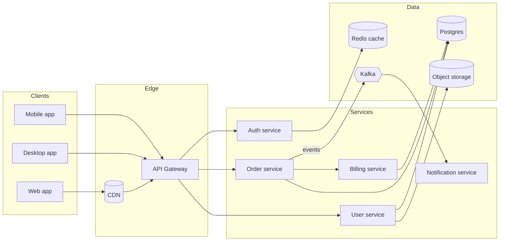
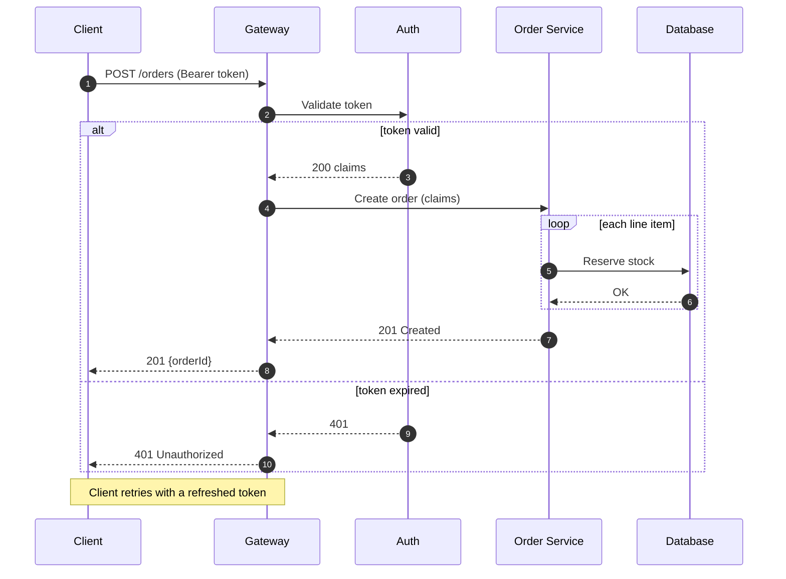

# Designing a resilient order pipeline

This walkthrough mixes prose, a diagram, code and data, the way a long design answer does. It covers the architecture, the request lifecycle, the core implementation, and the numbers that justify it.




Requests enter through the gateway; order events fan out over Kafka.

## The request lifecycle




## Implementation

Here are several code blocks in different languages.

```typescript
interface User {
  id: string;
  name: string;
  roles: ReadonlyArray<'admin' | 'member'>;
}

export async function loadUser(id: string, signal?: AbortSignal): Promise<User | undefined> {
  const res = await fetch(`/api/users/${encodeURIComponent(id)}`, { signal });
  if (res.status === 404) {
    return undefined;
  }
  if (!res.ok) {
    throw new Error(`Failed to load user ${id}: ${res.status} ${res.statusText}`);
  }
  return (await res.json()) as User;
}
```

```python
from dataclasses import dataclass

@dataclass(frozen=True)
class Point:
    x: float
    y: float

    def dist(self, other: "Point") -> float:
        return ((self.x - other.x) ** 2 + (self.y - other.y) ** 2) ** 0.5
```

```rust
fn fib(n: u64) -> u64 {
    match n {
        0 | 1 => n,
        _ => fib(n - 1) + fib(n - 2),
    }
}
```

```bash
npm ci && npm run build -- --mode production 2>&1 | tee build.log
```

```
plain fenced block without a language
    indentation is preserved
```

A very long line that should scroll horizontally instead of wrapping:

```js
const veryLongLine = ['alpha', 'beta', 'gamma', 'delta', 'epsilon', 'zeta', 'eta', 'theta', 'iota', 'kappa', 'lambda', 'mu', 'nu', 'xi', 'omicron', 'pi', 'rho', 'sigma', 'tau', 'upsilon'].map(s => s.toUpperCase()).join(' | ');
```

## Numbers

Benchmark results across regions:

| Region | Provider | p50 (ms) | p95 (ms) | p99 (ms) | Errors | Throughput (rps) | Cost / 1M req | Status | Notes |
|:-------|:---------|---------:|---------:|---------:|-------:|-----------------:|--------------:|:------:|:------|
| us-east-1 | AWS | 12 | 48 | 91 | 0.01% | 18,400 | $0.42 | ✅ | `c7g.xlarge` |
| us-west-2 | AWS | 14 | 52 | 103 | 0.02% | 17,900 | $0.42 | ✅ | baseline |
| eu-west-1 | AWS | 19 | 61 | 120 | 0.03% | 15,200 | $0.46 | ✅ | GDPR |
| eu-central-1 | GCP | 21 | 66 | 131 | 0.05% | 14,700 | $0.39 | ⚠️ | cold starts |
| ap-south-1 | Azure | 33 | 98 | 210 | 0.11% | 9,800 | $0.51 | ⚠️ | see [incident](https://example.com/inc/42) |
| ap-northeast-1 | AWS | 27 | 80 | 160 | 0.04% | 12,100 | $0.48 | ✅ | — |
| sa-east-1 | GCP | 41 | 120 | 260 | 0.20% | 7,300 | $0.55 | ❌ | **degraded** |
| af-south-1 | Azure | 55 | 150 | 330 | 0.31% | 5,100 | $0.61 | ❌ | new region |

A small two-column table:

| Key | Value |
|---|---|
| `timeout` | 30s |
| `retries` | 3 |
| `backoff` | exponential, *jittered* |

The softmax of a vector $z \in \mathbb{R}^K$ is $\sigma(z)_i = \frac{e^{z_i}}{\sum_{j=1}^{K} e^{z_j}}$.

Display math:

$$
\mathcal{L}(\theta) = -\frac{1}{N}\sum_{n=1}^{N} \sum_{k=1}^{K} y_{n,k} \log \hat{y}_{n,k}(\theta) + \lambda \lVert \theta \rVert_2^2
$$

And a matrix:

$$
A = \begin{bmatrix} 1 & 2 & 3 \\ 4 & 5 & 6 \\ 7 & 8 & 9 \end{bmatrix}
$$

## Rollout plan

## What changed

1. Rendering
   - Streaming markdown no longer reflows finished paragraphs
   - Code blocks keep their highlight while text streams
     1. Ordered inside unordered inside ordered
     2. Second nested item with `inline code`
   - Tables scroll horizontally
2. Agents
   - Background runs survive a window close
3. Fixes
   * Bullet written with an asterisk
   + Bullet written with a plus

### Checklist

- [x] Parse incrementally
- [x] Keep finished blocks stable
- [ ] Virtualize very long chats
- [ ] Ship it

In short: ship the gateway first, then move billing behind Kafka, and only then retire the legacy cron jobs.
